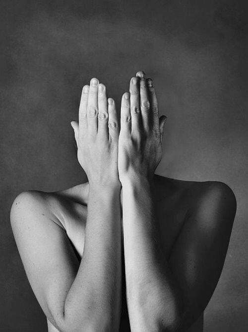

# Айдас хөлөнд оршдог

Та, өөрийгөө асар том цахилгаан станцын диспетчер байна гэж бодъё, тэнд байгаа хэдэн зуун тоног төхөөрөмжийн нэг нь анивчиж, дохио өгөөд эхэлвэл, маш яаралтай салгаж унтраах нь лавтай. Хэрэв, үүнийг хүлээж авахгүй, ойшоохгүй бол ямархуу сүйрэл гарах нь тодорхой гэдгийг бид мэднэ. Гэтэл бид, атомын цахилгаан станцтай зүйрлэхийн аргагүй үнэт, хэзээ ч юугаар ч орлуулж болохгүй бие мах бодынхоо, асар хариуцлагатай байх ёстой диспетчерүүд юм. Бидний бие мах бод бол, асар түвэгтэй нарийн бүтэцтэй, төгс механизм бөгөөд атомын цахилгаан станц дэргэд нь оёдлын машинтай дүйцэх бүтээл юм.

Ийнхүү, бидний төгс боловсронгуй механизм болох бие мах бод маань цаг үргэлж, хором бүрт бидэнд янз бүрийн амин чухал дохионуудыг өгч байдаг: -“амттан их битгий ид”, “чи энэ хүнийг тэвчдэггүй”, “амаръяа” гэх мэт дохионуудыг өгдөг боловч бид, эдгээрийг чухал гэж авч үздэггүй, их л бодож эмчид очиж, эм тариагаар эмчлээд өгөөч гэх, эсвэл бүр тоохгүй явсаар биегүй болж гунигт байдалд хүрдэг. Бид, тэрхүү атомын цахилгаан станцын диспетчерээс ганцхан зүйлээр л ялгаатай, ердөө л сүйрлийн хэмжээгээр. Гэтэл бид, өөртөө бол цорын ганц шүү дээ!!! Бид төрснөөсөө эхлээд л байгаллаг шинж чанараа алдаж, сэтгэл хөдлөлийн үед гаргадаг, мэдрэл, тархиа суллаж байх үйлдлүүдээ бүрэн хийж чадахгүй болдог. Бага хүүхэд гудманд ойчоод, уйлахад ээж нь, хүмүүжилтэй хүүхэд чанга орилдоггүй гэсэн бодол тархинд нь бат нут шингэчихсэн учраас, “дуугай байгаач” гэж хилэнтэйгээр хэлж бараг нэмж чимхэнэ. Хүүхдэд, энэ үед нэгдүгээрт: унахдаа өвдсөн, хоёрт: ээжийгээ аргадна, гэж бодсон боловч, нэмж загинуулсандаа, бүр гомдол нэмэгдэн, дээрээс нь “ээж минь надад хайргүй юм байна” гэсэн айдас төрдөг байна. Хүүхдийн хувьд, ээж нь үйлдлийнх нь төлөө загинасан гэдгийг ялгах салгах ухаан суугаагүй байдаг. Ингээд, иймэрхүү үйлдлүүд цаашид хүүхэд өсөх явцад давтагдсаар нөхцөлт рефлексийн хэмжээнд хүрэх бөгөөд, өнөө хүү маань байгалаас заяагдсан өвдөлт, гомдлын үед гаргах ёстой, орилох уйлах үйлдлээ гаргахаа больж хоолойгоо зангируулан, нулимсаа залгиж дотроо хураан, насан туршдаа, нулимс, хашгиралт, гомдол, хэлэх үгээ залгиж гаргахгүй түгжсээр, энэ нь дотор нь уур хилэн болж хувирдаг. Энэ бол энерги хадгалагдах хуулийн жинхэнэ жишээ. Хүн аливааг тэвчихийг шүдээ зууна гэж ярьдаг. Амьдрал дээр, хоёр хүн тутмын нэгнийх нь шүд тэвчээрийн зуултаас болж бараг угандаа тултал элэгдсэн байдаг гэнэ. Үүнийг уншаад, хүн, ер нь уйлвал ч уйлъя, дуулвал ч дуулъя, хашгирвал ч хашгиръя гэж бодогдох байх. Гэсэн ч үүнийгээ хүн, хийж чаддаггүй. Яагаад гэвэл айдас суурилчихсан байдаг. Айхад өвдөг чичирдэг. Хөл бол бидний тулгуур. Хүн айхад, мөн айдастай байхад сэтгэл санааны тэнцвэрээ алддаг бөгөөд үүнийг бие мах бод тольны тусгал мэт хүлээж авдаг. Өвдөг чичрэх, үеэрээ өвдөх, хөл шалтгаангүй цуцах зэрэг нь дотоод айдсын илрэл болж байдаг байна. Хэрэв танд, өөрийн бие организмаа хайрлах, хүндэтгэх, сонсох сонирхол төрсөн бол, бүрэн итгэлтэйгээр дараах дасгалуудыг хийж болох юм. Та, үдээс өмнө гэртээ, чимээгүй орчинд 2 цаг зарцуулах хэрэгтэй болно. Сул чөлөөтэй биендээ хамгийн амар байхаар хувцаслаж, өөрт тань хамгийн эвтэй байх байрлалаа яаралгүй олж сууна. Бие тань маш эвтэй байрлалаа олсон бол хэсэг хугацаанд хөдлөхгүй суугаад, биеийн тань аль хэсэг чангарсан байна, аль хэсэг суларсан байна, хаана дулаан, хаана сэрүүхэн, аль хэсэгт бүр халуун, аль хэсгээрээ хувцастай шүргэлцэж байгаа нь мэдрэгдэж байна, аль хэсэг нь сандал, хивс, шаланд хүрч байна гэж анхааралтайгаар, аажмаар сонсож эхэл. Таны ухамсар, тэмдэглэгч төхөөрөмжийн үүргийг биелүүлж байна. Биеэ ажиглан сонссон хэвээр аажим хөл дээрээ босно, хөлдөө мөрний хэмжээтэй зай авч зогсоод, хөлөөрөө тулаад зогсож байгаа энэ шал, биеийн бүх жинг өөр дээрээ авч, мөн цөмрөхгүй байна гэж бодоорой. Бие тань үүнийг бодох үед хүндэрдэг. Бага зэрэг ганхаж, хөлнийхөө байдлыг анзаар. Дараа нь газар хэвтээд хөлөө нугалан хөлнийхөө улыг шаланд хүрэхээр тавьж, амьсгалаа хэсэг сонсож байгаад, доод эрүүгээ суллан, хамраараа амьсгаа авч, хагас нээлттэй амаараа амьсгаагаа гарга. Минутын дараа, амьсгаа гаргах үедээ дуу оруул. Амьсгаа гаргах бүртээ дуу нэмнэ. Ямар ч авиа гарч болно. Үргэлжлүүл. Бүү ич. Бид үгээр худлаа хэлж болдог. Харин авиа хэзээ ч худлаа байдаггүй. Энэ бол дотоод дуу хоолой. Эхлээд эвгүй, аймаар санагдаж магад. Хамгийн чангаар, арай сул, нарийн, бүдүүн өнгө гэх мэт өөрийн хүслээр амьсгаагаа дуутай гаргаарай. Та энэ үед өөрийнхөө байгаллаг төрхөө илэрхийлж байгаа бөгөөд, мөн дотор хураагдсан нуугдмал сэтгэл хөдлөлүүдээ суллаж байгаа юм.

Араатан амьтад архирч гийнасаар насыг бардаг. Тэд, бид нар шиг стресс, депрест өртдөггүй. Гэтэл, бид ч ялгаагүй байгалийн амьтад. Арай хатуудав уу? Болгоон тунгаана биз ээ.
