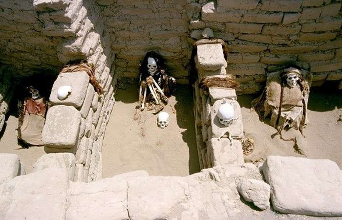
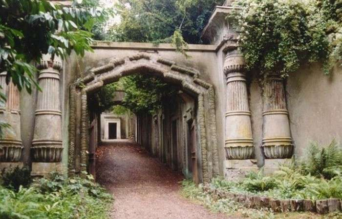
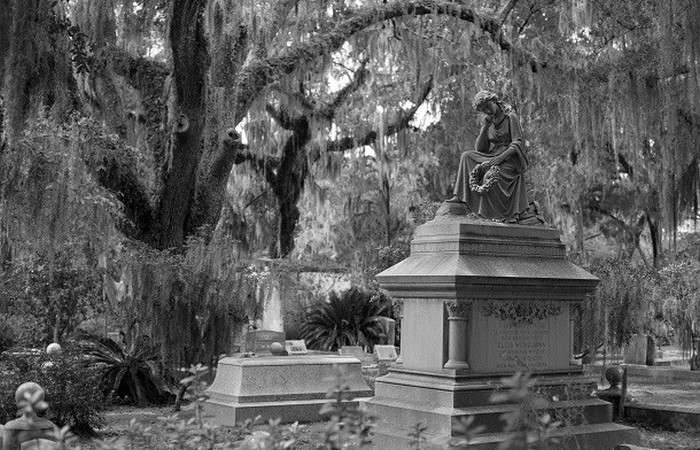
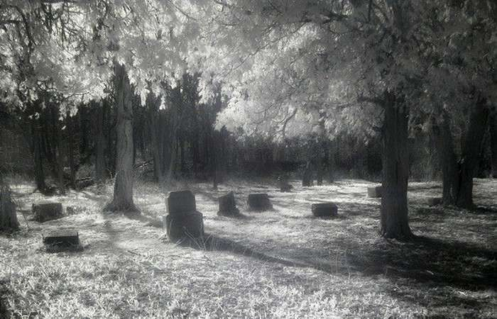
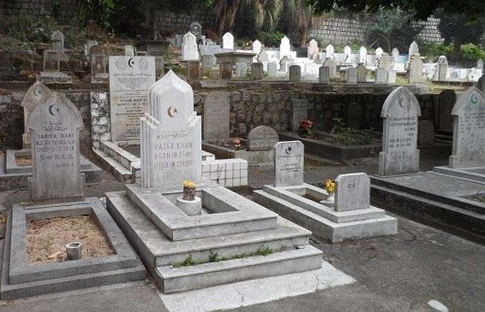
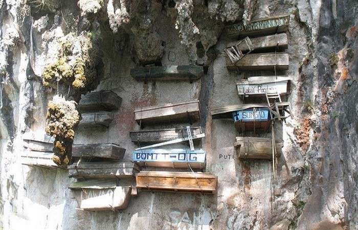

# Айдас төрүүлэм, хамгийн хачин оршуулгын газрууд

Үхэл, амьдрал хоёр үргэлж зэрэгцэн оршдог. Шарилын газарт, очиж үзээгүй хүн гэж үгүй ч, эдгээр оршуулгын газруудыг харахаар, дэлхийн улс үндэстнүүдийн, ёс заншил, зан үйлийг гайхаад барахгүй, жихүүдэс төрөм.

#### Перу. Чаучилын оршуулгын газар.

Энэ газар Наска хэмээх үндэстнүүд, 700-д жилийн турш талийгаачдаа, хагас суугаа байдлаар оршуулж ирсэн бөгөөд хамгийн сүүлийн оршуулга 9-р зуунд хамаардаг. Хачирхалтай нь зарим шарилуудын үс арьс нь хэвээр хадгалагдан үлдсэн байдаг. Аймхай хүмүүс зүглэлтгүй.

---

#### Англи. Хайгетын оршуулгын газар.

Энэ оршуулгын газар, 1960-д оны үед гарч байсан олон нууц, аймшигт зүйлээр алдаршсан. Нутгийнхан цус сорогч байдаг гэж үздэг. Тэндээс олддог олон үхсэн амьтдын цогцос дусал ч цусгүй байдаг .

---

#### АНУ. Джорджиа. Бонавентурын оршуулгын газар.

Иргэний дайнд оролцож явсан хүмүүст, зориулж байгуулсан энэхүү оршуулгын газар, 40-д га талбайтай бөгөөд сүг сүүдрээс нь илүү, хөшөө баримлууд нь айдас төрүүлдэг. Үүн дундаас, Грейси Уотсоны хөшөө, өөрт нь зориулж тавьсан бэлэг сэлтээс нь хүн авчихвал жинхэнэ нулимс гарган уйлдаг байна.

---

#### АНУ. Иллинойс. Bacherol'Grove-н оршуулгын газар.

Энэ газарт, олон арван тайлагдашгүй аймшигт зүйл болдогоороо алдартай. Хий үзэгдэл-машинаас эхлээд цөөрмөөс гарч ирдэг хөгшин фермчин зэрэг сүг сүнсээр дүүрэн газар гэдэг. Албан ёсоор хааж, хашаа татаж хориотой бүс болгосон.

---

#### Энэтхэг. “Нью-лаки” ресторан доторх оршуулгын газар.

Ахмадабад хотын, дотроо оршуулгын газартай хачирхалтай рестораны эзэн, уг ресторанаа барихдаа, голд нь байсан оршуулгуудыг хөндөхгүйгээр шийдэж, тойруулан хайслаж ресторанаа нээжээ. Үйлчлэгч нарын ажил, өглөөдөө, оршуулгуудын тоосыг арчиж, цэцэг тавихаас эхэлдэг гэнэ. Энэ хачин, жихүүцэм ресторан, үхэгсэдтэй хамт хооллож болдог дэлхийд ганцхан хоолны газар юм байна.

---

#### Филиппин. Сагадагийн оршуулгын газар.

Филиппин маш олон арлаас бүрддэг олон үндэстэн ястны улс юм. Тиймээс, оршуулах зан үйл нь янз бүр байдаг. Улсынх нь хойд хэсэгт амьдардаг, игорот омгийнхон, талийгаачдаа, ан амьтанд идүүлэхгүй байх, дайсан омгийнхны толгойны ангуучдаас, толгойг нь хамгаалах үүднээс, метр орчмын хэмжээтэй авсанд, ясыг нь хугалж багтаан, хавцал, ханан хаданд өлгөж оршуулдаг аж.
