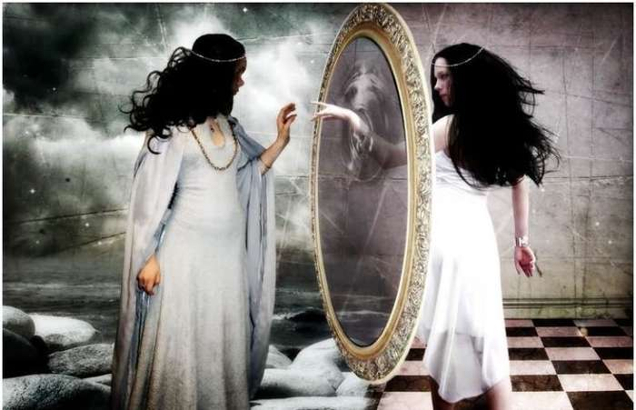

# Аюултай порталууд ба тольтой хийж болохгүй үйлдлүүд

Толь, тольны гүн гүнзгий байдал, ид шидийн, нууцлаг, тайлагдашгүй зүйл судлаачдын анхаарал сонирхолыг татсаар ирсэн зүйл юм. Толийг эртнээс хүн төрөлхтөн хэрэглэж ирсэн бөгөөд Парацельс хүртэл тольны далд хүчийг таних туршилт хийж байсан гэдэг. 19-р зуунд эрдэмтэд, толийг хүнд нөлөөлөх талаас судалгаа хийсэн ба тольны хавтгай аливаа зүйлсийн дүр төрхийг тусгахаас гадна энергийг шингээж авдаг гэсэн дүгнэлтэд хүрсэн байна. Хожим нь мөн тусгасан зүйлээ төсөөлөл болгодог үзжээ. Тиймээс ч тольны тухай ”хараалт толь”, “алуурчин толь” гэх мэт аймшиг төрүүлсэн яриа байдаг биз ээ. Хүмүүс итгэл үнэмшлээсээ үл хамааран тольтой анхаарал болгоомжтой харьцаж байхыг зөн билэгчид, үзмэрч нар зөвлөж байдаг.Толь, эзэмшиж буй хүнээсээ шалтгаалан, янз бүрээр үйлчлэл үзүүлдэг гэнэ. Сөрөг зүйлийг шингээн сөрөг энерги гаргах үйлчлэлтэй ба, хүн нас барахад сүнс байрших магадлалтай гэдгээс, толийг бүтээдэг уламжлалыг, улс үндэстнүүд шашин харгалзахгүй хэрэгжүүлж байдаг байна. Тольтой болгоомжтой харьцах зарим зүйлсийг танилцуулъя:

• Шөнө толинд харж хэрэггүй. Харанхуй, бүрэнхий үе нь толийг нэг төрлийн портал болгодог гэж үзэх бөгөөд, амьд зүйлийн энергийг сордог гэж үздэг. Шөнийн 3 цагаас хойш огт болохгүй, энэ цагийг “харын хүч”-ний цаг гэдэг аж.\
• Тольны ойролцоо, муу зүйлс хэлж ярьж хэрэггүй. Толинд харахдаа бодлоо чөлөөлсөн байх ёстой гэнэ. \
• Өвчний тухай ярьж болохгүй. Ойр дотныхон болон өөрт чинь өвчин ирнэ. Толинд харах үедээ дүр төрхөө голж бодож болохгүй. Жинхэнээсээ царай алдна. \
• Юм идэж байх үедээ толинд харж хооллож хэрэггүй. Урдны хүмүүс, толинд харж хооллоход ой санамж, дүр төрх, ер нь бүх зүйлээ хамт иддэг гэдэг байжээ. Юу ч үгүй болно гэж үздэг. \
• Толь бэлгэнд авахгүй байхыг хичээ. Авсан тохиолдолд урсгал усанд угааж хуурай болтол арчих хэрэгтэй. Эсвэл давстай хайрцганд 3 хоног байлгаад хэрэглэдэг.Давсаа хаях хэрэгтэй. \
• Толиор дамжуулан хүүхдээ битгий хараарай. Хүүхдийн энерги сул байдаг. 5 нас хүртэл бүр эмзэг байдаг. \
• Уйлж гунигласан үедээ толинд хэрхэвч битгий хар. Маш муу. Байдал чинь улам дордно. \
• Танихгүй хүнтэй хамт толинд харахад энергиэ алдна. Ер нь хүмүүс, хоёулаа зэрэг хамт толинд харахыг таагүй гэдэг. \
• Цуурсан хагарсан толинд огт харж болохгүй. Бараан зүйлд боож харамсахгүй хаях хэрэгтэй. Дараа нь заавал гараа угаадаг. \
• Ор руу гаа толь харуулж байрлуулж болохгүй. Шөнө болоход далд ертөнц хоорондын порталууд нээгддэг гэж үздэг. Унтаж байгаа тань толинд тусахад хар дарж зүүдлэн амардаггүй. \
• Толинд харсан тусгалаа “сэлфи”-дэх нь, маш муу. Камер доторх жижиг толь, нөгөө тольтой нэгдэн хонгил үүсгэдэг бөгөөд, эрүүл мэндэд муу, энергиэ алддаг. Мөн муу зүйлс нэвчинэ гэдэг. \
• Толинд ховорхон харах хэрэгтэй. Сайн сайхан дүр төрхөө аль болох харж байхыг хичээгээрэй. Зөвхөн эерэг дүр төрхөө өгөхөд, толь эргээд мөн эерэгийг өгдөг. \
• Орох хаалга руу толь харуулж тавьдаггүй. \
• Хичнээн ойр дотных ч байсан хүний толинд өөрийгөө бүү хар. Бусдын энерги хүнийх л байдаг.

Эцэст нь хэлэхэд, толийг нууцлаг, гайхамшгийн ертөнц гэж үзэхийг үгүйсгэж болохгүй мэт. Зарим хүмүүс, мөн толийг био талбар гэж үзэх нь ч бий. Та, итгэхгүй ч байсан, тольтой болгоомжтой хандахыг зөвлөж байна. Өөрийн эрүүл мэнд аз жаргалаа аливаа эрсдэлээс хамгаалж хайрлах хэрэгтэй биз ээ.
