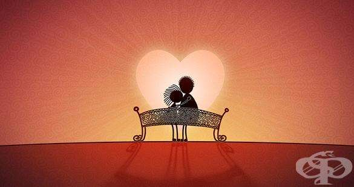

# Аз жаргал ба Хайр

Бяцхан Аз жаргал, ааваасаа, -Хайр хүмүүсээс алга болдог уу? гэж асуухад, аав нь, -Тиймээ алга болдог. Байгаа зүйлсээ үнэлэхгүй, хайрлахгүй байхад явчихдаг юм гэж хариулав. Бяцхан Аз жаргал хэсэг бодлогоширон сууснаа, өсч том болоод, хүмүүст тусалдаг болно гэж шийдэв. Он жилүүд өнгөрч, Аз жаргал өсч том болов. Тэр, хүмүүст туслах өөрийн амлалтаа мартсангүй, хүмүүст туслах, туслахыг оролдох боловч хүмүүс түүнийг огт сонсохгүй, олж хардаггүй байлаа. Аз жаргал хүмүүсийн энэ үйлдлээс болж жижгэрч эхлэв. Тэр алга болчихвий гэж айсандаа, энэ байдлаасаа гарахаар, алсын замд гарчээ. Урт удаан аялах замд нь, түүнийг анзаарах нэг ч хүн таарсангүй, ядарч сульдан амрахаар шийдэж, том модны доор хэвтэв. Удалгүй хэн нэгэн алхах чимээ сонсогдон нүдээ нээн хартал, уранхай ноорхой хувцастай, хөл нүцгэн, таягтай ядарсан эмгэн дөхөн иржээ. Аз жаргал ухасхийн босч, -Та сууж амар, ядраа юу? Хэмээн түшиж суулгах зуур, эмгэн, -Би залуу л даа, гэтэл, ядарсан эмгэн гэж хэлэхээр гомдмоор юм. Намайг Хайр гэдэг юм, гэхэд гайхсан Аз жаргал, -Та чинь Хайр юм уу? Надад, хайр, хорвоо ертөнц дээрх хамгийн сайхан зүйл гэж ойлгуулсан шүү дээ, намайг Аз жаргал гэдэг гэлээ. –Юу? Надад бас аз жаргал гэж бас хамгийн сайхан зүйл гэж ойлгуулсан гэснээ, урагдаж салбарсан хувцасныхаа хаанаас ч юм толины хэлтэрхий гаргаж ирэхэд, түүнд нь өөрийгөө харсан, Аз жаргал чангаар уйлж эхлэв. Хайр түүнийг тэврэн Аз жаргал энэ үед, -Муу хүмүүс, хувь тавилан биднийг ямар болгочихов оо? хэмээн уйлах аж. Харин, Хайр, -За яахав, хоёулаа хамт байж бие биеэ халамжилж залуу сайхан болцгооё, гэж тайтгаруулан аргадаж хамт байхаар болж, хэзээ ч салахгүй байхаар тохиролцов. Ийнхүү, тэр цагаас хойш, хэн нэгний амьдралаас Хайр алга болоход, түүнтэй хамт Аз жаргал мөн үгүй болдог болсон аж. Харин хүмүүс одоо ч, үүнийг ойлгохгүй амьдарцгаадаг гэнэ.

