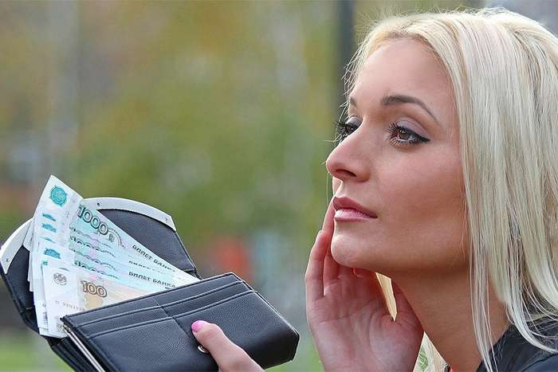
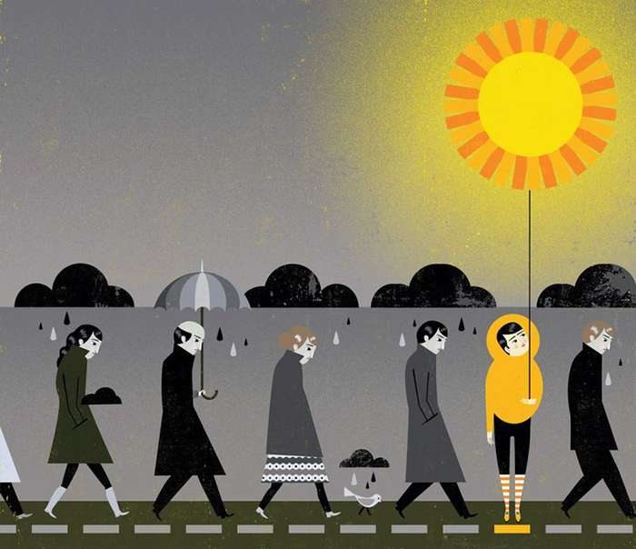

# Аз жаргалтай байхын тулд, хүнд хичнээн мөнгө хэрэгтэйг эрдэмтэд тооцож гаргажээ

Хамгийн сонирхолтой нь, хүний жилийн орлого 60 мянган доллараас давахад, амьдралаас авах баяр баясгалангийн мэдрэмж нь буурдаг гэнэ. АНУ-ын Пердью Их сургуулийн сэтгэл зүйч Эндрю Джеббээр ахлуулсан судлаачидын баг, Гэллапын асуулга-судалгааны институттай хамтран 164 орны 1 сая 700 мянган хүнийг хамруулсан, хүнд аз жаргалтай байхын тулд хичнээн мөнгө хэрэгтэйг тодруулах, мөн аз жаргалын мэдрэмжид мөнгө нөлөөлдөг эсэх талаар судалгаа явуулжээ. Эхний шатанд, сар бүрийн орлого, худалдан авах чадварыг үе шаттай судлав. Дараагийн шатанд, оролцогчидын эерэг, өөдрөг мэдрэмж, амьдралаас сэтгэл ханамж авах үеүд, сэтгэл санааны ая тухтай байдлын үргэлжлэх хугацаа зэргийг цаг хугацаа, он сар өдөр, давтамж, үргэлжлэлээр нь, мөн гутрах, түгших үеүдийн давтамж хугацааг нарийвчилан судалж, график ашиглан, хүмүүсийн мөнгөтэй байх үеийн өсөлтийн муруй, сэтгэл санаа нь жаргалтай байх үеийн өсөлтийн муруй хоёрын огтлолцолуудын G цэгийг олох математик аргачлалаар тооцжээ.

Гэтэл үр дүн нь, олон нийтийн үздэгчилэн, хүн их мөнгө олж, санаснаараа үрж зардаг байх нөхцөлд сэтгэлийн таашаалтай жаргалтай байдаг, мөн мэдээллийн хэрэгслүүд сурталчилгаагаар цацаж итгүүлж байдаг, худалдан авалт хүмүүсийг жаргалтай болгодог гэсэн дүгнэлтүүдээс хол зөрсөн бөгөөд орлогын өсөлт тодорхой хэмжээ, босгонд хүрмэгцээ, хүний сэтгэл санааны байдал, сэтгэл хөдлөлд нөлөөлөхөө больдог болох нь харагджээ. Судлаачид улам нарийвчилан судлахын тулд, аз жаргал гэсэн ойлголтыг: 1/ амьдралаа бүрэн болж байна гэж үзэж буй чинээлэг хүмүүс 2/ өдөр тутмын буюу баяр, баясгалан, хөгжөөн, зугаа, сэтгэл ханамж, таашаал зэргийн идэвхитэй давтамж бүхий амьдралтай хүмүүс гэж хоёр хуваан авч үзэхэд, эхний түвшний хүмүүст жилийн орлого нь 95 000$, харин хоёрдох түвшнийхэнд 60-75 000$ байх үед хамгийн сэтгэл хангалуун жаргалтай байдаг болох нь харагдсан байна. Гэсэн ч хамгийн сонин нь, дээрхи орлогоос нь, орлого нь даваад ирэх үед, хүмүүс амьдралдаа сэтгэл хангалуун биш болдог болох нь харагджээ. Эндрю Джебб үүнээс үүдэлтэй, мөнгө бол “ядуу” гэдэг нэртэй өвчиний эм юм байна, хүмүүс байр, машины зээлээ төлөөд дуусмагц, анхан шатны хэрэглээ нь хангагдсанаар мөнгө “шидэт дохиур” шиг санагддаг байхаа больдог. Харин бусдын хөрөнгөтэй харьцуулах үе шат эхэлнэ. Энэ нь жаргалтай мэдрэмж хэзээ ч төрүүлдэггүй. Тиймээс, мөнгө бол, хүнийг аз жаргалтай болгох зүйлийн хэсэгхэн хувийг эзэлнэ гэж дүгнэжээ. Энэ дүгнэлтийг, Нобелийн шагналтан Даниель Канеман, Ангус Дитон нар өөрсдийн судалгаагаар саяхан давтан нотолсон байна. Уг судалгааны ажлаа тэд, америкийн хүн амын дунд явуулсан бөгөөд, америкчуудын жилийн орлого 75 000$-с хэтрэхэд, хүмүүс амьдралын баяр баясгалангүй болж байгааг илрүүлж, энэхүү босгыг “Аюулт босго” гэж нэрлээд, мөнгөний хүч нь, өвчин намдаах эм шиг, гачигдал, зовлон бүр өвчинг ч мартуулдаг гэжээ. Мөн ижил байр байдалтай, ганц бие салсан хүмүүс, ижил оноштой өвчтэй хүмүүсийг харьцуулахад, сэтгэл санааны байдал, аз жаргалын мэдрэмж нь эрс ялгаатай гарч байсан бөгөөд энэ нь, тэдний амьдралын түвшинтэй холбоотой байсан гэж тайлбарлажээ. Мөнгө, таагүй зүйлс өвчин зовлонг мартуулах ч “Аюулт босгыг” давахаараа үнэ цэнээ алддагийг, хураах өсгөх хариуцлага нэмэгддэгтэй холбож үзсэн ажээ. Мөн, сүүлийн үеийн баян хүмүүсийн дунд идэвхитэй өргөжин тэлсээр байгаа Марк Цукербергийн үүсгэсэн “Бэлэглэлийн тангараг” төсөлд, тэрбумтанууд улам ихээр хамрагдан, хандив өргөх болж буйн шалтгаан нь, дээр дурдагдсантай холбоотой байж болохыг үгүйсгэхгүй гэж үзсэн байна. Мөнгөний шуудай байх тийм ч амар биш бололтой.
