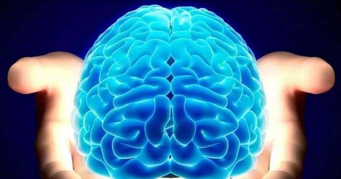

# Аз жаргалтай болгох, тархины нарийн мэс засалчийн зөвлөгөө

Аз жаргалтай болоход 4-хөн зүйл хэрэгтэй гэж, өдрийн турш, бидний толгойн доторх тархи хэмээх саарал зүйлийг судалж суудаг эмч нотолж байна.

-Хувь тавиландаа мөн бүх зүйлд талархах хэрэгтэй. Талархах үеийн мэдрэмж, сэтгэл хөдлөл нь, тархины серотонин, дофаминыг өсгөдөг. Эдгээрийг өсгөдөг, бупрофион, флуоксетин гэдэг эм байдаг ч, эдгээрийг талархлаар орлуулж болно гэж үзжээ. Энэхүү, энгийн талархах үед үүсдэг мэдрэмж, тархины урд хэсэгт серотиныг ялгарах процессыг өсгөдөг гэнэ.\
-Хүн, сөрөг муу зүйлс, уйтгар гуниг, түгшүүр, гомдол зэргээ ярьж, хэлснээр, уг сэтгэлийн хөдөлгөөнүүдийн тархинд үйлчилэх биологийн нөлөөллүүдийг сулруулдаг. Үүнийг заавал хэн нэгэнд ярих биш, хамгийн гол нь хэлж, тархи мэдрэлээ суллах хэрэгтэй байдаг байна. Янз бүрийн сэтгэл хөдлөлийг илэрхийлсэн хүмүүсийн фото зургуудыг, туршилтад оролцож буй хүмүүст үзүүлэн тархины хариу үйлдлийг хэмжих хэмжилт хийхэд, хамгийн түрүүнд тунгалагийн булчирхай идэвхжиж байгаа нь харагдсан бөгөөд, эдгээр хүмүүст, тухайн зургууд дээрхи сэтгэл хөдлөлүүдийг нэрлэ гэсэн даалгавар өгөхөд, чангаар нэрлэж эхэлмэгц, тархины идэвхижил буурч байсан байна. Өөрөөр хэлвэл, энэ нь, тухайн сэтгэл хөдлөлүүдийн зургийг харснаар идэвхижсэн тархи, тухайн сэтгэл хөдлөлүүдийг нэрлэж хэлэх үед, зургаас үүссэн сөрөг үйлчилэл нь, буурдаг болохыг харуулж байв.\
-Шийдвэр гаргадаг байх хэрэгтэй. Хүн ямарваа нэг шийдвэр гаргах үед, түгшүүр, сандрал үгүй болдог байна. Шийдвэр гаргахад зорилго үүсч, энэ нь тархинд таатай мэдрэмж өгч, нөлөөлснөөр, сөрөг сэтгэл хөдлөлд хүргэдэг стриатумын идэвхжилийг бууруулдаг.\
-Нэгэн туршилтын үед, хүмүүсээр компьютер дээр, бөмбөг шидэлцэх тоглоом тоглуулжээ. Гэхдээ шидсэн бөмбөгийг буцааж шидэх үйлдлийг, үнэн хэрэгтээ, хэн нэгэн хүн хийхгүй харин компьютер хийж байсан боловч, үүнийг оролцогчидод хэлээгүй хүнтэй хоорондоо тоголж байна гэж ойлгуулсан байна. Гэтэл, шидсэн бөмбөгийг буцааж шидэхгүй удахад, хүний тархи, үүнийг өвдөлт шиг хүлээж авч байгаа нь ажиглагджээ. Өөрөөр хэлвэл, хүн үгүйсгэлийг, хугарсан хөлний өвдөлттэй дүйцэхүйц хэмжээнд, эмзэглэн хүлээж авдаг гэсэн үг аж. \
Ер нь тархинд, хүмүүстэй харилцах харилцаа нэн чухал байдаг. Үүнд, ойр дотныхноо тэврэх, үнсэх, таалах зэрэг үйлдлүүд тархинд гайхалтай сайн нөлөөлдөг болохыг шинжлэх ухааны үндэслэлтэй нотолсон тухайгаа уг эмч ярьжээ.
