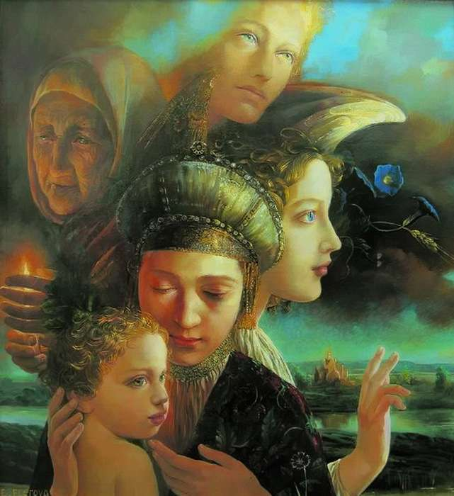

# Аз жаргалтай ээж болох еврейчүүдийн зөвлөмж

Олон хүүхэдтэй нэгэн ядуу еврей айл амьдардаг байжээ. Ээж нь, өөрийгөө үл хайрлан угааж цэвэрлэн, хоол ундаа бэлтгэн үр хүүхдээ хүмүүжүүлэхээр загинаж үглэн, ёворч хараалын үгс урсгана. Нэг удаа энэ амьдралаасаа ядарч цуцсан эмэгтэй, сүмийнхээ ахлагч буюу раввинд, хэрхэн сайн ээж болж болохыг асуухаар очжээ. Раввин юу хэлснийг хэн ч мэдэхгүй, өнөөх эмэгтэй сольчихсон юм шиг өөрчлөгдөн, тайван, тэнүүн, эелдэг, үр хүүхдээ харааж загинахаа больж нүүрэндээ сайхан инээмсэглэл тодруулан явдаг болжээ. Тэрээр, долоо хоногт нэг удаа захаас хүнсээ цуглуулахаар явдаг бөгөөд дараа нь өөрийнхөө өрөөндөө ороод таг болчихдог байв. Хүүхдүүд нь ээжийнхээ энэхүү өөрчлөлтийг гайхацгаан, нэг удаа учрыг нь мэдэхээр өрөө рүү нь орцгоов. Эмэгтэй ширээнийхээ ард суух бөгөөд амтлаг цимес, цайтай идэж суух аж.\
Хүүхдүүд нь, -“Та чинь яаж байна аа? Бид нарт яагаад өгөхгүй байгаа юм?” гэхэд, эмэгтэй тайвнаар, “Чимээгүй хүүхдүүдээ! Би та нарт, аз жаргалтай ээж хийж байна” гэсэн аж.
