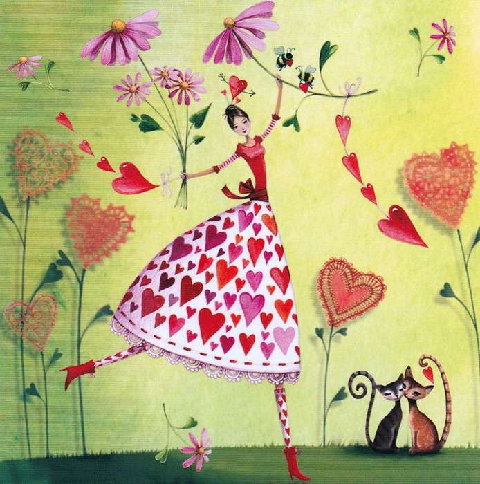

# Аз жаргалын тухай ойлголт

Сэтгэл санаагаар унаж, шаналсан, чинээлэг, царайлаг, сайхан эмэгтэй сэтгэл зүйч дээр ирж, -“ Амьдрал хов хоосон, ямар ч утга алга, би яах вэ?” хэмээн нулимс дуслуулан туслахыг хүсэв. Сэтгэл зүйч түүний ярихыг анхааралтай сонсож байснаа, өрөөний үүдээр харагдах, хонгилын шал угааж зогсоо хижээл эмэгтэйг дуудав. Тэгээд, -Одоо, Мария гэдэг энэ эмэгтэй, хэрхэн аз жаргалаа олсон тухайгаа яриг. Миний зүгээс таныг анхааралтай сонсоосой гэж л хүсэх байна даа гэлээ. Цэвэрлэгч эмэгтэй шалны модоо хана түшүүлэн тавьж суугаад дараах түүхийг ярьж эхлэв. “Нөхөр маань өвчинөөр өөд болж, гурван сарын дараа хүү маань ослоор нас барж, би аймшигт зовлонд унасан. Надад ойр дотны гэх өөр хэн ч байгаагүй. Би унтаж, идэж, бүр ярьж ч чадахаа больсон доо. Бүр амиа хорлоё ч гэж бодох болсон. Гэтэл нэг орой, ажилаасаа гэр рүүгээ явж байтал, намайг нэг жижигхэн муурын зулзага дагаад байлаа. Гадаа их хүйтэн байсан тул, би түүнийг өрөвдөж гэртээ аваачсан. Зулзага маш их өлссөн байсан тул хийж өгсөн сүүг минь, тавгийг нь гялалзтал долоочихоод, хөлөнд минь биеэ үрж, хүржигнэн талархаж байна уу даа гэмээр аашилна. Би тэгэхэд анх удаа багахан инээмсэглэх аядсан. Тэгснээ, энэхүү бяцхан зулзагад тусалсан маань, намайг инээмсэглүүлж чадаж байгаа юм чинь, магадгүй би, зүгээр л, өөр бусад хүмүүст сайн зүйл хийгээд байвал аз жаргалтай болж болох юм биш үү? гэж бодсон. Ингээд өглөө нь, жигнэмэг хийж, удаанаар өвдөж гэрээсээ гарч чаддаггүй хөршдөө оруулж өгсөн. Иймэрхүү байдлаар би, өдөр бүр, орчин тойрныхныхоо хэн нэгэнд сайн зүйл яаж ийгээд хийх болсон. Тэгээд тэдний маань баяр, талархал намайг аз жаргалтай болгосон доо. Одоо миний сэтгэл санаа, биеийн байдалд залуу хүн ч атаархдаг шүү. Учир нь би, аз жаргалыг хуваалцаж, бусдад түгээснээр, өөрөө олж авсан юм” гээд яриагаа дуусгав. Сонсож суусан баян эмэгтэй, хэдийгээр, тэр маш их мөнгөтэй ч, мөнгөөр худалдан авч болдоггүй олон зүйлээ аль эрт гээснээ ухааран уйлж суулаа.

Үүнээс харахад, зөвхөн та өөрөө аз жаргалтай байхад амьдрал сайхан байдаггүй, харин бусдыг аз жаргалтай болгох үед хамгийн сайхан байдаг. Аз жаргал бол зорилго биш харин ЗАМ. Тэр ирээдүйд байдаггүй зөвхөн өнөөдөр л байдаг. Аз жаргал нөхцөл байдлаас хамааралгүй харин хүн бүрийн ухамсарласан шийдвэр бөгөөд аз жаргал бол зөвхөн чи ямар байна вэ гэдгийн илрэл болохоос чи юутай вэ, юу эзэмшдэг вэ гэдгээс хамааралгүй зүйл гэдгийг ойлгох хэрэгтэй аж...

