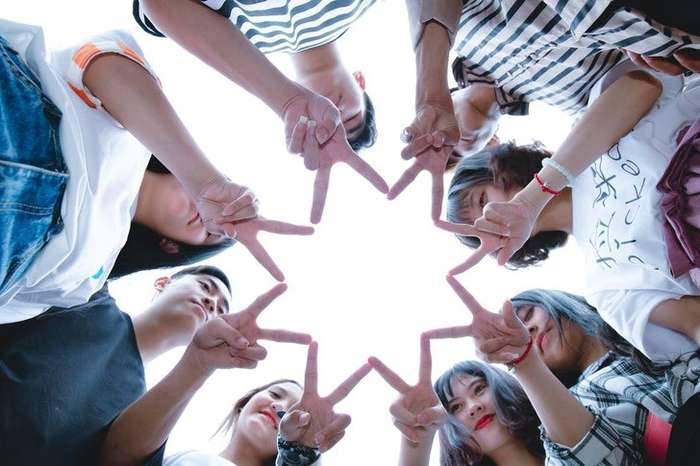

# Аз жаргалын жор ба хүмүүсийн аз жаргалыг мэдэрсэн үеийнхээ тухай бичсэн дурсамжууд

Хүн бүр аз жаргалыг янз бүрээр ойлгож хүлээж авдаг ч, аз жаргалтай байхад хоёрхон зүйл хэрэгтэй байдаг гэнэ. 1/ Ямар нэг томоохон зүйлийн нэг хэсэг нь гэдгээ мэдэрч байх: Бид, энэ хорвоо дээр өөрийн байр суурийг үргэлж эрж хайж байдаг бөгөөд нийгэм, орчиндоо хэр амжилттай байр суурь эзэлсэн байна төдий чинээ аз жаргалтай байдаг байна. Өөрөөр хэлвэл, ажил алба, гэр бүлийн хүрээнд “Би хэрэгтэй, чухал хүн” гэдгээ мэдэрч байхад, хүн аз жаргалтай байдаг гэнэ. 2/ Аз жаргалыг тэрэгтэй зүйрлэвэл, түүнийг чирж явдаг морь нь хайр учираас салшгүй ойлголт: Хайр энэрэл нь, хүмүүсийн бүхий л сайхан сэтгэл хөдлөл, санаа бодлын эх булаг юм. Тиймээс, түүнийг аз жаргалын алтан түлхүүр гэж нэрлэдэг байна. Харин аз жаргалын гол дайсан нь, хүний хувиа бодсон үзэл, уруу дорой сөрөг бодлууд, мөн бүхий л муу зуршилууд байдаг. Дээр дурдсанчлан, аз жаргалыг хүн бүр, янз бүрээр хүлээн авдагийн жишээ болгон, хүмүүсийн аз жаргалыг мэдэрсэн үеийн дурсамжуудыг толилуулъя:

-Би ажлынхантайгаа далайн эрэг дээр амарч байлаа. Энэ үедээ, бид жижигхэн моторт завиар аялсан юм. Тэгэхэд би, завьнаас хөлөө унжуулж, завьны ус зүсэн явах урсгал хөлийн минь улыг шүргэх байдлаар суугаад явж байхдаа, гэнэт үгээр илэрхийлэхийн аргагүй хачин сайхан болж, байгалийн үзэсгэлэн, оршихуй, дотоод амирлал, эргэн тойронд болж буй бүх зүйл хоорондоо нэгдэн уусах мэт болохыг мэдэрч уйлсан. Энэ аз жаргал байсаан. Хэзээ ч мартдаггүй.\
-Би хуримын ордны үүдэнд, сүйт бүсгүйгээ над руу харж инээмсэглэсээр цагаан даашинзтай машинаас бууж байхыг хараад, газарт зоогдсон мэт мэдрэмж төрж, түүний над руу дөхөн ирж буй хөдөлгөөн кинон дээрх шиг жингүйдэж, үгээр илэрхийлэхийн аргагүй жаргалтай болсон. Хацар дээр минь, тэр минь үнсэхэд л ухаан орж билээ.\
-Сүйт залуу минь цэргээс халагдах өдрийнх шиг, би аз жаргалтай мэдрэмж, сэтгэл хөдлөлд автаж байгаагүй. Түүнтэйгээ уулзах үед, сэтгэл дотор булгилж, чих шуугиж, зүрх минь дэлдэж байж билээ. Би одоо ч, 6 жилийн дараа энэ үеийг дурсахдаа зүрх минь догдолж, жаргалыг мэдэрч уйлдаг юм.\
-Би, анх удаа далай харж байгаа бяцхан охиныхоо, -“Хараач, ямар гоё юм бэ! Ямар их ус вэ! Их ус!” гэж догдлон хашгирах үед авсан мэдрэмж одоо ч тодхон. Зүрх сэтгэл булгилж, зүрх минь дотроо хөдлөх шиг болж, голоос нэг зүйл зулгаах шиг, халуун дулаан юм биеэр минь гүйж байсан. Үгээр илэрхийлшгүй сайхан мэдрэмж байсан. Охины минь сэтгэл хөдлөл, байгалийн үзэсгэлэн, цаг агаарын нөхцөл байдал хоршин, надад аз жаргалыг мэдрүүлсэн гэж боддог. Эдгээр зүйлс үргэлж хамт байдаг бол хүн жаргалтай байж чадна аа.\
-Би 2 настай хүүтэйгээ гэр рүүгээ орохоор явж байтал, хүү минь гараас минь түлхүүр авч, өөрөө онгойлгохоор урд гараад баацганан гүйлээ. Түүнийг араас нь хараад, ямар ч хөөрхөн юм, хүрэмнээс нь багахан цухуйх майжиг хөл, хачин инээдтэй гүйж байгаа нь хүртэл үнэхээр өхөөрдөм, тэгээд би бас түүний ээж байгаа нь хичнээн догь вэ? гэж бодогдож, зүрх минь хайраар бялхсан. Энэ бол эх хүний аз жаргал гэж боддог.\
Өөр хоорондоо адилгүй эдгээр түүхүүд бүгд, хүн хайраар дүүрч бялхах үеийн сэтгэл зүрнээс ундрах хайртай холбоотойгоор, хүн хэн нэгэн, эсвэл байгаль дэлхийн нэгээхэн хэсэг гэдгээ ухамсарлаж нэгдэн уусах үед аз жаргалын мэдрэмж авдаг болохыг харуулжээ. Аз жаргал нь, заавал хэн нэгэн эсвэл орчин тойрон, байгаль дэлхийг хайрлаж, нэгдэх, тэдэнтэй аливааг хуваалцах үед ирдэг байна. Энэ нийтлэлийг хуваалцаж буйдаа, бид ч мөн баяртай, жаргалтай байна. Харин таныг юу жаргалтай болгодог бол? Хуваалцаарай!
