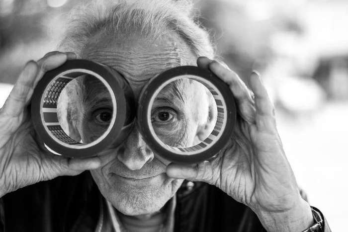
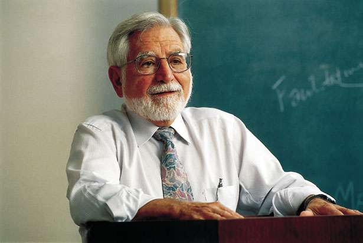

# Азгүй таагүй зүйлсийг, хоромхон зуур эерэг болгох арга

Бизнесмен, захирлууд, удирдлагын аппаратынханаас бүрдсэн нэгэн группынхан, маркетингийн сургалтад суухдаа лекц уншисан настай профессортоо, хууль, татвар, өссөн орчин нөхцөл, мөнгө, гэр бүл, багш, төрөл төрөгсөдтэй холбоотой, тэр тийм байсан бол, энэ ийм байсан бол гэж бүх л боломжуудаа үгүйсгэн баахан бэрхшээл зовлонгоо ээлж дараалан ам булаалдан ярьцгааж байв. Үүнийг сонсож суусан өвгөн профессор гэнэт, -“Үр дүнгүй байх нь, таны л үр дүн”, “Хэрэв чи юу ч үгүй бол, ямар ч зүйл эрхэлж чадахгүй байгаа бол, ийм байдалд хүргэсэн ямар нэг таагүй түүх байгаа нь магад”, гэж учир нь ойлгогдохгүй зүйл бувтнаснаа, чангаар, -“Та нар, өөрсдийн хийгээгүй зүйлийнхээ бурууг бусдад чихэхийн тулд, өнгөрсөндөө гацчихаад, бүр түүнийгээ улам муухайгаар гашууруулан ярих юм” гээд боссоноо ярьж эхлэв,

-“Харин, би, бүр гэдсэнд олдохдоо л азгүй байсан. Би та нарт өөрийн гунигт түүхийг ярьж өгөх үү?” гэж асуув. Тэд, түүнийг сонсохоор, мөн түүнийг өрөвдөхөд бэлтгэцгээн толгой дохицгоов. Профессор, -“Би, гэдсэнд олдохоосоо л азгүй байлаа. Миний аав болох ачаа бараа зөөж буулгадаг хүн, ээж минь болох насанд хүрээгүй өнгөт арьстан охиныг жирэмсэн болсноо хэлмэгц, зугтаачихсан гэдэг. Тиймээс би эцэггүй. Энэ бол миний азгүй хувь заяаны дөнгөж эхлэл байсан юм. Ээж минь намайг төрүүлмэгц надаас татгалзаж эмнэлэгт шууд хаясан. Ингээд би таньж мэдэхгүй орчлонд гав ганцаар хоцров. Цаашаа улам дордож, би их өвдөмтгий, дээрээс нь өнгөт арьстанаас төрсөн болохоор хэн ч өргөж авахгүй байснаас асрамжийн газар шилжсэн. Асрамжийн газар маань өнгөт арьстануудын асрамж байсан тул, тэнд хятад хүүхдүүдийн гарын шүүс болж, мексик хүүхдүүдэд нулимуулж, хар хүүхдүүдэд чимхүүлсэн амьдрал намайг угтсан. Сургууль миний хувьд мөн л зовлон байлаа. Багш нар нь үргэлж солигдож, суралцахад маш хэцүү байсан. Ерөнхийдөө дэндүү азгүй амьдрал” гэснээ, -“За, за би бүр ядарчихлаа, энэ миний түүх биш, харин өөрийнхөө түүхийг ярья” гээд хэсэг дуугүй сууснаа, -“Харин би, амьдралдаа хамгийн азтай хүн, би гэдсэнд олдохоосоо л азтай байсан, бүтэлгүй аав минь амьдралаас минь алга болж, түүнээс дутахгүй бүтэлгүй ээж минь амьдралаас минь бүр мөсөн алга болсон. Аав минь, намайг өсгөж чадахгүйгээ мэдээд зугтсан биз. Би түүнд энэ шийдвэрийнх төлөө талархдаг. Хэрэв хамт байсан бол би хэн болж өсөх байсан юм? Магадгүй тэр, намайг хажууд нь байвал хүчтэй хүн болж өсч чадахгүй байх гэж зөн совингоороо мэдрээд алга болсон байх. Би түүнд үүнийх нь төлөө талархдаг. Би ер нь их азтай. Залуу өнгөт арьстан ээж минь төрөхийн орон дээр л надаас татгалзсан нь бас л нэг аз. Хэрэв тэр намайг төрөх газраас авч гарсан бол миний амьд үлдэх магадлал тун бага байх байлаа. Ингээд, тэр намайг хаяснаар амьдрах боломж надад олдсон. Үүнийг тэр л надад өгсөн. Би, өөрийн бүтэлгүй арван долоон настай ээждээ үүнийх нь төлөө талархдаг. Хэрэв тэр надаас татгалзаагүй хамт байсан бол миний хүүхэд нас төсөөлшгүй бэрх байх байсан. Анхныхаа уйлах дуутайгаа зэрэгцэн өнчирөн хоцорсон би, найдах хэн ч байхгүй цор ганцаараа гэдгээ зөн совингоороо мэдрэн, дотоод энерги минь хүчирхэг болсон гэж боддог.” гээд инээмсэглэн, -“Цаашдаа аз минь бүр гийсэн, намайг хэн ч үрчилж аваагүй нь бас аз болсон. Хэрэв хэн нэгэн үрчилж авсан бол, өвдөмтгий сул биетэй хүүхдийг тэр хүмүүс, тохилог орчин, хайр халамжаараа хүчтэй биеэ даасан хүн болгож чадахгүй байсан болов уу гэж би боддог. Харин асрамжийн газрын тэр л орчин намайг тэсвэр тэвчээртэй амьдралд сургасан. Хятадуудаас зодоон, харуудаас зантай чимхэх, мексикчүүдийн нулималтыг харин ч сайн сурсандаа. Нулимж ч ёстой чадна шүү. Энэ ч бас аз биш гэж үү? Сургууль сайхан байсан. Багш хүрэлцэхгүйгээс нэг л багш нилээд олон хичээл заана. Ахлах ангид байхад минь, “явдаг нэвтэрхий толь” гэдэг хочтой биологи, математик ордог нэг багш надад сайн харьцдаг болсон. Би түүний хичээлд дуртай болохоор тэр хичээлүүд дээр онц сурдаг болж, төгсөхдөө түүний зөвлөснөөр колледжид элсэв. Тэгээд дээд сургууль, дараа нь эрдэм шинжилгээний ажил, гэр бүл, үр хүүхэд, ач нар, гуч нар гээд л аз минь хөвөрсөндөө. Би азын одонд төрсөндөө баярлаж, хувь заяандаа талархдаг. За, ингээд та нар, нэг амьдралыг хоёр өөрөөр харсан хоёр түүх сонслоо. Аль нь таалагдаж байна?” гэснээ, -“Хэн нэгэн, “хэрэв тийм байсан бол...тэгэх байсан”, ”надад тийм юм байсан бол...”, “тэр тийм байсан бол...” гэх мэтээр өөрийгөө зөвтгөх гэж арга саам хайх үед энэ түүх толгойд байнга орж ирдэг юм” гэчихээд гарч явжээ...
