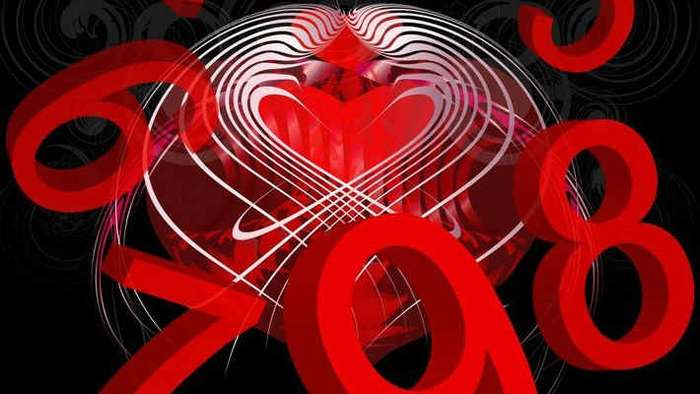
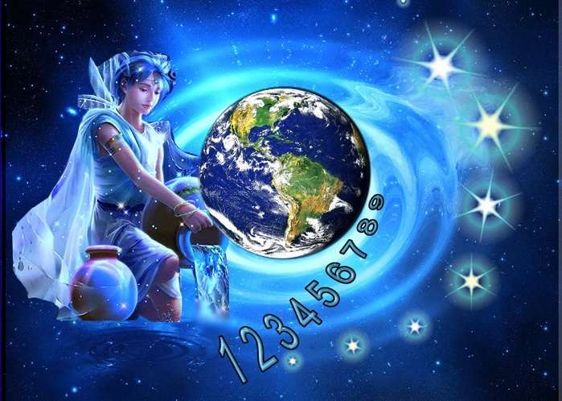
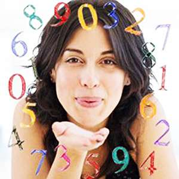

# Азын тоонууд

Хүний амьдралын зарим үйлдэл, үйл хөдлөлүүдэд тустай, азын тоонууд гэж байдаг гэнэ. Тоонуудын тоон утгыг ашигласан, энэхүү азын тоонууд, сонирхолыг тань татах, эсвэл эгдүүцлийг тань төрүүлж магад. Юутай ч, шинжлэх ухааны эрин зуунд ч, тайлж барахгүй байгаа хорвоо хэмээх нууцлаг ертөнцийг тайлах оролдлогуудын нэг гэж үзэн хүргэнэм. Харин, хэрхэн хүлээн авахыг таны мэргэн оюунд даатгая. Аз жаргалтай хүүхэд насандаа, бид, бүхэнд, ид шидэд хүртэл итгэн, хүслийнхээ төлөө, одооныхоор зан үйл хэмээн нэрлэдэг, хүүхдийн хөөрхөн, хөгжилтэй зүйлсийг хийж, тэр маань үнэхээр биелдэг байсныг дурссанаа нуух юун.

---

-Хэрэв ямар нэг зүйлийн явцыг хурдасгахыг хүсвэл, амандаа 20 гэж давтах сайн. Учир нь, 2-ын тоо хүчин зүтгэлийг өсгөж, 0-нь, саадыг тэглэдэг.\
-Харин удаашруулахыг хүсвэл 4-н тоо, хамгийн тогтвортой тоо гэж үздэгээс удаашруулах увидастай байдаг гэнэ. \
-Ямар нэг зүйлийг өсгөхийг хүсвэл, 7+1 гэж давтах. 7-г нууцлаг ид шидтэй тоо гэх ба 1-н тоог энерги, зорилгын тоо гэдэг. Түүнчилэн эдгээрийн нийлбэр нь, хязгааргүйн билэгдэл 8-г заадаг аж. \
-Ямар нэг зүйлийг багасгах, хасахыг хүсвэл 10-1. 9-нь өөрчилөлтийн тоо юм. \
-Аз, амжилт, аз жаргалыг хүсвэл, 21 гэж хэлж, давтах. Энэ хоёр оронтой тоог амжилтын тоо гэж үздэг байна. \
Цаг хугацаа хүрэлцэхгүй, аливаад амжихгүй байгаа тохиолдолд, 91. 9 –өөрчилөлтийн тоо, 1-энерги, мөн хамгийн хурдтай тоо гэдэг. Түүнээс гадна, 1-н тоо эхлэл, 9- нь, цаг хугацааны циклийг багтаасан төгсгөлийг заадаг. 911 гэсэн америкийн аврах албаны утасны дугаарыг, санамсаргүй зохиогдсон дугаар биш, ер бишийн тоо, аврах туслах хурд, үр дүнг тооцсон тоон утгыг агуулсан дугаар гэж үздэг. Мөн, зөн билэгтнүүд энэ тоог, бүх зүйлийн хугацааг заадаг ертөнцийн тоо гэдэг ажээ.
