# Бага насандаа ядуу зүдүүг үзсэн одууд

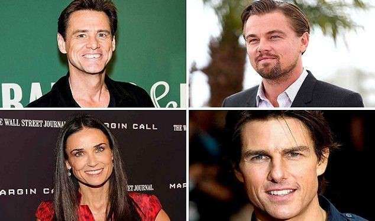

Энэ хүмүүсийг баян чинээлэг болоход, бага насандаа ядуу зүдүү амьдарч байсан зовлон зүдгүүр нь, бүх хүч, сэтгэлээ зорилгод хүрэхэд зориулах сэдэл болсон байх талтай бөгөөд, мөн өөрсдийнх нь хувь хүний зан чанар сэтгэлийн тэнхээ нөлөөлсөн гэж үздэг.

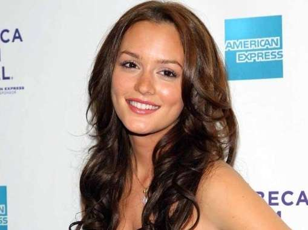

Лейтон Мистер, 5 сая долларын хөрөнгөтэй, түүнийг ээж нь шоронд байхдаа төрүүлсэн бөгөөд, төрүүлснийхээ дараа 3 сартайд нь буцаж шорондоо орсон гэдэг. Эдгээр хүнд хэцүү амьдрал ахуйнхаа талаар, тэр зөөлөн дулаанаар дурсдаг.

---

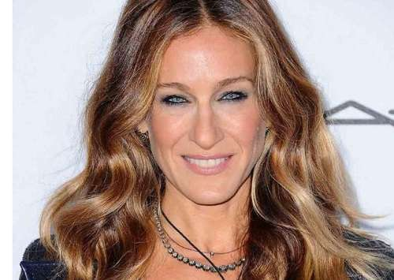

Сара Джессика Паркер, түүний гэр бүл 8 хүүхэдтэй байсан бөгөөд халамжийн мөнгө, ээжийнх нь бага цалингаар маш ядуу зүдүү амьдардаг байжээ. Бүр, тог цахилгаангүй байранд амьдарч байсан боловч, ээж нь, дуу, бүжгийн сургалтын мөнгийг яаж ийн төлж охиноо явуулдаг байснаар, өнөөдрийн алдартай жүжигчин, продюсер, 90 сая долларын хөрөнгөтэй охинтой болж чаджээ.

---

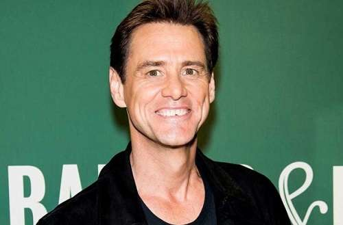

Джим Керри. 150 сая долларын хөрөнгөтэй, багад нь аав нь ажилгүй болсноор, гэр бүлээрээ бүхээгтэй машинд амьдардаг болж, 15 настайдаа сургуулиа хаяж цэвэрлэгчийн ажил хийж гэр бүлдээ тусалж эхэлсэн гэдэг. Энэ, хүнд амьдрал нь, түүнийг алдартай хошин жүжигчин болоход нь саад болоогүй юм.

---

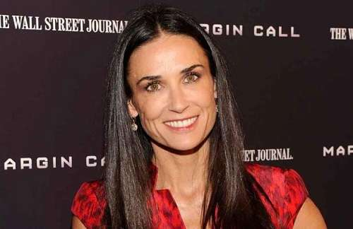

Деми Мур, 150 саяын хөрөнгөтэй, тэр, бага насаа дурсах тун дургүй. Эцэг нь төрөхөөс нь өмнө хаяж явснаас, эцгээ мэддэггүй, мөн ээж нь хар тамхичин, хойд эцэг нь тогтмол ажилгүй учраас маш хэцүү амьдрал үзсэн. Гэхдээ тэрээр алдартай жүжигчин болж, мөн санхүүгийн эрх чөлөөнд хүрснээрээ бахархдаг.

---

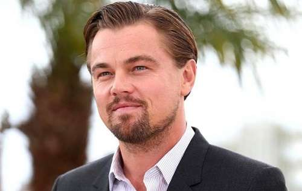

Леонардо ДиКаприо, 220 саяын хөрөнгөтэй, бага нас нь Лос Анжелесын хамгийн ядуу районд, нэгэн зэрэг, янз бүрийн ажил хийж, зүтгэдэг ээжийнхээ гар дээр өсчээ, тэр, өнөөдөр, Холливудын хамгийн өндөр үнэтэй жүжигчидийн нэг болж чадсан юм.

---

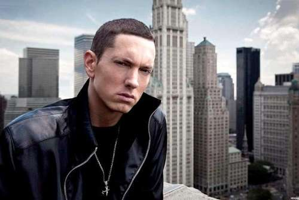

Эминем, 160 сая долларын хөрөнгөтэй, түүний бага нас Детройтын хамгийн ядуу районд өнгөрсөн. Гэсэн ч, тэр рэпийн хамгийн шилдэг алдартан болж чадсан юм.

---

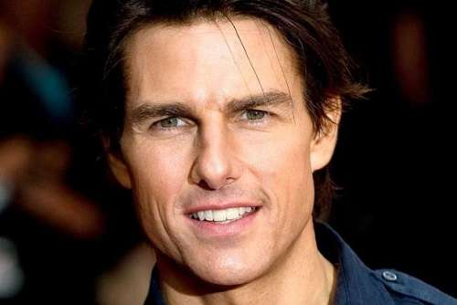

Том Круз, 380 сая долларын хөрөнгөтэй, түүний бага нас төрсөн эцгийнх нь хатуу ширүүн зодуур дор өнгөрсөн бөгөөд, ээж нь тэвчихээ больж салснаар амьдрал нь арай дээрдсэн гэдэг. Магадгүй энэ өөрчлөлт, түүнийг, Холливудын хамгийн алдартай жүжигчин болоход нөлөөлсөн байж болно гэж үздэг.

---

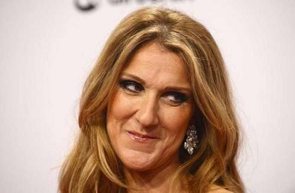

Селин Дион, 800 сая долларын хөрөнгөтэй, тэрээр, 14 хүүхэдтэй гэр бүлийн хамгийн бага нь. Гэр бүл нь хэдийгээр, ядуу зүдүү байсан боловч, үр хүүхдээ хайр халамжаар дутаагаагүй гэдэг. Энэ нь, түүнийг амжилтад хүрэхэд нөлөөлсөн гэж тэр өөрөө үздэг.

---

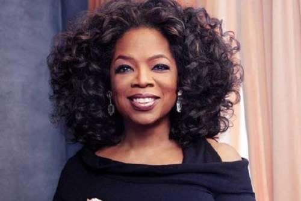

Опра Уинфри, 2.9 тэрбум долларын хөрөнгөтэй, түүний бага нас зөвхөн ядуу зүдүүгээс гадна хүчирхийлэл, дарамт дор өнгөрсөн. Ээж нь түүнийг асрах, тэжээх боломжгүйн улмаас янз бүрийн хамаатан саднууд дээрээ амьдарч, хувцасгүй, төмсний шуудайгаар оёсон хувцас өмсч явдаг үе ч байсан гэдэг. Энэхүү хүнд хэцүү байдал дунд өсч торнисон ч гэсэн, Опра, дэлхийн хамгийн анхны хар арьст-тэрбумтан эмэгтэй болж чадсан юм.

---

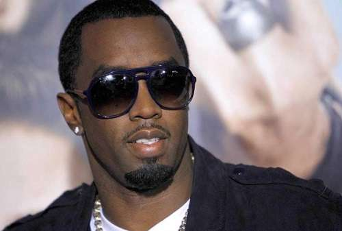

Дидди, Нью-Йоркийн Бруклинд, түрээсийн байранд өсчээ. Эцэг нь, хар тамхины наймаачин байсан бөгөөд багад нь буудуулан амь насаа алдсан гэдэг. Энэ бүхэн, түүнийг алдартай од болоход саад болоогүй юм. Тэр, 700 сая долларын хөрөнгөтэй.
