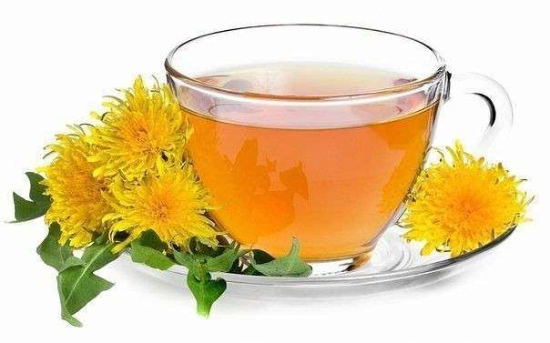
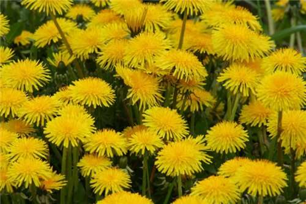

# Багваахай цэцгийн ханд, харвалтын дараа тустай

Багваахай цэцгийн хандыг хэрэглэн, цус харвасны дараах биеийн мэдээгүй болсон талаа сэргээсэн хүн -“Хоёр жилийн өмнө тархины цус харвалтаас биеийн баруун тал саажсан. Эмч нар намайг дахин ярьж, явж чаддаг болно гэдэгт итгэлгүй байсан. Харин би, өөрийн зохих хэмжээний зүтгэл мөн ердийн багваахай цэцгийн ханд хэрэглэсний хүчээр, одоо ярьж чаддаг, явж чаддаг болсон гээд, тэр үедээ, саажсан гар хөлдөө массаж, хөдөлгөөний дасгал хийхийн зэрэгцээ багваахай цэцгийг дараах маягаар хэрэглэснээр сар орчимын дараа эхний үр дүн мэдэгдэж эхэлсэн, 3 сарын турш хэрэглэсний дараа аажмаар хэвийн байдалдаа орсон” гэж бичжээ. Багваахай цэцэг нь, харвалтын дараах үеийн сэргээх эмчилгээний үед орлуулшгүй тустай байдаг байна. Цусан дах холестеринийг бууруулж, бодисын солилцоог сайжруулан, зүрх судас-мэдрэлийн системийн үйл ажиллагааг тогтворжуулдаг.

**Хэрэглэх арга:** -1 хоолны халбага хатаасан багваахай цэцгийг, 1 литр буцламгай усаар хандлан шүүж, өдөрт 3 удаа, хоол идэхээс нилээн өмнө, 3 хуваан ууж хэрэглэх\
-50 грам хатаасан багваахай цэцгийн үндсийг нунтаглаад, адил хэмжээний зөгийн балтай хольж багсран, жижиг бөмбөлгүүд болгон хөргөгчид хадгалаад өдөрт 3 удаа хоолны өмнө хүлхэж идэх. Хандтай хамт хэрэглэх үр дүнтэй.\
/women-page.ru/
