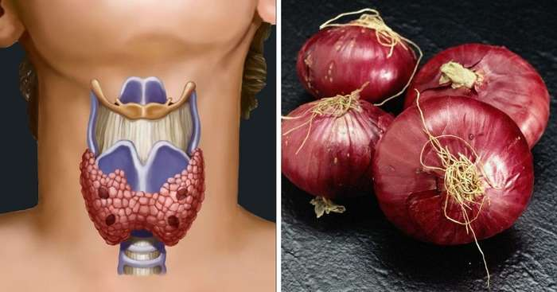
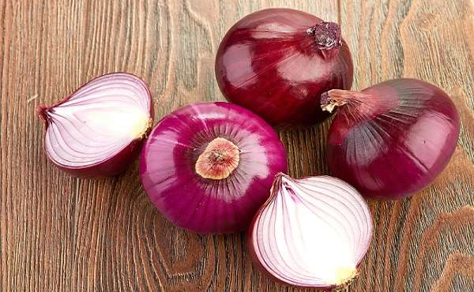

# Бамбай булчирхайг сонгиноор эмчлэх арга

Сонгино нь, фосфорын агууламжтай тул, бактери устгах, арьсыг цэвэрлэх, цус цэвэрлэх гайхалтай чадвартай гэх мэт ашиг тустай эмчилгээний чанарыг нь тоочоод баршгүй юм. Харин, бамбай булчирхайг эмчлэхэд үр дүнтэй гэдгийг тэр бүр мэддэггүй

Хэрэглэх: Үүнд, зөвхөн улаан сонгиныг хэрэглэдэг. Унтахын өмнө, нэг бөөрөнхий улаан сонгиныг голоор нь зүсээд, тал сонгиноороо, аль болох доош нь харуулж шүүсийг нь гоожуулахгүйгээр, бамбай булчирхай байрлах хүзүүнийхээ хэсэгт тойрог маягаар массажлан түрхэж өгдөг. Угааж болохгүй. Шөнийн турш, бамбайн булчирхайн үйл ажиллагааг сэргээх үйлчлэл явагддаг бөгөөд үр дүн нь гайхалтай байдаг. Уг сонгиноо, нимгэн зүсэж хөлийн уландаа дэвсэх маягаар, оймсондоо хийж унтах нь биеийн ерөнхий эрүүл мэндэд сайн нөлөөлдөг байна.\
Мөн сонгиныг ил тавихад агаар цэвэрлэж байдаг гэнэ.
