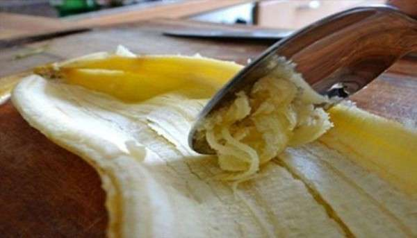
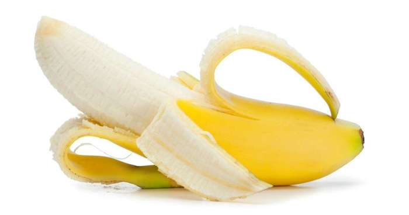

# Бананы хальсаа бүү хаяарай

Бананы, эрүүл мэндэд тустай чанарыг бид сайн мэддэг. Харин бананы хальсыг ийм их тэжээллэг чанартай гэж мэддэггүй хаясаар л байгаа. Үүнийг уншаад та, хаяхаа болино. Энэтхэг болон зарим улс орнуудад, бананы хальсыг гоо сайхан болон эмчилгээнд хэрэглэж ирсэн аргуудаас хуваалцъя.

Хальсны ашигтай чанарыг хэрэглэхийн тулд, хальсны дотор талыг халбагаар хусч авдаг байна. \
-Батга үрчлээний эсрэг түрхэх маягаар хэрэглэдэг. Антиоксидантын өндөр агууламжтай тул, арьсанд тэжээл өгч, чийгшүүлэн залуужуулах үйлчилгээтэй. Асуудалтай газрууддаа түрхэж, 30 минутын дараа угаана. \
-Псориазын өвчинд арьсандаа түрхэж хэрэглэнэ. \
-Шүд цайруулах үйлчилгээтэй. 15 хоногийн турш, бананны хальсаар, дотор талаар нь шүдээ арчихад шүд цайрдаг. \
-Үү арилгадаг. Бананны хальсаар арчихад арилахаас гадна дахин гардаггүй.

Маш хялбар энэ аргыг бусадтайгаа хуваалцаарай.
