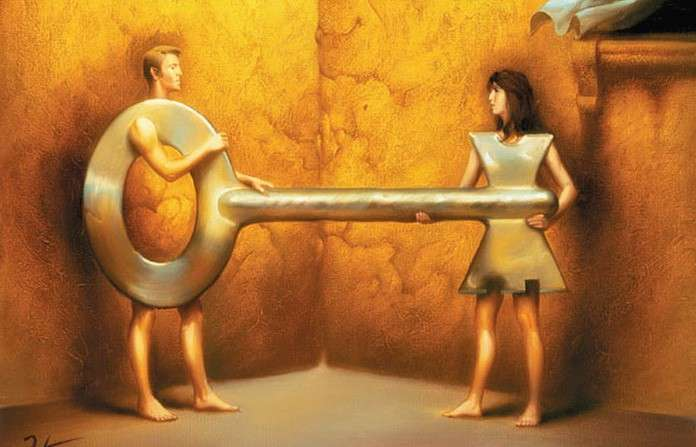
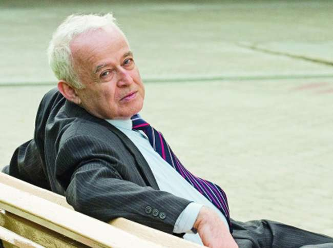

# Бат бэх гэр бүл зохиохын үндэс

Гэрлэлтийн байдлын тоон үзүүлэлт сүүлийн үед, бараг нийгэм дэх гамшигийн хэмжээнд хүрээд байгаа юм. Салалт ердийн үзэгдэл болж, залуус, гэрлэлтийг гэр бүл зохиох, урт удаан хамт амьдрах талаас огт хардаггүй, тухайн үеийн сэтгэл хөдлөл, дурлалд үндэслэн гэрлэцгээх болсоноос салалт хэмээх энэхүү хор хөнөөлтэй зүйл өссөөр байна гэж сэтгэл зүйчид үздэг. Оросын нэрт сэтгэл зүйч Михаил Литвак, 11 000 гэр бүлүүдийг судлахад, зөвхөн 3 гэр бүл аз жаргалтай амьдарч байна гэсэн гунигт үр дүн гарсанд харуусч явдагаа илэрхийлээд, салалтын шалтгаанууд, буруу сонголтын хор уршигийн талаар бичсэнийг толилуулъя.

Азгүй гэрлэлтийн бүх шалтгаан хүмүүсийн буруу хүмүүжлээс шалтгаалж байна. Тэд, бодож тунгаахаас хойргошдог болж, хэт сэтгэл хөдлөлөөр аливааг шийддэг болсоноос хань ижлээ буруу сонгодог. Эмэгтэйчүүдийн дунд явуулсан асуулгаар, “Би чамгүйгээр амьдарч чадахгүй”, “Би чамайг хэзээ ч гомдоохгүй”, “Хамтдаа амьдралыг даван туулъя” гэсэн эрэгтэйчүүдийн сэтгэлээ илэрхийлсэн үгсээс, “Чамгүйгээр амьдарч чадахгүй” гэсэн үгийг 75%-нь таашаан хүлээж авч, нөхөрт гардаг болох нь илэрчээ. Гэтэл, “Амьдралыг хамтдаа даван туулъя” гэсэн сэтгэлийн илэрхийлэл, амьдрах санал хамгийн үнэн байдаг гэдгийг ялгах ухаан дутаж байгаа нь харагддаг. Дурлал гэж юу вэ? –Хамтын амьдрал болон хайртай хүнийхээ хувь хүний өсөлтөд идэвхитэй анхаарах санаа тавихыг хэлнэ гэвэл олон хүн зөвшөөрөх нь битгий хэл ойлгох ч үгүй. Энэ бол буруу хүмүүжлийн нэгэн илрэл. Ихэнхи гэр бүлүүд, “Би чамгүйгээр амьдарч чадахгүй” гэсэн “наалданги” бэртэгчин үгэндээ итгэцгээн амьдралаа зохиодог. Гэтэл дурлал цаг хугацааны туршид улам хүчтэй болж байх ёстой атал, ийм бэртэгчин үзэл бодлоор зохиосон амьдрал зовлон болж, өнөөх сайхан бие биедээ өгсөн амлалт талаар болж, салцгаан өөрийг эрэлхийлэн амьдардаг. Хатуу хэлвэл хэн нь ч үхдэггүй. Гэр бүл болоход, эрэгтэйчүүд нь жинхэнэ эр хүн, эмэгтэйчүүд нь мөн жинхэнэ эм хүн болж бие мах бод, сэтгэл санааны хувьд төлөвшсөн байхаас гадна эд материалын хувьд ч боломжийн болсон байх ёстой байдаг аж. Канадын сэтгэл зүйчид, бат бэх гэр бүлийг үүсгэх дөрвөн хүчин зүйлийг тодорхойлсон бөгөөд хамгийн нэгдүгээрт: хосуудын ертөнцийг үзэх үзэл адил, хоёрт: хоол хүнсний амт хүлээн авах чадвар ижил төстэй, гуравт: бэлгийн харьцаа, дөрөвт: энхрийлэл гэсэн дарааллаар харьцаагаа тогтоон амьдардаг гэр бүлүүд аз жаргалтай амьдардаг гэсэн дүгнэлт гарчээ. Ор дэрээр эхэлсэн амьдрал сайнд хүргэдэггүй болох нь харагджээ. Эрчүүд өөрсдийгөө эр араатан амьтадтай харьцуулан урвалт хууралт байх ёстой гэж үзэх нь бий. Энэ бол хамгийн буруу ойлголт бөгөөд, энэ байдал сэтгэл хөдлөлөөр амьдралаа шийдэж, хань ижлээ буруу сонгосноос үүдэлтэй өөр хүн таалагддаг байдалд хүргэдэг хамгийн том алдаа юм. Гэр бүл дэх эмэгтэй ямар байх ёстой вэ? Эрүүл хөгжсөн бие мах бодтой, оюун санааны зөв хөгжилтэй, эд материалын хамааралгүй, ийм эмэгтэйчүүдийг эр нөхөр нь хэзээ ч хуурдаггүй. Гэтэл, эмэгтэйчүүдийн дийлэнхи хэсэг, нөхөрт гарахдаа, эр нөхөртэйгээ хамтран амьдрахаар бус харин, тэднийг хүмүүжүүлэхээр амьдардаг. Мөн архи уудаг хүнтэй амьдарч, хүмүүжүүлэхээр зүтгэдэг. Архичин бол адгуус амьтан гэдгийг ойлгодоггүй, өөрсдийгөө доромжлохыг тэсвэрлэн амьдардаг. Мөн, наад захын нүдэнд ил байдаг, эр хүний хувцаслалт, үйл хөдлөл, хөдөлгөөн, үг яриа, харилцааг анзаарч анхаарч сураагүй байдаг /үүнд хэн ч сургадаггүй/ нь харамсалтай. Сократын, “Чи надад хэдэн үг хэлээч, би чамайг танимаар /хармаар/ байна” гэсэн алдарт үг хичнээн сургаалтай вэ? Эмэгтэйчүүд, нөхөрт гарах бус харин нөхрөө хүмүүжүүлэхээр суусан юм шиг амьдрал ихээр ажиглагддаг болжээ. Хүнийг дахин хүмүүжүүлж амьдрах боломжгүй, хамтран амьдардаг ч аз жаргалгүй байдаг. Гэр бүлийн, хосын амьдралд хүн, зөвхөн ганцхан хүнийг хүмүүжүүлж болдог, тэр нь өөрөө юм. Алдсан бол салах хэрэгтэй. Өөрийг хай. Харин үдэшлэг, найр наргиан, шөнийн клубэд зөвхөн худал хуурмагийн цуглаан болж байдгийг мартаж болохгүй. Эмэгтэйчүүдийн хэрэглээ, хэрэгцээ шаардлага сүүлийн 100 мянган жил өөрчлөгдөөгүй гэсэн судалгаа байдаг бөгөөд сүүлийн үед бүсгүйчүүд байр суурьтай баян эрчүүдтэй гэрлэхийг эрмэлзэх болсон нь нэг талаас тэд, боловсорч буйг илтгэдэг ч өөрсдөө мөн ийм байх ёстой гэдгийг орхигдуулж, эд материалд шунасан, биеэ үнэлэгчийн хэмжээнд оччихдог нь харамсалтай. Мөн, өөрсдөө өсч хөгжихийн оронд, чинээлэг эмэгтэйчүүдийг сонирхдог залхуу залуус ч бий болоод байна. Эдгээр тохиолдолд сонголт нь зөв ч, өөрсдийгөө мөн байр суурьтай, эд мөнгөний хамааралгүй болгож чадахгүй байгаа нь алдаа юм. Эцэст нь хэлэхэд, хайр бол үгээр илэрхийлэхээс илүүтэй, сэтгэлээс ундран гарах үйлчлэл, үйл хөдлөл дээр тулгуурладаг нандин харьцаа гэдгийг сануулая. Хайртай гэсэн үгийг хэн болгон хэлж чадах ч, харин хайрыг илэрхийлэх үйлдэл тэр бүр, тийм ч амар байдаггүй нь зөвхөн сонголттой холбоотой байдаг.
