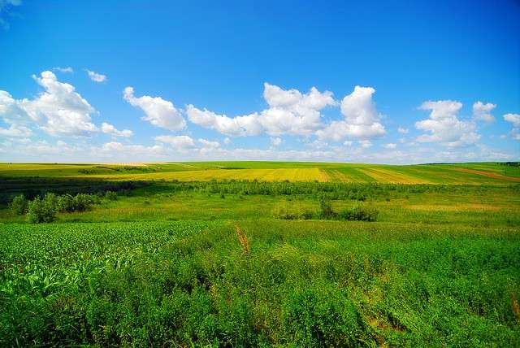

# Баян эцэг нь хүүдээ амьдрал ойлгуулах гэснийхээ хариуд, харин өөрөө ойлгосон түүх

Баян эцэг нь хүүгээ, амьдрал таниулж, хүүдээ ядуу зүдүү хүмүүс хэрхэн амьдардагийг харуулах, өөрийнх нь хүчээр, хүү нь тансаг хангалуун орчинд амьдардагийг нь мэдрүүлэх, харьцуулан ойлгуулах зорилготойгоор, хөдөө газар дагуулан явжээ. Тэд, нэгэн том талын дунд орших, ферм дээр ирж, гэрийн эзнийд нь, тав тухгүй нөхцөлд дөрөв хоног амьдарчээ.

Буцаж ирээд, аав нь хүүгээсээ, үзсэн харсан зүйлсийнх нь сэтгэгдлийг нь сонсох, өөрийнх нь түүнийг амьдруулж буй нөхцөлийг магтуулахаар, санаа бодлыг нь сонирхон асуув. Тэгтэл, хүү нь, саяын явсан аялал хачин сайхан байлаа гэхэд, гайхсан ч, аав нь, -Хүү минь чи саяын хэдэн хоног, ядуу мөнгөгүй хүмүүс хичнээн хэцүү амьдардагийг харсан, ойлгосон биз дээ? гэхэд, хүү нь, -Тиймээ, ойлгосон. Тэр хүмүүс нилээн хэдэн нохойтой байсан, харин манайх ганцхан нохойтой. Бид, энд бассейндаа сэлдэг, харин тэр хүмүүс, эхлэл, төгсгөл нь мэдэгдэхгүй том голын урсгал усанд сэлдэг, манай цэцэрлэгт гайхалтай гэрэлтүүлэг бий ч, харин тэнд, түүнтэй зүйрлэшгүй одот тэнгэр туяаран байдаг. Манай харшийг тойроод зүлэгт талбай хангалттай байдаг ч, тэнд зах хязгаар нь тэнгэрийн хаяанд төгссөн цэлгэр уужим тал байдаг. Бид, идэхийн тулд, мах сүү худалдан авдаг, харин тэд түүнийг өөрсдийн гараар бэлтгэж хийдэг. Бид гадны хүмүүс, урилгагүй зочидоос болгоомжилон, өндөр зузаан хана барьж гэр орноо босгодог. Харин тэд, олон найзуудтай, гэрийнх нь үүд хаалга үргэлж нээлттэй байдаг. Үүнийг сонсож суусан эцэг нь, бүр амаа ангайн гайхширав. Энэ үед, хүү нь нэмж, -Би сая явж, үзсэн харсан зүйлсээсээ, бид ямар ядуу амьдардаг болохоо ойлгосон, ааваа, гэжээ.\
Хүмүүс ер нь амьдралдаа, аль нэг өөрт байхгүй зүйлээ хүсч, аз жаргалд тооцон, байгаа зүйлээ үнэлэхээ больж байдаг. Мөн, зарим хүмүүсийн хямд хэрэгцээгүй гэж үздэг зүйлс, нөгөө хэсгийнх нь хувьд, байхыг нь аз жаргалд тооцох нь ч бий. Гэхдээ, энэ хүүгийн үгс, бидэнд аз жаргалтай байлгах бүх зүйлс эргэн тойронд маань байж байдгийг сануулах юм даа.
