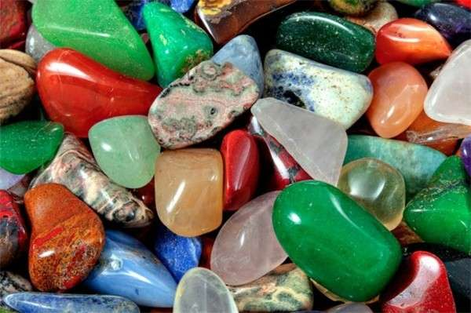
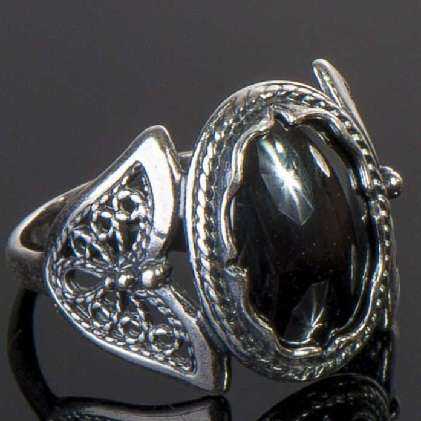
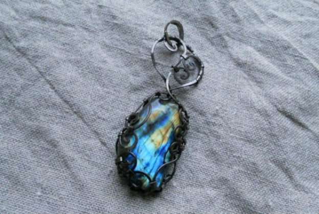
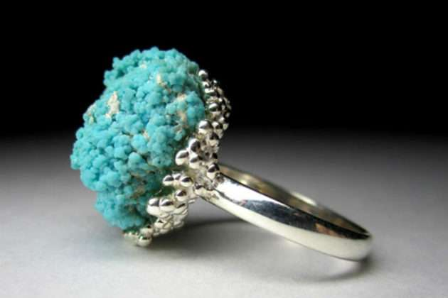
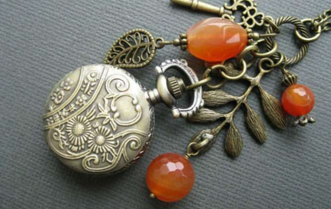
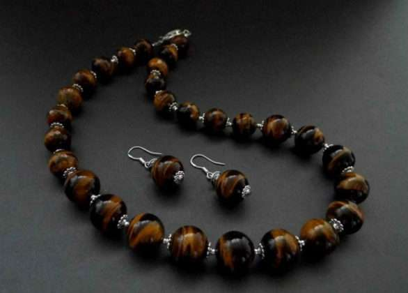

# Байгалийн чулууны эмчилгээний увидаст чанар

Чулууг, эртнээс эмчилгээнд ашиглаж ирсэн бөгөөд нунтаглан эм танд хэрэглэх, биеийн идэвхитэй цэгүүдэд массаж хийх, өвчтэй газруудад тавих зэргээр хэрэглэдэг байжээ. Орчин үед, уламжлалт бус эмчилгээний мэргэжилтэнүүд химийн найрлага талаас нь судалсаар байгаа бөгөөд литотерапия буюу чулууны эмчилгээ гэж нэрлэн нэгэн шинэ салбар болон хөгжиж байгаа бөгөөд чулууны энергийг гайхамшгийг бүтээх чадвартай гэж үздэг байна. Зарим, олонд дэлгэрсэн, олдоц ихтэй, гоё сайхан өнгө үзэмжээс гадна эмчилгээний увидастай, гайхалтай энергитэй чулуунуудаас танилцуулъя.

#### Номин

Хөх, хөхөлбөр саарал, нил ягаандуу өнгөтэй тунгалаг биш чулуу. Тэнгэр огторгуйг билэгддэг. Өндөр уулархаг газраас олборлодог. Хэрэв хайртай хүнтэйгээ, харилцаагаа бэхжүүлэхийг хүсвэл номин чулуун эдлэлийг байнга зүү гэдэг. Мөн, уг чулуу, сэтгэхүйг амрааж, хүмүүсийн хоорондын харилцааг эерэгжүүлдэг гэж үздэг. Олуулаа ажилладаг хамт олны уур амьсгалыг эерэг байлгах, мөн олны өмнө үг хэлдэг илтгэгч, удирдагч нарт ээлтэй, шинэ санаа төрүүлдэг чулуу гэх ба мэдрэлийн ядаргаа, нойргүйдэлд зүүхэд тустай, өөртөө итгэх итгэлийг нэмэгдүүлэх увидастай гэж үздэг.

---

#### Гематит

Гүн хар, улаан хүрэн туяатай чулуу, хар сувд гэж нэрлэгдэх нь бий. Энэ чулууны гол увидас нь хамгаалалт болдогт оршино. Эрэгтэйчүүдэд сайн чулуу гэдэг ба эрэлхэг чанар, танин мэдэхүйн чулуу. Аян замд хамгаалдаг гэж үздэг байна. Цусны өвчин, шээс, бэлгийн замын өвчилөлүүдэд тустай. Мөнгөн эдлэлд суулгаж зүүхэд илүү тохирдог.

---

#### Лабрадор

Ногоон, саарал үндсэн өнгөтэй олон өнгөөр солонгорсон чулуу. Сэтгэл санаа өргөж, ажил үйлс бүтээх чадвартай, мөн стресс тайлах, зангирсан булчинг суллах, үргүйдлийг эмчлэх увидастай гэж үздэг. Уран бүтээлчидийн чулуу гэдэг бөгөөд онгод сэргээх, сэтгэл хөдлөлийг эерэгжүүлэх, ажил хөнгөвчлөх чадвартай байдаг байна.

---

#### Оюу

Аз жаргал, эд баялагийн чулуу. Тод өнгийн оюу ядаргаа тайлж, гэр оронд эв эеийг сахиулдаг. Оюу зүүдэг хүн, төлөв түвшин, илүү нээлттэй байдаг гэнэ. Элэг, ходоодны өвчинд сайн. Ачаалалтай ажилладаг хүмүүс зүүх шаардлагатай. Уг чулуугаа алгандаа барих, харах үед үйлчилгээ үзүүлж байдаг байна. Хувийн амьдрал, гэр бүлийн харилцаа холбоог хамгаалдаг чулуу гэж үздэг.

---

#### Сердолик

Улбар шар өнгөтэй чулуу. Хайр дурлалаа олох, барих чулуу гэж үздэг бөгөөд эмэгтэйчүүдэд илүү тумтай байдаг. дааврын тэнцвэрийг зохицуулж, арьс, шүд, үсэнд сайн нөлөөлдөг. Толгой өвдөх үед, чамархайн тус газраа нааж барих, нүдээ аниад, зовхиндоо барихад намдаадаг. Цус хангамжийг сайжруулж, даралт бууруулдаг байна. бухимдуу хүмүүс зүүх хэрэгтэй ба, бодлогогүй үйлдлээс хамгаалдаг аж.

---

#### Барын нүд

Эзнийхээ, өөрийгөө таних, хэрэгцээ, чин хүслээ таньж олж авахад тусалдаг сонин чулуу гэнэ. Анхаарал төвлөрүүлэлтэд сайнаар нөлөөлөхөөс гадна, эмэгтэйчүүдэд тустай, хэт идэх, хардах, нямбай бус байдлаас гаргах шидтэй чулуу аж. хүрэн бор өнгийн уг чулуу нь, эзнээ, анзаарагдахгүй өнгөрөх ашигтай зүйлст анхаарлаа хандуулахад тусалдаг гэнэ. Амьдралын томоохон өөрчилөлтөөс болсон сэтгэл санаагаар унах үед зүүх тустай гэх ба уг чулуунаас гарах энерги амьдралын эрч хүч өгдөг гэж үзсээр иржээ.
