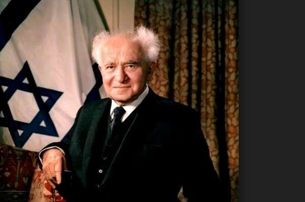
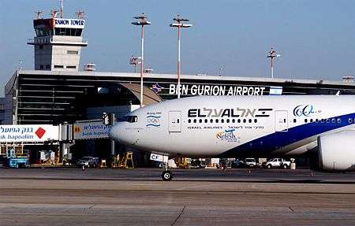

# Бен Гурион: Эх орныг духандаа хөлстэй барьж байгуулдаг юм.

Анхдагч байх хэцүү, бүр хамгаас хэцүү, хэний ч яваагүй замаар анхлан алхаж, хэний ч шийдвэрлэж байгаагүй зүйлсийг шийдвэрлэж, хүн бүхний ажигласан, шүүмжилсэн, үл ойшоосон, үзэн ядсан харцанд онилогдож, энэ яагаад үүнийг хийгээд байгаа юм бэ, гэсэн үл ойлголтын дунд анхдагч үргэлж буруутгагдаж байдаг.

Энэхүү анхдагчийн хүнд бэрх үүргийг ариунаар, цуцаж няцахгүйгээр гүйцэтгэж Израйль орныхоо төлөө өөрийгөө зориулж, улсаа байгуулж чадсан агуу хүн, Израйль улсыг үндэслэгчидийн нэг, Израйлийн анхны ерөнхий сайд Давид Бен Гурион, 1886 оны 10 сарын 16 –нд төржээ. Тэр маш намхан хүн байсан бөгөөд ердөө 150 см өндөр байсан ч, түүнийг ерөнхий сайдын хувьд гурван ерөнхий сайдтай тэнцэхүйц хүчирхэг хүн гэж үнэлдэг байжээ. Ямар сайндаа, “Бен-Гурион Бурханд итгэдэггүй атал, заримдаа Бурхан түүнд итгээд байх шиг санагддаг” гэж хамтран зүтгэгч нар нь тодорхойлсон байхав. Мөн Түүний эх орны тухай хэлсэн алдартай үг байдаг: “Эх орон зүгээр нэг өгөгддөггүй, эх орныг бэлгэнд авдаггүй, эх орон ямар нэг хэлэлцээр зөвшилцлөөр ирдэггүй, эх орныг алтаар наймаацалддаггүй, эх орныг нударгаар шийдэж олж авдаггүй, харин түүнийг духандаа хөлстэй барьж байгуулдаг юм” гэжээ. Түүний энэ бодол, үзэл санаа хэрэгжсэний илрэл бол, 1948 оны 5 сарын 14-нд Израйль улс тусгаар тогтнолоо зарласан явдал юм. Сониноос 1952 онд, Бен-Гурион Альберт Эйнштейнд ерөнхий сайд болох санал тавьж, түүнд нь Эйнштейн, хүмүүстэй харилцах туршлагагүй, тэгээд ч чадваргүй гэж тайлбарлаад татгалзаж байсан гэнэ. Бен-Гурион гавьтай боловсролтой байгаагүй ч, эртний грекийн гүн ухааныг сонирхсондоо грек хэл сурч, Платоныг эх хэлээр нь унших, Спинозын үзэл санаатай танилцахын тулд латынь хэл сурсан гэдэг. 1971 онд, америк залуусын дунд явуулсан судалгаан дээр үндэслэн, Роберт Кеннеди, Билл Косби, Нил Армстронг, Джон Уэйн нар цаг үеийнхээ баатруудаар шалгарч, Рашмор ууланд хөрөг нь дүрслэгдэх болсныг зарлах үеэр нэгэн уншигч, “Яагаад Бен-Гурионы хөргийг тэнд залж болоогүй юм? Энэ хүн хоёр мянган жилийн турш дэлхийгээр нэг тарж бутарсан ард түмнийг нэгтгэж, бүхэл бүтэн улсыг байгуулсан хүн шүү дээ” гэсэн захидал ирүүлж байсан гэнэ. Тэрээр цөлийг эзэмших төлөвлөгөөтэй, их зорьж байснаас, Цөл дэх Негев хотод бусдад үлгэрлэхийн тулд албан тушаалаа өгснийхөө дараа суурьшиж байв. Негевт түүний нэрэмжит их сургууль байдаг. Израйлийн үүд хаалга, Тель-Авивын нисэх онгоцны буудал мөн түүний нэрэмжит бөгөөд энэ буудал ойрхи дорнодын нисэх буудлууд дунд толгой цохидог. Энэ буудлын тухай “Бен-Гурион”-ны нисэх буудалд, мянган зорчигчидын тээшний хоёр нь л, төөрч алдагдах магадлалтай гэхдээ заавал эргэж олддог гэж сайшаан ярьцгаадаг. Ийнхүү, Израйльд түүний нэртэй гудамжууд, дүүрэг цөөнгүй байдаг байна. Энэхүү эх оронч, Израйлийг үүсгэн байгуулагч, анхны ерөнхий сайд Бен-Гурион 1973 онд 87 насандаа Тель-Авивт нас нөгцжээ.
