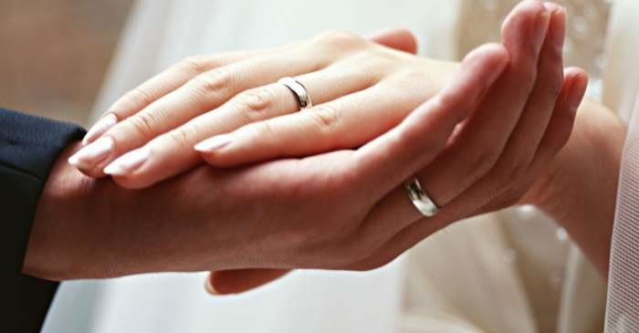
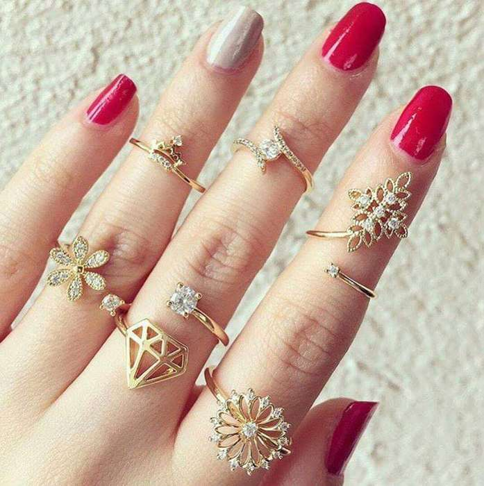

# Бөгжийг зөв зүүх нь, таны байр суурийг илэрхийлдэг

Хүмүүсийн хамгийн түгээмэл гоёл болох, бөгж, эрт дээр үеэс улбаатай, хамгийн эртний гоёл бөгөөд бөгжийг ид шидийн хүчтэй гэж үзэх нь ч бий.

Гоёл чимэглэлийн эд зүйлсийг, зүүж хэрэглэх өөрийн гэсэн дүрэм журам байдаг байна. Энэ дүрэм нь, таныг, гоёмсогоор байдал төрхөө илэрхийлэхэд тань тус болдог. Бөгж бүр гоё хийц загвартай, олноор зүүх сэтгэл төрүүлсэн гоёмсог байдаг бөгөөд харин, энэхүү дүрэм, хоёр гарт 3-с илүү бөгж зүүхээс зайлсхийхийг сануулдаг.\
Олон бөгж зүүсэн хүн, өөрийн байр суурь, наад захын, гоёл чимэглэл зүүх соёл, дүрмийг мэдэхгүйгээ харуулж байна гэсэн үг гэнэ. Ядам хуруунд, хуримын бөгж зүүдэг. Хуримын бөгжийг, их том биш байх ёстой гэж үздэг байна. Мөн, долоовор хуруундах бөгж, нарийн хийцтэй, жижгэвтэр байхыг зөвлөдөг. Хэрэв том чулуун шигтгээтэй, жинтэй бөгжинд дуртай бол дунд хуруундаа зүүх хэрэгтэй аж. Эрхий хуруунд, шигтгээ чимэглэлгүй, өргөн том бөгж зүүх нь зохистой гэдэг байна.\
Эрэгтэйчүүд, хуримын бөгжнөөс гадна, зүүн гарын чигчий хуруундаа, үнэт бөгж зүүх нь эрхэмсэг харагдуулдаг.\
Залуу охид бүсгүйчүүд жижиг бөгж зүүн, гарынхаа гоо үзэмжийг дарахгүй байх нь зүйтэй. Хижээл насныхан харин, эсрэгээр анхаарал татахуйц том бөгж зүүх нь зөв гэдэг.\
Нэг гартаа нэг л бөгж зүүгээрэй. Хэрэв хоёр гартаа, нэг нэг бөгж зүүх бол хоорондоо төстэй байхаар сонго.\
Нэг гартаа олон янзын бөгж зүүх зуршилтай бол, үүнээсээ татгалзах нь дээр. Үнэтэй, эсвэл хямд бөгжийг хамтад нь зүүдэггүй.\
Өндөр үнэтэй бөгжийг өдрийн цагаар зүүдэггүй. Харин, хүлээн авалт, үдшийн зоогонд уригдахдаа, зоригтойгоор хольж зүүж болно.\
Чөлөөт хувцас өмссөн үедээ том шигтгээтэй бөгж зүүж хэрэггүй.\
20 наснаас дээш насныхан, хямдхан, төмөр хуванцар эдлэлүүд зүүхээс татгалз.

Эдгээр зөвлөгөөнүүд, ямар ч орчинд, хаана ч, өөртөө итгэлтэй, өөдрөг байхад тустай.
