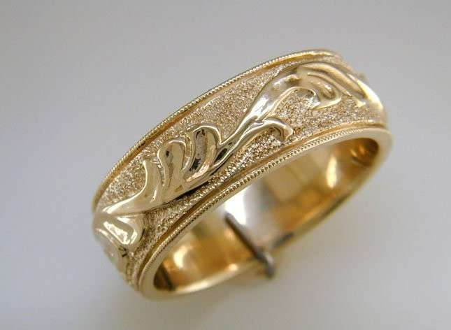

# Бөгжний ид шид

Бөгж бол зүгээр нэг гоёл чимэглэл, загвар, байр суурь илэрхийлэхэд тустай гоё сайхан зүйл биш, харин хамгаалалтын сахиус болох чадвартай байдаг гэнэ. Энгийн нэг бөгж ч танд, таны амьдралд тус хийх чадвартай бөгөөд бусдын нөлөөлөл эрхшээлээс хамгаалдаг гэж эрт дээр үеэс үзсээр иржээ. Зурхайч, үзмэрчид гарын хуруу тус бүрийг гариг эрхэстэй холбоотой гэж үздэг ба бөгжийг тухайн гаригийн хуруунд нөлөөлөх нөлөөллийг харгалзан зүүснээр танд тус болно гэж үздэг ажээ.

- Эрхий хуруундаа бөгж зүүснээр, ертөнцийг хүлээн авах мэдрэмжээ идэвхижүүлж, мөн мөнгө дуудагддаг гэнэ\
-Долоовор хуруундаа бөгж зүүх нь, Бархасбадь гаригийн нөлөөлөл болох эрх мэдлийг идэвхжүүлдэг бөгөөд өөртөө итгэлтэй болж зорилгодоо хүрэхэд тусалдаг байна\
-Дунд хуруугаа бөгжөөр гоёсноор, Санчир гаригийн нөлөөллийг идэвхижүүлж, мөн өвөг дээдсийнхээ дурсгалыг хүндэтгэн хадгалдаг гэх бөгөөд энэ хуруунд өвлөгдөж ирсэн бөгж зүүх нь тухайн хүнийг хүчтэй болгож өвөг дээдэстэй нь холбож тус дэм авахад нөлөөлдөг байна. Үр хүүхэддээ, болвол бөгж бэлэглэх хэрэгтэй гэнэ. Энэ нь цаашдын амьдралд нь тусалдаг сахиус болж өгдөг байна.\
-Ядам хуруундах бөгж, урам зориг өгч, бүтээлч эрч хүчийг идэвхижүүлж, харилцаанд сайнаар нөлөөлдөг. Ойр дотны хүний бэлэглэсэн бөгжийг ядам хуруунд зүүх нь хоорондын харилцааг сайжруулдаг гэдэг аж.\
-Чигчий хурууны бөгж, сэтгэл санааг өргөж, хэрэгцээтэй харилцаа холбоо тогтооход тусалдаг байна. Найз нөхөддөө чигчий хурууны бөгж бэлэглэдэг.
