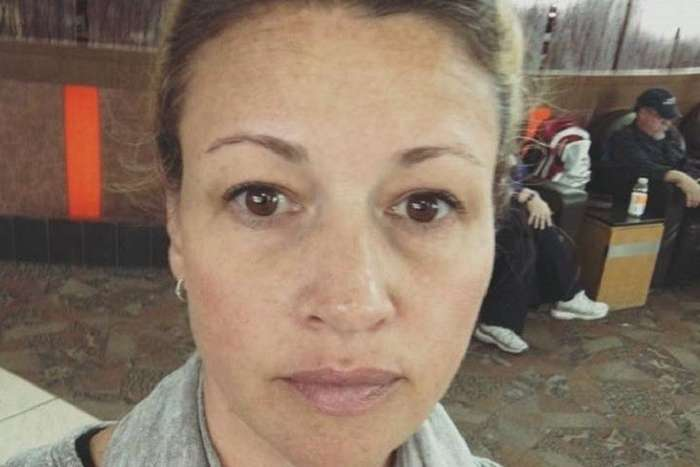
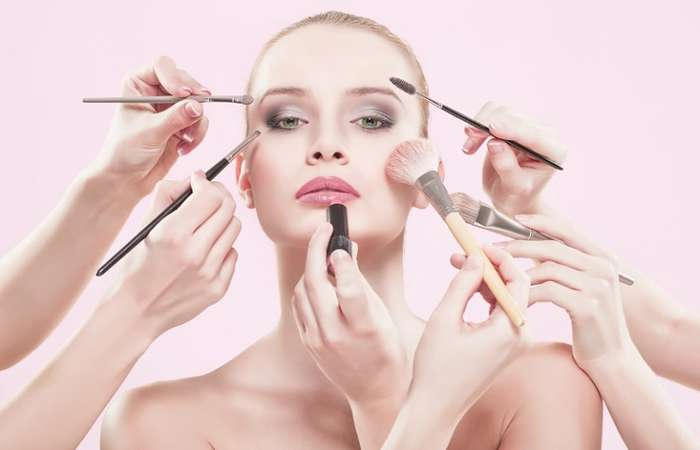

# “Би хэдтэй юм шиг харагдах нь хүнд хамаатай юу?”

Энэхүү, гоо сайхны хэмжүүрийг зад татсан пост, дэлхий нийтийг шуугиулаад зогсохгүй, олон эмэгтэйчүүдийн нуугдмал, байгаллаг чанарыг хөндсөн гэдгээрээ анхаарал татсан дуулиан болжээ. Хэдхэн долоо хоногийн дотор, энэ пост, 55 мянган лайк, 42 мянган шейр авсан бөгөөд ихэнхи нь, энэ эмэгтэйтэй санал нэг байгаагаа илэрхийлсэн байсан аж.

Канад эмэгтэй Анник Робинсон, Монреалд бага хуралд оролцчихоод, гэр рүүгээ буцахдаа, өөрийн хотын нисэх буудал дээр буугаад нислэгийн дараа ядарсан, гэр орон руугаа яарсан хүн явж байтал, гоо сайхны бүтээгдэхүүний борлуулалтын зөвлөх нэгэн залуу зогсоон хэдэн асуулт тавьснаар энэ түүх эхэлжээ.

Анник: -“тэр зөвлөх залуу намайг зогсоож, яриа үүсгэхийг хүсч, мөн, үнэгүй саван өгсөн. Орчин үед, дэлхий дээр хэзээ ч үнэгүй зүйл байдаггүй. Тэр дундаа нисэх буудал дээр шүү. Би маш их ядарсан байсан бөгөөд дараах яриа болсон” гэж бичжээ.\
Зөвлөх:-“таны арьс өөрөөрөө байгаа юм байна. Та нүүрээ будаагүй, тийм үү?” \
Анник:-“мм, тийм” \
Зөвлөх:-“би таны насыг таах гээд үзье, зүгээр биз дээ...” \
Анник:-“би өөрийнхөө насанд харагддаг, энэ бол хэвийн зүйл.” \
Зөвлөх:-“би танд манай бүтээгдэхүүний багцуудыг танилцуулъя. Та одоо л нүүрний арьсандаа анхаарч арчлахгүй бол 45 насандаа, үрчлээс тань улам гүнзгийрч, ямарч гоо сайхны бүтээгдэхүүн туслахгүй болно” \
Анник:-“эмэгтэй хүн 40 настай харагдахад юу нь муу байгаа юм?” \
Зөвлөх:-“таны нүдний доор үүсч байгаа уутанцар, нүүрний хөдөлгөөнөөс үүссэн үрчлээсүүдийн тань тухай ярилцъя. Танд би, 15 минутын дотор асуудлыг тань шийдэх зовхины тос санал болгое” \
Анник:-”миний нүд яасан гэж? Би хүүхэдтэй болж, сүүлийн хоёр жил дутуу нойртой байсан, тэр хөөрхөн хүү минь намайг гэрт минь хүлээж байгаа. Тиймээс би энэ уутанцрууд байгаад харамсдаггүй. Нөхөр бид хоёр үргэлж инээж байдаг, тиймээс үрчлээ гарсан. Гэсэн ч би, байгаа төрх байдал минь нөхөрт маань таалагддаг. Таны санал болгож байгаа тос надад хэрэгтэй гэж бодохгүй байна.” \
Зөвлөх:-“магадгүй, одоо танд хэрэггүй байж болох юм. Харин 50 нас хүрэхэд танд хагалгаанаас өөр зүйл тусалж чадахгүй болно шүү дээ” \
Анник:-“эмэгтэй хүн хөгшрөх тийм аймшигтай асуудал гэж үү? Нөхөр бид хоёр, нэг бус удаа, бид хоёр нүүрээрээ дүүрэн хөгжилтэй үрчлээстэй, хижээл хосууд болж, өтөл насаа хамт өнгөрүүлнэ гэж ярьдаг. Нөхөр маань ч мөн хөгширч байгаа, бид адилхан л нас явж байна. Энэ бол амьдралын бас нэг салшгүй хэсэг гэж боддог” \
Зөвлөх:-“за, за та, үнэнд нь санаа зовоод байгаа бол, хямдруулаад, 3 тосыг 199 доллараар ав. Ботоксоос хямд шүү” \
Анник:-“би хэвийн харагдаж байгаа. Би 45 хүрээд ч хэвийн харагдах болно. Мөн 50 хүрээд ч адил. Эмэгтэй хүн хөгшрөх нь гэм буруутай гэж үү? Хижээл нас бол, давуу эрхтэй сайхан зүйл, харамсалтай нь бараг бүгд үүнийг үгүйсгэдэг. Би, та нарыг, өөрсдийн бараагаа залуу насаар орлуулан сурталчилах, өтөл насыг харлуулан, бараа борлуулах арга болгодог асуудлыг хэзээ ч дэмжихгүй гэж хэлсэн. Тэгээд, энэ ярианы дараа, би шууд үрчлээ, уутанцартай царайгаа буулган авсан. Энэ царайнд минь миний хүүхдүүд, нөхөр маань хайртай. Энэ царайтайгаа явах л болно” \
Энэ, дуулиан дагуулсан нийтлэлийн дараах мянга мянган сэтгэгдэлтэй танилцсаныхаа дараа, Анник дараах зүйлийг олон нийтэд дахин хүргэжээ. \
“Намайг дэмжсэн хүн бүрт талархаж байна. Гэхдээ нэг зүйлийг тодруулмаар санагдлаа. Миний бичсэн зүйл, нүүрээ арчилахгүй байхыг уриалаагүй, мөн зөвлөх залуугийн харилцаанд гомдоллосондоо бичээгүй. Тэр залуу ажил үүргээ л биелүүлж явсан. Харин, эмэгтэйчүүдийг өөрсдийн нүүр царайг, байгалийн хууль болох хөгшрөлтийг үзэн яддаг болгоход чиглэсэн үйл ажиллагаа явуулж, сая саяар нь орлого олдог гоо сайхны бүтээгдэхүүн үйлдвэрлэгчидийн тухай бичиж ойлгуулахыг оролдсон юм шүү. Бидэнд, үрчлээгээ анзаарч бухимдаж суухаас илүү олон чухал зүйлс байдаг, тиймээс, иймэрхүү хиймэл нөлөөллөөс ангижирцгаая” гэж уриалжээ.
