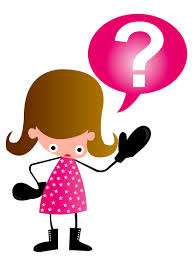

# Би хэн бэ?

Би ээлжийн амралт авдаггүй, надад амралтын өдөр байдаггүй, өвчний чөлөө ч авдаггүй.\
Би сэрүүлэг, тогооч, цэвэрлэгч, үйлчлэгч, багш, сувилагч, шүүгч, хамгаалагч, үсчин, сүнс айлгагч, би өдөр шөнөгүй ажилладаг, хэзээ ч утсаа салгаж болохгүй. Би таны хувьд хэн ч биш, би харин нэг хүний хувьд бүх юм. Би бол .......! таагаарай!
