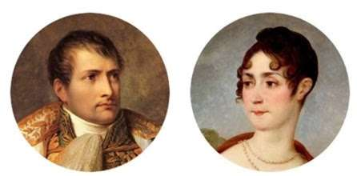

# Бичиг захидлын увидас

Бидний амьдарч буй энэхүү эрин зуун, сэтгэлээ бичиг захидлаар илэрхийлэх шаардлагагүй бараг боломжгүй гэмээр цаг үе билээ. Сэтгэл хөдлөл, мэдрэмж, байр байдлаа цаасан дээр гайхалтай урнаар буулгаж илэрхийлдэг байсан үеэс суралцах хэрэгтэй бус уу? Хэдийгээр бидний харилцааны хэрэгслүүд өөрчилөгдөж, бүх зүйл цахимжсан ч, бүх л зүйлээ бичгээр илэрхийлэхээс өөр арга байдаггүй. Тиймээс, аливааг гоё сайхнаар илэрхийлж, сэтгэлийн нарийн мэдрэмжүүдээ үгээр бичих нь эх хэлнийхээ тансаг сайхныг мэдрэхэд тустай байх юм. Цахимаар ч бай, сэтгэл хөдөлгөсөн сайхан захидал хүлээж аваад, уншиж уяран суух сайхан биш гэж үү? Урд нь хүмүүс бие биедээ бичдэг байсан захилуудаас цувралаар хүргэх сэтгэл төрсөнийг хүлээн авна уу.

**Наполеон Бонапарт, гэргий Жозефинадаа бичсэн захидал**\
Чамайгаа хайрлахгүй өнгөрүүлсэн нэг ч өдөр байсангүй, чамайгаа сэтгэлээрээ тэврэн энхрийлэхгүй нэг ч шөнийг өнгөрүүлээгүй шүү, хайрт минь, аяга кофены ард, чамаас минь хол байхын шалтгаан болсон, өөрийн бардам зан, нэр төрд дурлах зангаа хараасаар суунам. Мянга мянган дайчидынхаа өмнө зогсох мөч болон зогсож буудалласан хуарангуудаа шалган явах үед минь ч, чи миний зүрхийг эзэлж, хайртай Жозефина, чамайгаа бодсоор байдаг. Би, одоо, Рон мөрний урсгалын хурдаар чамаасаа алслагдан холдож байна, гэхдээ энэ нь, би чамтайгаа уулзах цаг мөчийг хурдасгахын тулд юм, гэж сэтгэлээ цайруулнам. Заримдаа, шөнө дунд босч ажилаа хийх үедээ ч тэр, чамдаа, хайрт чамдаа буцан очих үеэ түргэсгэхийн тулд гэсэн бодлоор хүч чадлаа сэргээдэг. 23, 26-ны захидлууддаа чи, “Та” гэж надад хандсан байх юм. Яаж ингэж болох юм бэ? Ямар хүйтэн харилцаа вэ? Жозефина! Жозефина минь! Би хэзээ ч билээ чамд, ертөнц надад хүчирхэг, хувиршгүй сэтгэл заяасан гэж хэлж байсныг минь санаж байна уу? Харин, ертөнц чамайг минь, сиймгэр тор, сэвэлзүүр салхиар бүтээсэн юм шиг... Чи минь намайг хайрлахаа болио юу? Амьдралын минь утга учир болсон миний хайр, миний дурлал минь! сэтгэл зүрх минь урагдах нь. Өршөөн соёрхооч намайгаа. Чамд зориулагдсан зүрх минь айдас, уйтгар гунигаар дүүрэн байна... Зүрх сэтгэл минь өвдөх юм. Чи минь надад, нэрийг минь дурдаж, хандан бичиж байгаач. Ийнхүү бичихийг чинь хүлээх болно. Баяртай хайрт минь. Хэрэв чи надад хайргүй болсон бол, хэзээ ч хайрлаж байгаагүй гэсэн үг. Би маш ихээр харамсах болно.
