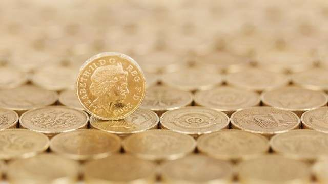

# Бид хийдэггүй, харин, хөрөнгө чинээтэй баян хүмүүсийн хийдэг 9 зүйл

Орчин үед хүмүүс, зээл, урьдчилгаагаар амьдрах дуртай болж, зээл бүтэх боллоо гэхэд, учиргүй баярлаж, эргэн төлөлт, хүүгийн талаар сайтар бодохгүй сул мөнгө алдан, зээл авахын тулд хахууль мөнгө өгөх зэргээр зөвхөн тухайн үеийн мөнгөтэй байх байдалд дулдуйдсан харалган бодол тээн, зээлийн эрхшээлд амьдарч энэ нь, тэр болгон эд хөрөнгөтэй баян болоход хүргэдэггүйг мэдэхгүй алдсаар байдаг. Харин эд, хөрөнгөтэй баян хүмүүс эхнээсээ л, аливаад хандах хандлага нь өөр байдаг гэнэ.

1. Тэд хэргэлж байсан эд зүйлс худалдаж авахаасаа, их цэрвээд байдаггүй. Үнэтэй зүйлс хэргэлж, түүгээрээ өөрийгөө үнэлүүлэх талаас огт боддоггүй бөгөөд сайхан хэргэлсэн ижил төстэй зүйлийг хямд авах нь дээр гэж тооцдог\
2. Баян хүмүүс, халаасандаа багтсан үнэтэй зүйлийг л худалдаж авдаг. Эд, зүйлс авахын тулд өр зээл тавих, сарын цалингийнхаа үнэр хэмжигдэх эд зүйлс худалдаж авахгүй. Тэд, өр зээллэг нь, олон жилийн дарамтад оруулж, амьдралын баяр баясгаланг хумсалж, утсгадаг гэдгийг мэддэг.\
3. Тэд, урт удаан эдэлгээтэй эд зүйлсийг илүүтэйд үздэг. Бид хямд зүйл худалдаж аваад, үүгээрээ хэмнэлт гаргаж байна гэж боддог. Жишээ нь, 100 мянгын гутал, 20 мянгын гутлыг харьцуулъя. Мэдээжийн хэрэг өмсөх хугацааны хувьд үнэндээ дүйцсэн элэгдэл гарна. Баян хүмүүс, хуурмаг хэмнэлтийн энэхүү “дэгээн”-д ордоггүй\
4. Тэд хүлээцтэй, мөн аливааг хүлээж чаддаг. Сэтгэл судлаачид, баян хүмүүсийн сэтгэлгээг судлахаар нэгэн туршилт явуулжээ. Хэсэг хүмүүст, хоёр хувилбараар мөнгө санал болгосон бөгөөд, өнөөдөр өгөх 5 долларыг авах уу, маргааш өгөх 10 долларыг авах уу гэхэд, ихэнхи хүмүүс эхний хувилбарыг сонгож 5 доллараа авсан аж. Гэтэл, хоёрхон хүн маргаашийн 10 долларыг сонгосон нь баян хүмүүс байжээ. Тэд хүлээж чаддаг\
5. Тэд, тэтгэвэрт гарахыг хүлээдэггүй. Гарсан ч ажилласаар байдаг бөгөөд зүгээр сууж чаддаггүй\
6. Тэд, арвич хямгач. Өнөөдрийн, зар сурталчилгааны эрин үед, тэд, зар сурталчилгааг ойшоож үздэггүй. Зөвхөн хэрэгцээт зүйлийнхээ худалдан авалт хийж, үлдсэн мөнгөө илүү үнэт зүйлст хөрөнгө оруулалт хийхийг чухалчилдаг\
7. Баян хүмүүс, хямдрал, акцууд, таатай саналуудыг ажиглан, цаг тухайд нь ашиглаж байдаг\
8. Тэд, төсвөө маш сайн төлөвлөдөг. Орлого зарлага, хадгаламжийн хүү, бонус, бэлгийн урамшуулыг ч тусган сараар, жилээр, хэдэн жилээр төлөвлөж байдаг. Та, ядахдаа, нэг сараар төлөвлөөд үзээрэй, хаана алдагдалтай, юунд мөнгөө үрэхгүй байх талаар эхний ойлголттой болдог гэнэ шүү\
9. Тэд, баян харагддаггүй. Баян хүмүүсийн хувьд, өөрийгөө баян, эд хөрөнгөтэй харагдуулах шаардлага байдаггүй. Тэд, ихэвчилэн, өөрийгөө үнэлэх мэдрэмж нь эрүүл, ердийн хүмүүс л байдаг\
Хамгийн гол нь, баян хүмүүс эд хөрөнгөө бүтээхдээ, тод, бүрэн дүүрэн амьдарлаар амьдрахын тулд бүтээдгээс биш, бусдад харуулахын тулд, баян харагдахын тулд бүтээдэггүй, тэд, зөвхөн амьдралаас сэтгэл ханамж авахын тулд амжилттай амьдардаг байна.
