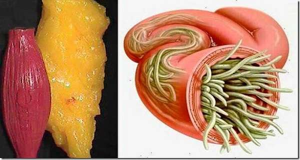

# Бие организмаас шимэгчид, паразитуудыг хөөх үр дүнтэй арга

Хэдийгээр, орчин үеийн эрүүл ахуйн нөхцөл эрчимтэй сайжирч буй ч, бие организм дах халдварт шимэгчидээс салах асуудал орхигдсоор байгаа юм.

Хойд америкийн судлаачдын явуулсан нэгэн судалгаагаар насанд хүрсэн хүн амын 85-95%-нь гэдсэндээ шимэгч паразитуудыг тээдэг болохыг нотлов. Эдгээр паразитууд хүний бүдүүн гэдсэнд амьдрах ба хүний бие организмд нэлэнхүйд нь нөлөөлж, гэдэс дүүрэх, өтгөн хатах, харшилууд, арьсны өвчинүүд, архаг ядаргаа, жин нэмэх, нойр өөрчлөгдөх, булчин, үе мөчний төрөл бүрийн өвдөлтүүд, дархлаа унах, гэх мэтээр илэрч байдаг байна. Цаг тухайд нь эмчилээгүйгээс уушиг гэмтэх, бусад архаг өвчинөөр өвчилөхөд хүргэдэг. Судлаачид, ихэвчилэн чихэрлэг, амтлаг зүйл байнга хэрэглэснээр, гэдэс салстаар дүүрч, мөөгөнцөр, паразитууд өсч үржих таатай орчин бүрдэж байдаг гэж үзжээ. Паразитууд хүний энергийг шимэн сордог тул, хүн эрч хүч олж авахын тулд чихэрлэг зүйлд дуртай болдог гэнэ. Хүний биед, хир их паразит байна төдий чинээ тарган байх магадлалтай байдаг байна. Бие дэх паразитуудаас салсанаар, жин хасагдаж, чихэрлэг зүйлд дурлахаа больдог гэнэ. Паразитаас салах оросын ардын эмчилгээний аргыг танилцуулъя. Энэ аргыг зургаан сард нэг удаа хэрэглэж байх хэрэгтэй гэнэ. 100 грамм маалингын үр, 10 грамм гвоздика /лиш цэцэг буюу хоол амтлагч маягаар худалдаалагддаг/ -г хамтад нь нунтаглан 3 өдрийн турш өдөрт 2 хоолны халбагаар хэрэглэнэ. Өглөөд өлөн элгэн дээрээ усаар даруулан хэрэглэдэг. 3 хоног хэрэглэх, 3 хоног амрах маягаар сар хэрэглэдэг. Энэ холимог, ходоод гэдэсний хананд наалдаж үлддэг тул паразитуудыг хөөх үр дүнтэй арга болдог байна.
