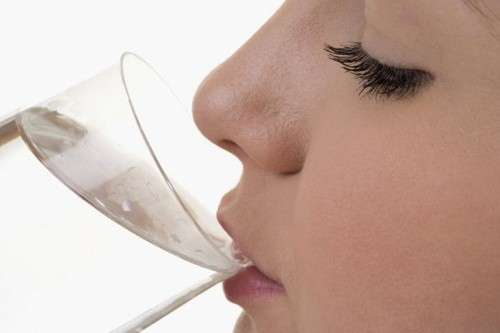
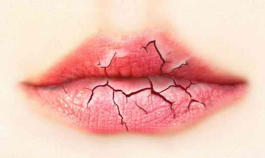

# Бие организмд ус дутагдаж буйг илтгэх 8 шинж

Ус нь, бие организмын метаболик, катаболик үйл ажиллагаанд чухал үүрэг гүйцэтгэхээс гадна арьс, үс, хумсны эрүүл сайхан байдлыг хадгалахад ихээхэн үүрэг гүйцэтгэдэг. Бие организм, хангалттай ус авч чадахгүй бол, эд эрхтэний хэвийн үйл ажиллагаа алдагдаж, сэтгэхүйд хүртэл нөлөөлөх өвчин өвчилөлүүд үүсэх эрсдэлтэй байдаг бөгөөд ус дутагдаж буй үед, дараах шинж тэмдэгүүд илэрдэг байна.

1. Эрүүл хүн өдөрт, 7-8 удаа хөнгөнөөр бие засдаг. Хэрэв, энэ асуудал ховордсон бол ус дутагдаж буйн шинж\
2. Байнга толгой өвдөх. Ус нь, цусны эргэлтийн хэвийн ажиллагааг хангаж байдаг. Толгойн өвдөлт, хөдлөх үед хүчтэй болж байвал, зайлшгүй ус дутагдаж байгаагийн шинж\
3. Ам хуурайших, шүлс ялгаралт багасах, амны хөндий үрэвсэх байдал илэрнэ.\
4. Шээсний өнгө өөрчилөгдөж, үнэртэй болдог. Өнгө нь бараан, булингартай байвал эмчид яаралтай хандах нь зүйтэй.\
5. Организмд ус дутагдах үед, биеийн эд эсэд ислэг орчин бүрдсэнээс болж хүн архаг ядаргаанд ордог.\
6. Усны дутагдлаас, бие организмд кальци, кали, магни дутагдаж, байнга шөрмөс татах байдал ажиглагдаж эхэлдэг.\
7. Өтгөн хаталт, ус дутагдаж буйн шинж.\
8. Арьс хуурайшиж, зориулалтын тоснууд шингэхээ больно. Ус, арьсны тослогийг тэнцвэржүүлж байдаг байна
