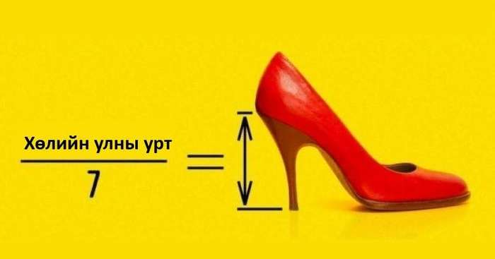
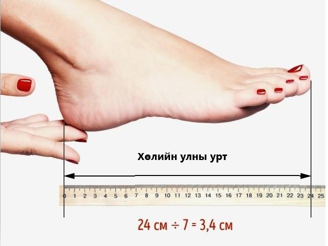
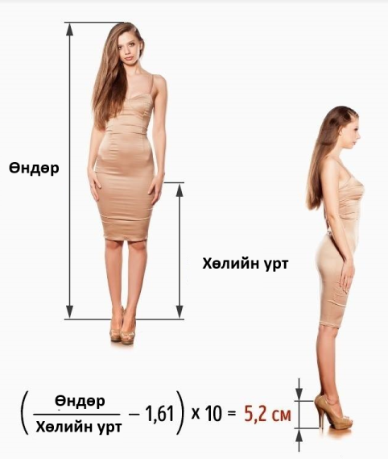
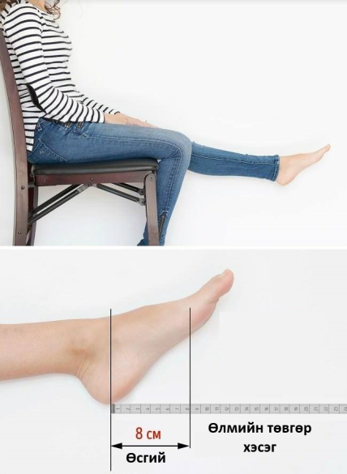

# Биед хамгийн тохиромжтой өсгийний өндрийг олох арга

Өндөр өсгийтийн хор уршигийн талаар сүүлийн үед бичигдэх болсон зүйлсээс эмэгтэйчүүд бид ер нь айхгүй л болов уу. Өмсөж болно, өмсөх хэрэгтэй зүйл мөнөөс мөн гэж л бодож, ер нь түүнгүйгээр өөрсдийгөө төсөөлж ч чадахгүй. Гэхдээ, өсгийний өндөрийг зөв сонгох талаар мэдлэгтэй байх хэрэгтэй юм. Хөлд эвтэйхэн байхаар, мөн нурууны өндөрт зохистой, гоолиг сайхан харагдуулах гутлын өсгийний өндөрийг олох 3 аргыг танилцуулъя.

1. Өдөр тутам өмсөх, гутлын хамгийн эвтэйхэн, тохиромжтой, аюулгүй өсгий. Хөлийн улны уртыг хэмжиж, гарсан хэмжээг 7 хуваана. Энэхүү хэмжээ, танд хамгийн тохиромжтой, алхаа гишгээнд нөлөөлөхгүй, зохистой хэмжээ. Эмч нар өдөр тутам өмсөх гутлын өсгийн өндөр 2-4 см гэдэг ч, энэ нь, тухайн хүний нурууны өндөр, хөлийн хэмжээг тооцоогүй байдаг дутагдалтай гэж үздэг байна.

---

1. Таныг гоолиг, өндөр харагдуулах төгс өсгийн өндөр. Биеийн өндөрийн хэмжээг, хөлний улнаас ташаа хүртэлх нийт уртын хэмжээнд хувааж, гарсан тооноос 1.61-ийг хасч, түүнийгээ 10-т үржүүлж гаргана.

---

2. Гоёлын өсгийтэй гуталны, хамгийн эвтэйхэн байх, нурууны өндөрт зохицох өсгийний хэмжээний дээд өндөрийг гаргахдаа, сандал дээр сууж хөлөө урагш өргөж өлмийг сул тавина. Өсгий хэсгээс өлмийн төвгөр хэсгийн хоорондох зайг хэмжихэд гарсан хэмжээ, таны хөлийн улны налуу гишгэх төрөлхийн дээд боломжийг заана. Ихэвчилэн 7-9 см байдаг. Түүнээс дээш өндөртэй өсгийтэй гутлыг өмсөх хүндрэлтэй байдаг.
