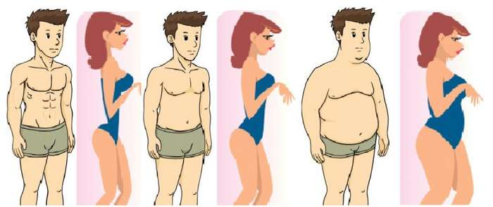

# Биеийн галбир ба төрсөн он, сар өдөр

Төрсөн он, сар, өдрийнхөө цифрүүдийг хооронд нь нэмж, 1 оронтой тоо болгоод, тухайн тоонд, хамаарсан зөвлөгөөг уншаарай.

Жишээ нь: 1990-12-05\
1+9+9+0+1+2+0+5=27 2+7=9\
Энэхүү 9-н тоонд харьцсан, зөвлөгөө таны галбирыг тодорхойлно.\
1- Энэ тоонд харьцах хүмүүс, маш их хөдөлгөөнтэй байдаг учраас таргалах нь ховор. Хөдөлгөөнийхөө ачаар гуалиг, сайхан биетэй байдаг.\
2- Энэ хүмүүс таргалах магадлал өндөр, ихэвчлэн хоолны дэглэм барьдаг. Гэвч, байнгын хоолны дэглэм, эрүүл мэндэд таагүй гэдгийг эдгээр хүмүүст сануулах хэрэгтэй. Хөдөлгөөн, байгалийн гаралтай хүнсийг эрхэмлэхийг зөвлөе.\
3- Илүүдэл жингээс илүү, “илүүдэл” стрест ордог. Үүнээсээ салчихвал, тэдэн шиг сайхан хүмүүс үгүй.\
4- Энэ төрлийн хүмүүс, үргэлж дуртай зүйлээ, хийж байх ёстой байдаг. Дургүй зүйл хийн, сэтгэлийн таашаал авахгүй байхаараа, идэж, өөхөө хуримтлуулах магадлалтай.\
5- Энэ хүмүүсийн бие галбир, амьдралынх нь байдлаас шалтгаалдаг. Өөдрөг, амжилттай энэ төрлийн хүмүүс гуалиг сайхнаараа удаан амьдардаг.\
6- Энэ төрлийн хүмүүсийн бие, галбирлаг байдаг. Зөвхөн зөв хооллоход л хангалттай.\
7- Эдгээр хүмүүс, хань ижилтэйгэй ямар харьцаанд байгаагаас их шалтгаалдаг. Таагүй бол илүүдэл жин баталгаатай.\
8- Ийм хүмүүс, гомдолоо тайлж сурах хэрэгтэй. Гоморхуу зан тань, таргалалтад хүргэнэ гэдгийг бүү март.\
9- Эдгээр хүмүүс таргалах эрсдэл өндөр, хуримтлуулсан таргаа хаяхад хэцүү. Исгэлэн хүнс голчилсон хоолны дэглэм танд туслана.
