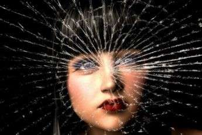

# Бүх өвчин, өвчилөл бодол сэтгэхүйгээс үүсдэг

Хүн амьдралдаа тохиолддог асуудлууд, үйл явдлуудыг хэрхэн хүлээж авч, ямар хариу үйлдэл хийдэг болон яаж тусгаж авч бодол сэтгэлдээ тээж явдгаас эрүүл мэнд ихээхэн шалтгаалдаг гэнэ. Бид өөрсдийн амьдралд тохиолдож буй зүйлсийн төлөө 100% зөвхөн өөрөө хариуцлага үүрдэг гэдгээ ухамсарлаж, өөрийгөө буруутгахгүй, аливаа таагүй зүйлс, гомдол бухимдлаа сэтгэлдээ хадгалах буюу дотроо бугшуулахгүй, аливааг өөртэйгээ харьцуулж өөрийгөө зовоохгүй байх нь эрүүл амьдрахын баталгаа болж байдаг болохыг туйлаас ойлгох хэрэгтэй гэж сэтгэл зүй, сэтгэцийн эрүүл мэндийн эрдэмтэн судлаачид зөвлөж байна.

Бодолд дарагдсан, уйтгартай царайтай хүний сэтгэхүй ямар байх вэ? Өөрөө ч мэдэхгүй зөвхөн өвчин зовлонг л дуудаж байдаг байх нь. Мөн өндөр настай хүмүүсийн нүүр царай дүр төрх, туулж өнгөрүүлсэн амьдралыг нь харуулж байдаг гэсэн дүгнэлтэд хүрсэн бөгөөд амьдралын баяр баясгалантай, сэтгэлийн тэнхээтэй хүмүүс эрүүл саруул толиотой, сайхан дүр төрхтэй өтөлдөг болохыг судалгаагаар тогтоожээ. Бие мах бод болоод сэтгэл санааны бүх өвчилөлүүдийн 90-95 %, хүний сэтгэхүй, бодол санаанаас үүсдэг байна. Жишээ нь, хүний сэтгэл дэх айдас болгоомжлол, тархинд ачаалал өгч, тархи толгойны өвчтэй болгохоос гадна наад зах нь, толгойн хуйханд нөлөөлж үсний уутанцруудыг агшааж үс унаж халзрахад хүргэдэг аж. Мөн, нэгэн сонирхолтой дүгнэлт гарсан нь, эмэгтэйчүүдийн халзралт, “ажил хэрэгч” эрэгтэйлэг ертөнцөд оролцох болсноор мөн эрэгтэй үүрэг гүйцэтгэх болсонтой холбоотой эхэлсэн гэж үзсэн байна. Тархи толгойн өвчинүүд, санаандаа хүртэл амьдарч чадахгүй байгаа үед үүсдэг. Хоолойн өвчилөлүүд ба бамбай булчирхайн өвчин эрхээ эдэлж чадахгүй байх, өөрийгөө үнэлэхгүй байх, үнэлүүлж чадахгүй байх, уур уцаартай байх, хэлэх зүйлээ хэлж чадахгүй байх, бүтээх зүйлээ гүйцэлдүүлж чадахгүй байхтай холбоотой. Нурууны дээд хэсэг өвдөх нь сэтгэл санааны дэмжлэгээр дутмаг байх, дунд хэсэг нь өөрийгөө буруутгаж голох, доод бүсэлхий хэсгийн өвдөлт мөнгөтэй хамааралтай сэтгэл санааны зовиуртай байдлаас эхэлдэг. Уушиг, бүрэн дүүрэн амьдарлаар амьдарч чадахгүй байснаас. Хөхний өвчилөлүүд хуралдсан гомдол, уйтгар гуниг, уур хилэнгээс үүсдэг. Бүхнийг хайрлах сэтгэл үгүй бол зүрх агшиж өвчилөлд хүрч, баяр баясгалангаар тэжээгддэг цусны урсгал удааширч, зүрх судасны өвчинд хүргэдэг. Астмыг, хэт өндөр шаардлагатай, ёс суртахуунтай, аливааг өөрийнхөөрөө байлгах хүсэлтэй, сэтгэлийн ханамжгүй хүмүүсийн өвчилөл. Хорт хавдрыг, сэтгэлийн гүн дэх далд гомдол, шаналал, дотроос идэж эхэлснээр үүсдэг. Илүүдэл жин, таргалалт нь, өөртөө итгэхгүй байх, амьдралд итгэхгүй байхтай нягт холбоотой /энэхүү сөрөг бодлуудаа өөрчилж, өөрийгөө байгаагаар нь хүлээж авах нь илүүдэл жин, таргалалтаас салах шилдэг арга/ гэсэн дүгнэлтүүд гарсан аж. Ийнхүү өвчин өвчилөлийг тус тусад нь сэтгэл санааны байдал, зан араншинтай холбон үзсэн олон туршилт судалгааны дүгнэлтүүд дээр үндэслэн, амьдралд таарах таагүй зүйлсийг зовлон шаналалын хэмжээнд хүлээж авахгүй давж гарах өөдрөг сэтгэлтэй, сэтгэлийн тэнхээтэй байхад, хүн өвчин эмгэгээс хол байж чадна, хүн өөрөө өөрийгөө эрүүлжүүлэх чадвартай гэж сэтгэл зүйчид, сэтгэцийн эмч нар томоохон судалгаануудын үр дүн дээр тулгуурлан нотолж, зөвлөсөн байна.
