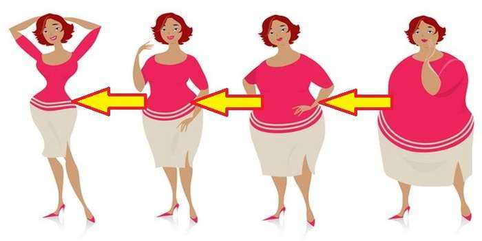
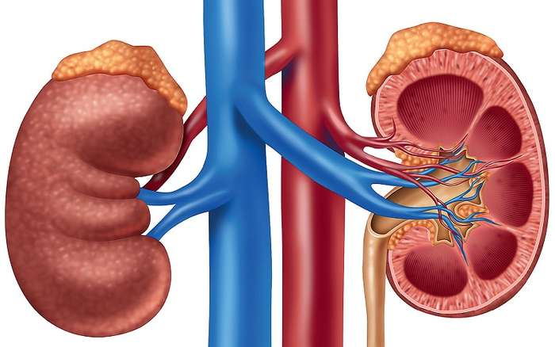
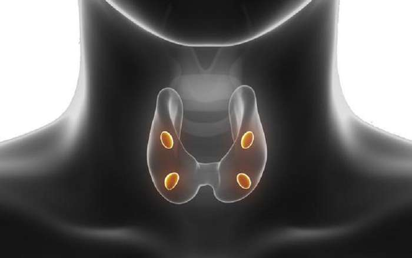
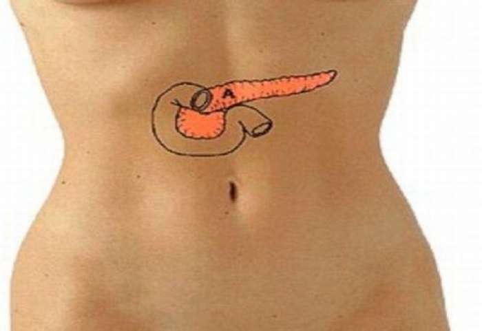
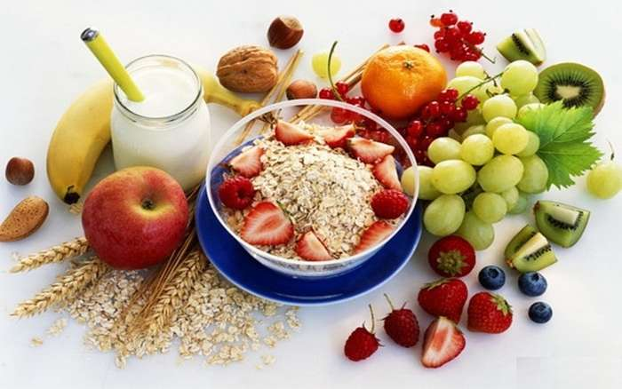

# Бодисын солилцоог буурахаас сэргийлэх аргууд

Бодисын солилцоо, нас нэмэхийн хирээр удааширч байдаг бөгөөд ялангуяа, 35 наснаас эхлэн эрчимжиж эхэлдэг аж. Бодисын солилцоог сэргээх, хэмжээнд нь барихын тулд дараах дүрмүүдийг мөрдөх хэрэгтэй болдог байна. Хөгшрөх процесс нь, дотоод шүүрлийн системийн үйл ажиллагаа өөрчилөгддөгөөс эхэлдэг бөгөөд энэ үеэс, эрүүл зөв, идэвхитэй амьдралаар амьдарч, хоол хүнсний хэрэглээндээ гойд анхаарах хэрэгтэй болдог.

-Бамбай булчирхайн үйл ажиллагаа сулардагаас, хүн ядардаг болж, сэтгэл санаа хямардаг. Мөн, эрт хөгшрөлт явагдах эрсдэлтэй. Тиймээс, В, С, тирозины агууламжтай улаан лооль, овъёос, фасоль, далайн бүтээгдэхүүн өдөр тутам хэрэглэхийг эмч нар зөвлөдөг.

---

-Эрэгтэй, эмэгтэй хүний хөгшрөлт нь, адилхан бэлгийн нөхөн үржихүйн булчирхайнууд болох өндгөвч, төмсөгний үйл ажиллагаанаас шалтгаалдаг. Хоолны хатуу дэглэм барих нь, эдгээрт маш муу нөлөөлдөг болохыг эмч нар сануулдаг. Хэвийн үйл ажиллагааг нь хангахад, хоол хүнсэндээ, С, Е аминдэмийн агууламжтай хүнс хэрэглэж байх хэрэгтэй аж.

---

-Бөөрний дээр байрлах адренал булчирхай нь, хүний бие организмыг эрч хүчээр хангах секрецийг ялгаруулдаг. Хэвийн үйл ажиллагааг нь, А, С аминдэмээр баялаг хоол хүнс дэмжиж өгдөг байна.

---

-Хос бамбай булчирхайн үйл ажиллагаа алдагдахад, хүн цочимог ууртай, хяналтгүй болдог. D амин дэмээр баялаг хүнс, уг булчирхайн үйл ажиллагааг сайжруулдаг аж.

---

-Нойр булчирхайн үйл ажиллагаа сулрах нь, олон төрлийн өвчилөлд хүргэдэг. Үүнээс сэргийлэхийн тулд, В-ийн төрлийн амин дэмийн агууламжтай хоол хүнсийг түлхүү хэргэлж байх нь зүйтэй.

---

Бие галбираа сайхнаар нь хадгалахад тустай бодисын солилцоогоо дэмжих энэхүү дүрмүүдийг мөрдсөнөөр, залуу нас тань уртасч, өөртөө итгэлтэй, идэвхитэй амьдрах хугацаа тань, мөн уртсах юм.
