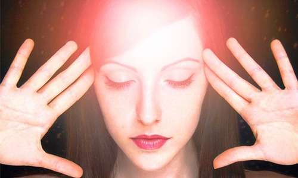

# Бодлоороо өөрийгөө эмчлэх арга

Дараах аргуудад, хүний анхаарлаа төвлөрүүлэх, төсөөлөн бодох, бодолдоо орох, уусах, мэдрэх чадварууд ихээхэн нөлөөлдөг. Оролдлого хэзээ ч талаар өнгөрдөггүй гэдэг. Та, өөрийн заяагдмал чадваруудын нэгээхэн хэсгийг нээж ашиглаж сурахаас гадна өөрийгөө эмчлэх гайхалтай аргыг эзэмших анхны алхамаа хийх юм.

**Толгой өвдөх үед.** Өөртөө тав тухтай байрлалаар сууж, зун цагийн хамгийн сайхан, аль болох байгалд ойр, салхинд гарсан үеийнхээ дурсамжуудаа дүрслэн бод. Тэр үед болсон бүх зүйлийг, горхины шаргих чимээ, шувуудын жиргээ, ургамал байгалийн үнэр, амтлаг шорлог, ер нь тэр үед мэдэрч байсан хамаг сайхан зүйлүүдээ аажмаар бага багаар мэдрэхийг хичээгээрэй. Анхаарлаа төвлөрүүлж, сатаарахгүй байхыг мөн хичээ. Хэсэгхэн хугацааны дараа толгой тань өвдөхөө больно. Гол нь сатаарахгүй байх.\
**Сэтгэлээр унаж гутрах үед.** Түнэр харанхуй ой дунд, зөвхөн та л мэдэх харгуйгаар олон хүмүүсийг аврахаар дагуулан явна гэж төсөөл. Та, тэдгээр хүмүүсийн итгэл найдварын гал гэдгээ мэдэр. Та тэрхүү галыг унтраах эрхгүй. \
**Хямралд автах үедээ.** Та, өөрийгөө зохиолч гэж бод. Хямралд хүргэсэн зүйлээ, номынхоо гол баатарт тохиолдсон зүйлийг бичсэн нэг хуудас болгон сэтгэлдээ буулгаж, эсвэл бичээд унш. Хөндлөнгийн хүнд тохиолдсон зүйл мэт авч үзэх нь тухайн асуудлыг олон талаас харах боломж өгч, шинэ шинэ санаа, гарцуудаа олж харж сэтгэл хөнгөрдөг. \
**Турахыг хүссэн үедээ.** Урд нь авахуулсан, өөртөө таалагддаг зургаа ил тавьж, түүнийгээ харан тэр үеэ төсөөл. Залуу, сайхан, эрч хүчтэй, аз жаргалтай байснаа аль болох тод томруунаар санаж, мэдрэхийг хичээ. Далд ухамсар, энэхүү төсөөллийн тань дагуу бие организмыг өөрчлөх чадвартай байдаг. \
**Бодлын хүчээр үрчлээс арилгах.** Бодлынхоо хүчээр, агаар, нарны гэрлийг ашиглан үрчлээсээс салж болно. Агаар болон нарны гэрлийг арьсны тань эд, эс ширхэг бүр шингээн авч, тэр чинээгээр татагдаж тэнийж байна гэж төсөөл. Гайхалтай үр дүнтэй. \
**Ханиад, томуу туссан үедээ,** мөнх цаст уулын оргил дээр гарч цэвэрхэн, хүйтэн агаарыг цээж дүүрэн авч байна гэж төсөөлөн, нүдээ аниад гүнзгий амьсгаа авч бай.
