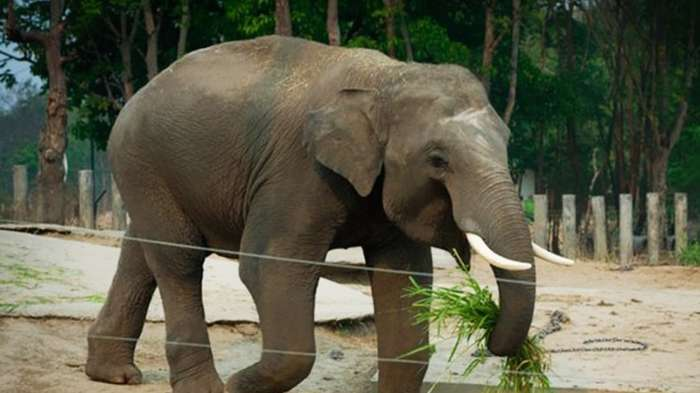

# Бодлын чөдөр

Нэгэн амьтны хүрээлэнд, нэг томоос том заан урд хөлнөөсөө нарийхан уяагаар аргамжуулчихсан хөдлөхгүй байхыг харсан хүн, энэ том заан ганцхан хөдлөхөд л тасрах уяанд баригдан зогсож байгааг нь гайхсандаа, амьтны хүрээлэнгийн ажилтанаас учирыг нь асуужээ. Тэр ажилтан, -Энэ зааныг бага байхад энэ уяагаар уядаг байсан. Тэгэхэд, тэр энэ уяагаа тасалж чаддаггүй байсан. Тэгээд, хэдийгээр өсч том болсон ч, энэ уяагаа, тэр үеийнх шигээ санаж, таслах оролдлого хийдэггүй юм, гэсэн бөгөөд өнөөх хүн, энэ аварга том амьтан, дуртай цагтаа суларч болох атал, анхнаас нь тархинд нь суулгасан, дасал болсон бодол нь түүнийг ийнхүү хүлж, насан туршид нь чөдөрлөх уяа болгосныг нь мэдэж ихэд гайхсан аж.

Магадгүй бид ч тэр, энэхүү зааны адил, ямар нэг юмыг хийх гээд чадаагүйгээ, хэзээ ч чадахгүйд тооцон өөрсдийн бодлын хайрцганд баглагдан, аливаа чадаагүй зүйлээ чадахгүйд тооцон итгэсээр явдаг юм биш биз?

