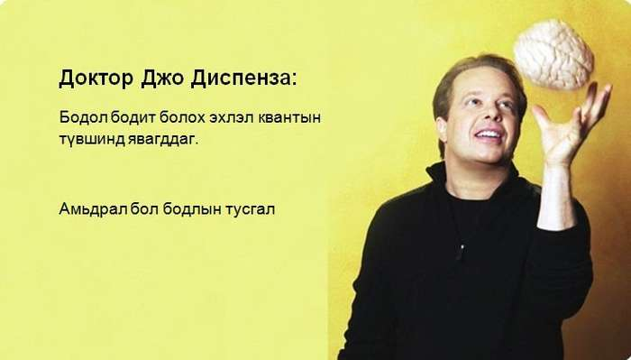

# Бодлын хүчээр эрүүлжих арга

Аливаа үйл явдал, тохиолдол, бодит болох үйлдэл нь, квантын түвшинд явагддаг болохыг доктор Джо Диспенза олон жилийн туршлага судалгааны үндсэн дээр баталжээ. Энэ нээлтийн гол цөм нь бидний тархи, бид бодож төсөөлж байна уу, эсвэл бодитоор өрнөж буй зүйлийг бодож байна уу, гэдгийг ялгадаггүй гэдгийг нотолсонд оршино.

Түүний энэ нээлт нь, өөрт нь тохиолдсон азгүй тохиолдлоос эхтэй бөгөөд, энэ нь, автын осолд орсных нь дараа, хөл дээрээ босох боломжтой болгохын тулд, нурууны бэртсэн үед нь, имплант суулган, “насан туршдаа өвдөлт зовиуртай байх” үр дагавартай, хагалгаа хийсэнтэй холбоотой аж. Тэрээр, энэ аймшигт дүгнэлтийг хүлээж авахгүй байхаар шийдэж, бодлын хүчний тусламжтай өөрийгөө эмчлэхээр шийдсэн нь үр дүнтэй болж, өвдөлт зовиургүй, явж чаддаг болсон бөгөөд бусад, өөртэй нь ижил төстэй байдалд орсон хүмүүсийг эмчилж эхэлснээр, хүний дотоод нөөц, бодлын хүчний агуу чанарыг харуулсан “Бид дохио хүлээж авах аа мэддэг” гэсэн, нэртэй баримтат кино хийж, дэлхий нийтэд алдаршжээ.

---

Түүний эмчилгээний арга нь, бодлыг эерэгжүүлэхээс эхэлдэг бөгөөд ягшмал, давтагдагддаг тархинд суусан бодлуудыг устгахад гол анхаарлаа хандуулдаг. Ж.нь: “хагалгаанд орсон бол бие муутай” “өвчин туссан бол эмчлэгдэх үү” “харвасан бол сааждаг эсвэл үхдэг” “зүрхний шигдээс авралгүй” “аваар ослоос эдгэсэн ч заавал юм үлддэг” гэх мэт сөрөг бодлуудаас салгахыг чухалчлан эмчилдэг байна.\
Ер нь, бидний эдгээр сөрөг муу, эргэлзээт бодлууд, тархины асар олон нейронуудад нөөцлөгдөн, суурилсан байдаг бөгөөд, бодлуудын давтамжаар байн байн идэвхжин, эрүүл мэнд, амьдралд сөргөөр нөлөөлдөг байна. Мөн энэ туршилтын үед, нэг хэсэг хүмүүсээр, хуруунуудаараа товчлуур дарах дасгал хийлгүүлж нөгөө хэсгээр нь, бодлоороо төсөөлж тэр товчлуурыг дарах даалгавар өгч тодорхой хугацааны дараа, хуруунуудыг нь шалгахад, механикаар дарсан хүмүүсийн хурууны үйл ажиллагаа 30%, бодлоороо дарсан хүмүүсийнх 22% сайжирч байсан байна. /8-хан хувийн зөрүү/ Бодлын хүчний нэг жижигхэн жишээ л гэхэд ийм байна.

Тиймээс бидний тархи, бодсон зүйлүүдийг маань татах нууцлаг хүчтэй ажээ. Мөн, өөр эх сурвалжуудад, телевиз мэдээллийн хэрэгслүүдээр авах мэдээллийг хүртэл эерэг байлгах, сонгох хэрэгтэйг сануулсаар байгаа билээ.
