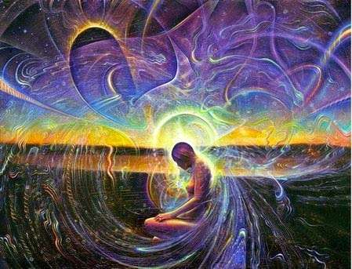

# Бодол санаа ба шидэт дохиур

Оноре де Бальзак, “Амьдралд тохиолдож буй бүх үйл явдлууд нь, бидний харж чаддаггүй, дэлхийн хамгийн агуу зохиолчийн бүтээл” гэж ярьдаг байжээ. Бид заримдаа, санаанд оромгүй сонин үйл явдлуудтай амьдралдаа таарч, оролцогч нь болж, тухайн үйл явдлын тайлагдашгүй учир шалтгааныг гайхсанаа бие биедээ ярьж хуваалцаж байх нь олонтаа байдаг ч үүнийгээ ердөө л тохиолдол гэж ойлгохыг хичээн өнгөрүүлдэг.

Гэтэл, энэ нь, бидний сэтгэлдээ бичсэн кино зохиолыг “амьдрал” гэдэг гарамгай найруулагч бүтээж байдгийн илрэл бөгөөд санамсаргүй үйл явдал амьдралд байхгүй гэдгийг заадаг. Бид, аз жаргалд тооцсон зүйлээ эрэлхийлэн “уулыг эргүүлэн, усыг гатлаад ч” олоогүй байтал, хожуу хойно, огт хүлээгээгүй байтал аз завшаан, аз жаргал амьсгаа давхацтал асгаран ирэх нь бий. Яг л, нууцлаг хөшигний цаанаас, хэн нэгэн, удирдаад байгаа юм шиг мэдрэмж төрүүлдэг. Ийм тохиолдолтой таараагүй хүн нэгээхэн ч үгүй болов уу. Огт бодоогүй гэнэтийн учрал, огт тооцоолоогүй аз завшаан, огт хүлээгээгүй таатай үйл явдал... эдгээр үйл явдлуудыг хэн бүтээнэ вэ? Үүнийг, шинжлэх ухааны түвшинд, оюун ухаан нь тархины үйлдэл, эсвэл биеэс гадуур оршино гэх мэт маргаан дагуулдаг нууцыг нь одоо ч тайлж чадаагүй, оюун ухааны үйлдэл болох бодол санаа гэж үзэж болно. Бидний бодол санаа шидэт дохиур мэт, эерэг сайн бодол хүслүүд маань сэтгэлд эргэлдэн хураагдсаар Дээд оюун болж, бодлын эрчимээс шалтгаалсан цаг хугацаанд таатай үйл явдлууд болон ирдэг байна. Бидний амьдралын “агуу зохиолч” нь бид өөрсдөө бөгөөд амьдрал маань бидний бодол санааны толин дох тусгал юм. Тиймээс, сэтгэлээ цэвэр, бодлоо тунгалаг байлгахыг эрмэлзэн, “Санаа зөв бол заяа зөв”, гэсэн зуун зууныг дамжин ирсэн сургаал үгийг эрхэмлүүштэй. Санамсаргүй тохиолдол, үйл явдал гэж үгүй. Бодолдоо тарьсан зүйлээ амьдралдаа хурааж авна гэдгийг үргэлж сана.
