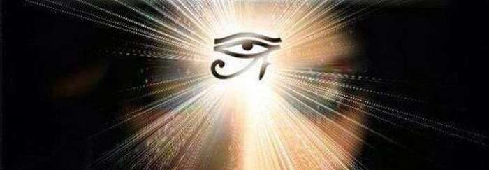
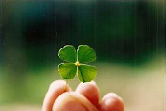

# Бодол санаа хаашаа чиглэнэ, энерги тийш төвлөрдөг

Хүн үр хүүхэддээ санаа зовж, байнга бодох нь, тэдний энергийг өөрийнхөө санаа зовинолоор тэжээж, азгүйтэлд хүргэдэг бөгөөд зам мөр, аливааг сонгох шийдвэрт нь саад учируулж байдаг гэнэ. Мөн байнгын эерэг сайхнаар бодох нь ч зөв биш, учир нь бодол бол хүчтэй энерги учираас хувь хүний амьдралын зам, энергийн талбайд хөндлөнгөөс оролцох нь таагүй гэж үздэг байна.

Ялангуяа, эцэг эхчүүдийн үр хүүхдийнхээ тухай бодох үеийн, “Тэр, ингэснээс энэ нь дээр”, “Түүний оронд тэгээсэй” гэх маягийн өөрийн хувийн туршлага дээр суурилсан бодлууд үр хүүхдийнх нь ажил үйлсийг хааж байдаг. Сайныг хүссэн эерэг энергийн бодлууд, “Энэ бодол санаа минь түүнд өөрчилөлт оруулах ёстой” гэсэн бодлоор илгээгдэж болохгүй. Хэр их бодож, түүндээ автна, тэр чинээгээр тэрхүү бодол чиглэгдсэн хүний орон зай, амьдралын төлөвлөгөөнд нөлөөлдөг. Энэ бол тухайн хүний хувийн орон зайд хөндлөнгөөс оролцож буй таагүй, саад учируулах үйлдэл юм. Хэн нэгэн хүн, өөр хүний тухай таагүй бодол байнга тээж, муугаар бодох, мөн тэр хүн нь мөн хариу дургүй бодол тээх нь аль алиных нь энергийн талбай өөрчилөгдөхөд хүргэж, бие бие рүүгээ тавьсан сум бие биенээ онож цоолох адил амьдралд нөлөөлдөг гэнэ. Харин тэрхүү өөрт нь чиглэсэн муу бодол тээж буй хүнийг ойшоохгүй, хариуд нь муу бодол болгоомжлол тээхгүй байх нь л энерги, орон зайгаа хамгаалах хамгийн үр дүнтэй арга гэдэг. Учир нь, таагүй бодлоор энергиэ сулруулахгүй байснаар, тухайн таагүй бодол тээж байгаа хүн муу бодлоо өөртөө буцааж хүлээж авах нөхцөлийг бүрдүүлдэг байна. Бусдын талаар муугаар бодож буй хүн, өөрийн хайран энергиэ бусдад өгч байдаг. Хариуд нь муугаар бодсон хүн, муу бодлыг нь энергитэй нь хамт авдаг гэх ба харин дургүйлхэхгүй, тоохгүй байгаа хүн, илгээж буй муу бодлуудынх нь зөвхөн энергийг нь авч байдаг байна. “Идүүлсэн бут цэцэглэж, идсэн эрүү хувхайрна” гэсэн үг үүнийг илэрхийлдэг. Хэрэв, атаа жөтөө ихтэй, өндөр давтамжит энергитэй хүн бусад хүнд муу зүйлийг хүсч, атаа жөтөө тээвэл, эргэж, учир шалтгаан үр дагаврын хуулиар, ухамсаргүй бодол санааныхаа төлөө хатуу шийтгэл амссаар байдаг бөгөөд хамгийн аймшигтай нь, орчин тойрныхоо хүмүүсээр дамжуулан хувиа хүртэж эхэлдэг. Өөрөөр хэлвэл, тэр хэдийгээр ойр дотныхондоо сайнаар хандах хэдий ч, тэдний хандлага, харьцааг өөрийн сөрөг энерги, мөн бодлын муу үйлээрээ өөрчилж өөрөө зовж байдаг. Хүн, өөрийн амьдралыг өөрөө л зохионо. Тэр, хайр энэрлийг хэр их өгч чадаж байна, төдийчинээ ихээр хайрыг бусдаас авна. Хүнд яаж хандна, түүнийгээ л буцааж авна. Хань ижлийнхээ талаар юу бодож байна, тэр л чанарыг нь бодол энергээрээ тэжээж тэтгэдэг. Телевиз үзэж байхад энерги хаашаа явдаг гэж бодно? Үзэж буй таатай, танил хөтлөгч, жүжигчин, нэртэй хүмүүс рүү энергээ илгээж, тэд мянга мянган хүмүүсийн энергээр цэнэглэгдэж байдаг. Одуудын амжилт бол сая сая хүмүүсийн хайр, таашаалтай холбоотой юм. Харин хэн нэгний тухай таагүй бодол тээж, атаа жөтөө өвөрлөсөн хүн, өдрөөс өдөрт тэрхүү хүндээ өөрийн үнэлшгүй энергээ өгсөөр байдаг байна.
