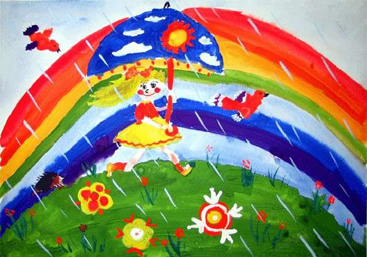

# Бодол төрүүлсэн зөвлөгөө

Хүмүүс, ялангуяа эмэгтэйчүүд, үр хүүхдүүдээ бөөцийлөн, хайр халамжаар булж, тэднийхээ төлөө амьдарч, тэднийгээ амьдралынхаа утга учир болгон хувиргах нь олонтаа. Гэтэл, энэ ээжийн бодлыг мөн, авч үзүүштэй юм шиг санагдах юм...

-Хүүхдийнхээ төлөө амьдрах бодлоо орхиоч. Гуйя. Амьдралын өөр утга учир, эцэг эх байх утга учираа арай өөрөөр хараач. Бидний бяцхан хөвгүүд, охид маань энэ хорвоог биеэ даан туулах чадварыг олгоход илүү анхаараач. Тэднийгээ, тэдний төлөө хийх “сайн үйлсийн”-хээ, золиос, барьцаа бүү болгооч. Хүүхдийн хувьд, бидний амьдралын утга учир болох нь, тэдэнд тун хэцүү байдаг. Хэзээ нэгэн цагт, амьсгалах агааргүй болох өрөө рүү чихэх мэт үйлдэл гаргахаа больцгооё. Тэд эхний үед, ийнхүү амьдрах ёстой нь зүйн хэрэг, харин дараа нь, хайр халамжид маань боогдож эхэлдэг. Харин, ханиа хайрлаж халамжилж байхыг сануулъя, Үр хүүхэд маань өсч том болоход, хань чинь л хажууд чинь үлднэ. Энэхүү бие биеэ хайрласан, энэ л харьцаа чинь үр хүүхдэд чинь, гэр бүл, үр хүүхэдтэй болоход нь, үлгэр болохоор байхад л анхаар. Үр хүүхэддээ, биеэ даан амьсгалах, амьдрах боломжийг олго. Ийм тохиолдолд, тэд өсч, хөгжиж, сонголтоо хийж чаддаг болдог. Хэт халамжилснаар, биеэ даах чадваргүй дорой нэгэн болдог. Эцэг эх бидний үүрэг нь, тэднийгээ цаг тухайд нь усалж, нарыг нь хаахгүй, хортон муугаас хамгаалдаг цэцэгчин шиг байхад оршино. Хүүхэд маань цаашдаа, цэцэг шиг, Бурханаас өгөгдсөн хамаг сайхнаа гайхуулан, өөрөөрөө амьдрах юм.
