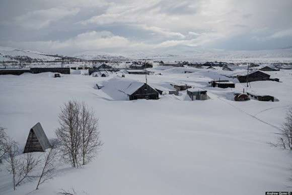

# Бохир зүйлийг цэвэрлэх ичгүүр биш

1940-д оны үед, алс буйд газрын, байнгын үйл ажиллагаатай нэгэн геологийн баазын нийтийн жорлон харахын аргагүй заваан байдаг байв. Үүндээ дасчихсан байсан бөгөөд, хэрэв энэ тохиолдол болоогүй байсан бол анхааралд өртөхгүй мартагдах байсан биз ээ. Энэ баазад ажиллахаар ирж буй, хэсэг хүмүүсийн бүрэлдэхүүнд, эртний тайжийн удмын нэгэн ажилтан ирсэн бөгөөд, тэнд байсан геологичид хоорондоо, -“За, бид нар ч яах вэ! Хөөрхий язгууртан, ноёнтон, энэ жорлонг яаж хүлээж авах болдоо” хэмээн хөхрөлдөн шоолцгоож байв. Гэтэл, өнөөх ”Язгууртан” маань ирмэгцээ, хувинтай ус, шалны алчуур авч очоод цэмцийтэл цэвэрлэж, бүхнийг алмайруулжээ. Түүний энэ үйлдэл, жинхэнэ язгууртны, бохир зүйлийг байлгах ёсгүй, бохирыг цэвэрлэх нь ичгүүр биш, харин бохир зүйл дунд амьдрах нь ичгүүр юм гэсэн уламжлалт хүмүүжлийг нь харуулсан үйлдэл болж, тэднийг юм бодоход хүргэсэн гэдэг.

