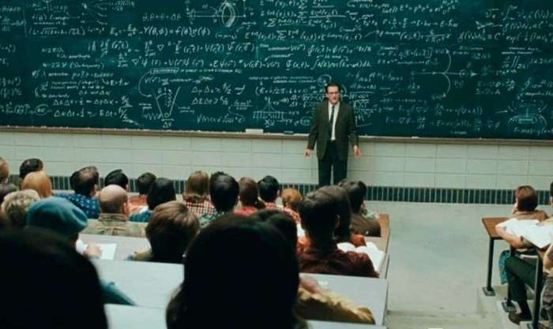
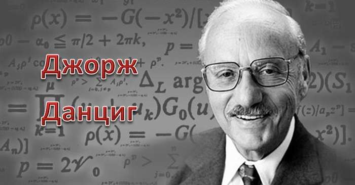

# Болдоггүй зүйл гэж үгүй

Зарим зүйлс огт бүтэшгүй зүйл гэж бодож байтал болж байдаг асуудал ховорхон ч гэлээ тааралдаагүй хүн байдаггүй. Амьдрал өөрөө маш зөрчилдөөнтэй зүйл. Амьдрал дах олон зүйлс хүний оюун ухааны бүтээл байхаас гадна бидний эргэн тойрондох зүйлс ч мөн бидний бүтээл байдаг. “Болшгүй зүйлийг шийдэж болдог”- үүнд итгэж чаддаг болох нь, амьдралын нэгэн том сургууль юм. Бид амьдралд, орчныхоо ямар нэг хайрцаг хэмжээнд баригдан илүү өргөн сэтгэх чадвараа алдаж байдаг. Дараах түүх амьдралыг арай өөрөөр харах, өвөрмөц сэтгэлгээг хөгжүүлэхэд тань түлхэц болох болов уу гэж найднам.

Математикч Джордж Данцигийн оюутан ахуй үед энэ зүйл тохиолджээ. Джордж маш идэвхитэй, хичээнгүй оюутан байсан бөгөөд шөнө дөл болтол хичээл хийж суух нь ердийн зүйл байв. Тэр нэг удаа оройтож унтсанаас болж, профессор Нейманы лекцэнд 20-д минут хоцорч иржээ. Ормогц самбар дээр бичээстэй байсан хоёр бодлогыг гэрийн даалгавар гэж бодон сандран хуулж аваад хичээлийн дараа бодож эхэлсэн бөгөөд нилээд хэдэн цаг сууж бодоод, маргааш нь профессортоо өгчээ. Гэтэл хэд хоногийн дараа профессор нь, өглөөний 6 цагт гэрт нь орж ирэхэд Джордж маш их гайхсан байна. Тэгтэл тэр, математикийн огт шийдэл нь гардаггүй бодлогуудыг лекцнээс хоцорсон учраас бодлогын тухай профессорын ярьсан зүйлийг сонсоогүй, гэрийн даалгавар гэж бодоод хоёуланг нь бодчихсон аж. Тэр, үе үеийн математикчидын бодох гэж зовсон, бүр Эйнштейн ч бодож чадаагүй бодлогыг хоёр цагийн дотор боджээ. Энэ нь Джордж уг бодлогуудыг бодож болохгүй гэдэгт хязгаарлагдаагүй, зүгээр л энэ тухай мэдэхгүй, бодож болохгүй байгаа гэдгийг мэдээгүйгээс л бодож чаджээ.

Иймэрхүү зүйлс хорвоо ертөнц дээр үргэлж болж байдаг. Тиймээс, “Болохгүй зүйл гэж үгүй”, “гарцгүй зүйл мөн үгүй” эдгээр үгсийг дотроо өвөрлөн, ихийг бүтээх хүсэл зорилго, бүтээлч үйлсэд тань амжилт хүсье.
