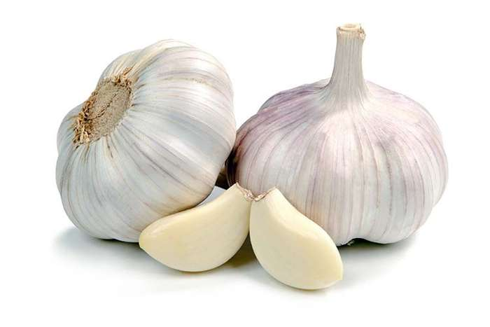
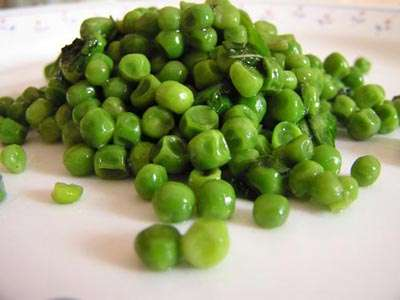

# Болгоомжлох  ёстой хятадын хүнснүүд

Хятад улс нь дэлхийн зах зээлд, сая тэр бумаар хэмжигдэх олон төрлийн бараа бүтээгдэхүүн гаргадаг. Эдгээр дунд шаардлага хангаагүй бүтээгдэхүүнүүд байдгийг дэлхий нийтээр ярьдаг. Үүнээс, хүнсний бүтээгдэхүүнд илүү анхаарах ёстой, тиймээс илүү анхаарч, шалгаж хэрэглэх хятадын хүнснүүдийг танилцуулъя:

Сармис. Дэлхий нийтийн сармисны хэрэглээний 80%-г хятад нийлүүлдэг. Эрдэмтэд, хятадын сармисыг пестицид, хүнд металлууд болон эрүүл мэндэд хортой зүйлс агуулдаг гэж зарлаад байгаа аж. Өөр бусад улсруу ачаалахаас өмнө хлороор цацдаг гэнэ. Энэ нь хадгалах хугацааг уртасгаж өнгө үзэмжийг нь муутгадаггүй байна. Тиймээс аль болох хятад сармис хэрэглэхгүй байхыг зөвлөж байна.\
Хар нунтаг перец. Хамгийн өргөн хэрэглэгддэг хоол амтлагч, тиймээс өөрийнх нь өртгийг хямдруулж ашгаа өсгөхийн тулд будсан крахмал эсвэл нунтаг шохой хийдэг байна\
Хатаасан мөөг. Агаарлын бохирдлын тундаснаас болж ихэнхи мөөг хордсон байдаг. Бээжингийн ойролцоох таримал мөөгнөөс өөрсдөө олноороо хордож байсан тохиолдол байдаг.\
Загас. Загас үржүүлэгтээ өндөр дозын өсөлтийн гормон, хүчтэй антибиотик хэрэглэдэг. Мөн загас үржүүлгийн усан сан нь жижиг байдгаас бохирдолт ихтэй усанд үржүүлснээс хортой гэж үздэг аж.\
Хятад байцаа. Ачилт тээвэрлэлтийн явцад өнгө үзэмжийг нь муутгахгүйн тулд формальдегид гэх бодисоор шүршдэг байна. Энэ бодис хоол боловсруулах эрхтэний үйл ажиллагаа, арьсны эрүүл байдалд хортой нөлөөтэй.\
Ногоон вандуй. 2005 онд анх ногоон вандуйг хуурамчаар хийж эхэлсэн гэдэг. Үүнийг шар буурцаг, ногоон хүнсний будаг, метабисульфитаар хийдэг. Метасульфит нь хүнсэнд хориотой бодис бөгөөд хорт хавдар, бодисын солилцооны өөрчлөтөд хүргэх муу үр дагавартай. Ийм вандуй чанахад удаан болдог ба чанасан ус нь цайвар ногоон өнгөтэй болдог.\
Цагаан будаа. Хиймэл цагаан будаа хэрэглэх нь “гялгар уут” идэхтэй адил гэсэн үг. Ялгах аргыг урдны мэдээлэлд дэлгэрэнгүй өгсөн билээ. /sugar.mn/

Хүнсний хэрэглээндээ гойд анхаарах ёстой цаг үед бид аж төрж байна. Аль болох хүнсний зүйлийг, шалгаж , маш анхааралтай хэрэглэхийг зөвлөж байна
