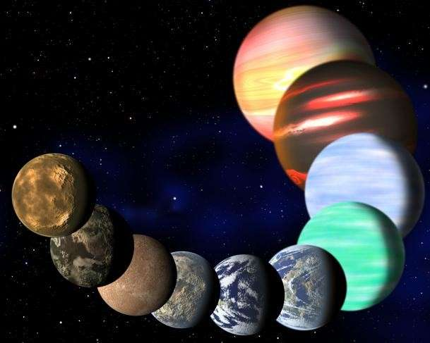

# Боломж ба аз завшаан

Амьдрал бидэнд цаг үргэлж, маш богино хугацаанд шийдвэрлэх хэрэгтэй,ердийн амьдралын хүрээнээс хальсан, асар түргэнээр ойж сэтгэхийг шаардсан шалгуураар, боломж, аз завшааныг өгч байдаг

Харамсалтай нь бид, түүнийг анзаарахгүй байдгаас гадна, хэвшмэл зан чанартаа баригдан түүнийг барьж авч чадахгүй алдаж байдаг. Бид, аливааг, тал талаас нь бодох, үр дагаврыг нь тооцоолох аргад насан туршдаа суралцаж байдаг тул азтай тохиолдлыг бодож тооцсоор байгаад алдсанаа мэдэж шогширон харамсдаг хүмүүс. Боломж, завшааны портал, маш богино хугацаагаар нээгддэг бөгөөд энэ үед хүн шийдэж чадахгүй, бодож цэгнэн тээнэгэлзэх хооронд, үүд нь хаагдаж дараагийнхийг хүлээх л үлддэг ажээ. Ихэнхи хүмүүсийн амьдрал ийм маягаар өнгөрдөг. Зоригтой шийдэмгий хүмүүс, харин аз завшаан, боломжийг ашиглах чадвартай байдгаас амжилтад хүрэх нь илүү байдаг аж. Харин, амьдралдаа алдсан боломжууд, завшаануудаа, тэр бүр хүн анзаардаггүй, мэдэхгүй өнгөрүүлдэг ажээ.\
...Хөдлөхөд нь, хэдхэн минут үлдсэн галт тэрэгний цонхны цаана зогсох, бүх насаараа эрж хайсан юм шиг, харцаараа ойлголцох, нэг л дотно хамаг бүхнийг мартуулсан царай..! хамгийн түрүүнд, галт тэрэг рүү үсэрч орох сэтгэл үүснэ, энэ үед, яагаад?... юу ч болоо билээ?...ярилцахгүй бол яана?...бодсоноос минь өөр бол яана?...хайр биш байх аа?...таалагдахгүй бол яана?...гэх мэт өөр бодлууд толгойнд эргэлдэн хэвшмэл байдалдаа дийлдэн, ухарна. Хүлээсэн, дуудсан харц..! дахиад л, уулзах хүсэл төрнө. Энэ үед, галт тэрэг зугуухан хөдөллөө. Үсрээд орчих боломжтой байна...гэсэн бодол толгойд, мөн, болиоч, солиотой юм уу!...гэсэн бодол. Галт тэрэг хурдаа нэмэн “түүнийг” аван одлоо. -Сонин юм, дахиж таарах болов уу...гэсэн хөнгөн гуниг тээн алхана. Тэр, өмнө нь нээгдсэн ямар үнэтэй завшааныг алдсанаа мэдээгүй. Хайр бялхсан мөнхийн хайр байсныг мэдээгүй, аваагүй...
