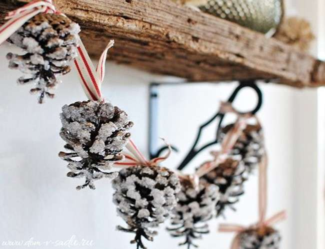
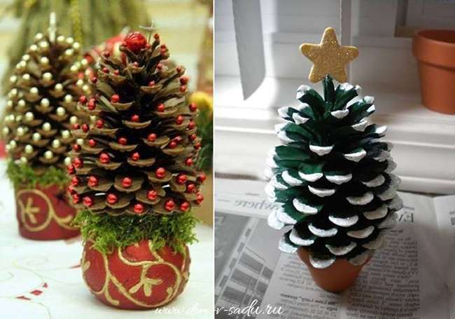
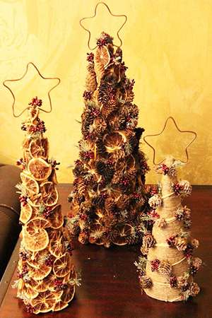
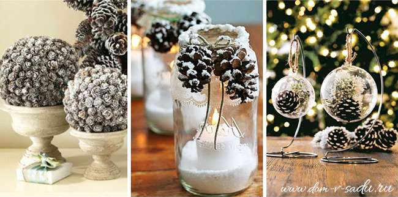

# Боргоцойгоор шинэ жилээ чимэглэе

Шинэ жил болоход 21-хэн хоног үлдлээ. Шинэ жил болтол “настр”-аа сэргээж, өөрсдийн гараар, сэтгэлээ шингээсэн, бяцхан, хөөрхөн гацуурууд урлацгаая. Өөрсдийн хийсэн зүйл үргэлж баяр бахархал төрүүлдэг. Тийм биз дээ? Зарлагагүй, хялбар гацуурхануудаа бэлгэнд өгвөл бүр гоё. Маргааш ууланд явцгааж боргоцой түүгээд л болоо. Хэрэв ууланд боргоцой түүж буй хүн харвал тэр чинь би, бид нар шүү! Ингээд боргоцойгоор, баяр дээр баяр хөөр нэмэх, бяцхан хөөрхөн гацуурхан, хөөрхөн чимэглэлүүдийг хийх аргуудыг танилцуулъя.

-Хатсан боргоцой\
-Жижиг сав /боргоцойны диаметрт таарахаар/ нэг удаагийн аяга, кексний аяга гэх мэт\
-Цавуу\
-Усан будаг\
-Нунтаг саа\
Боргоцойгоо будаад, саагаа түрхэж жижиг савандаа суулгана. Ямар өнгө, ямархуу байхыг танд өөрт чинь даалгая. Таны чөлөөтэй төсөөлөл, хийсвэр сэтгэхүй тань заагаад өгнө. Хэрэв олон боргоцойгоор хийх гэж байгаа бол картоноор конус хийгээд түүндээ наана. Бүр гоё болгоё гэвэл, хатаасан жимс, зүсэж хатаасан мандарин, ер нь гарын дорх юугаар ч чимэглэж болохоор байгаа биз?

---

Мөн боргоцойгоо, дангаар нь давсаар бүрж чимэглэл, шинэ жилийг билэгдсэн сувенир хийж болно. Эдгээр нь урт удаан нүд баясган, зун болсон байхад ч өвлийн дурсамж болон үлддэг.\
Боргоцойндоо, ПВА /тарган цавуу/цавуу түрхээд, давсаа цацан, үсний лакаар шүршиж бэхжүүлээд бэлэн болно.

---

