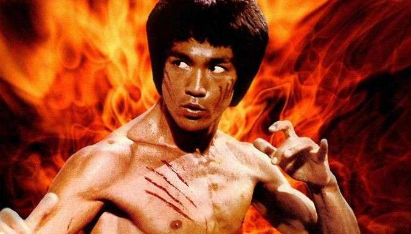
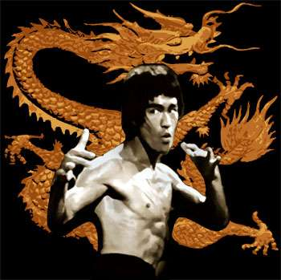

# Брюс Лигийн амжилтын нууцыг тайлах захидлууд

Брюс Ли 32 нас хүрэхдээ, хүссэн бүхэндээ хүрч чадсан байсан гэдэг. 1969 онд, туранхайдуу биетэй энгийн нэгэн ази залуу, 20-р зууны хамгийн алдарт хүмүүсийн тоонд орно гэж хэний ч толгойд ороогүй байлаа. Үүнийг зөвхөн түүнээс өөр хэн ч мэдэхгүй байв. Тэр жил тэр, өөрөө өөртөө захидал маягаар зорилгоо бичсэн нь хадгалагдан үлджээ.

#### Миний гол зорилго:

Би Брюс Ли, Америкийн нэгдсэн улсын хамгийн өндөр орлоготой алдартай од болно. Би хамгийн нэртэй найруулагчидын бүхнийг байлдан дагуулсан олон киноны гол дүрд тоглох болно. Би, 1970 оноос эхлэн, дэлхийд нэрд гарна, харин 1980 он гэхэд надад 10 000 000 доллар хуримтлагдсан байх болно. Би, хүссэнээрээ амьдарч, дотоод сэтгэлийн зохилдлогоонд хүрч, аз жаргалтай байх болно\
Брюс Ли *1969 оны 1 сар*\
Дөрвөн жилийн дараа тэрээр, хорвоогийн мөнх бусыг үзүүлсэн бөгөөд тэр, энэ дөрвөн жилийн хугацаанд, бичиж төлөвлөж байснаасаа хэтэрсэн асар их амжилтад хүрч, зодооны урлаг, кино урлагийн түүхийг өөрчилж чадсан алдартай дэлхийн од болсон байлаа. Брюсийн бичсэн зорилгыг уншихад, өөртөө итгэх итгэлээр нэвчсэн байгаа нь мэдрэгддэг. Энэхүү асар их өөртөө итгэх итгэл түүнд хаанаас, хэрхэн, яаж бий болов оо? Энэ асуултын хариултыг бид, хэзээ ч олж мэдэхгүй байж болох юм. Гэхдээ, түүний захидлуудын цуглуулга, “Луугийн захидлууд”, “Гайхамшигт бодол санаа” номуудаас уншихад, хариултынхаа заримыг ухаж ойлгож болно. Нас барахаасаа 10 жилийн өмнө, Вашингтоны Их сургуулийн оюутан байхдаа, 21 настайдаа бичсэн нэгэн захидлыг нь уншицгаая.\
Хайрт Перл\
Энэ захидлыг ойлгоход хэцүү байх болов уу. Энэ бол миний мөрөөдөл, бодол санааны илрэл, миний амьдралын хэв маяг бөгөөд бүхий л мэдэрч байгаа зүйлсээ бичиж илэрхийлэхэд хэцүү байгаа учраас нэг л тодорхой гарч өгөхгүй нь ээ. Гэсэн ч, би танд бичихээр, мэдэгдэхээр шийдээд бичиж сууна. Би, аль болох ойлгомжтой бичихийг хичээнэ. Та, захидлыг минь уншиж дуусахаасаа өмнө яаран дүгнэлт хийхгүй гэдэгт найдъя.\
**Хүн, сайхан амьдрах хоёр арга байдаг: нэгд- хүнд хүчир, хар ажилын үр дүн, харин хоёр дох нь- төсөөллийн үр дүн /мөн л ажиллах, зүтгэхийг шаарддаг/.** Хөдөлмөр ба ариглан хэмнэлт нь, мэдлэг туршлага, нэр хүндэд хүргэнэ. Харин элбэг хангалуун байдал буюу эд баялаг нь, хүний, урд нь хэний ч бодоогүй зүйлийг олж бодож сэтгэх чадварын шагнал болдог гэж бодож байна. Санаа, энэхүү санааг л Америк эрж хайж байна. Санаанууд л Америкийг ийм болгосон. Нэг сайхан санаа л, хүнийг, хэн байхыг хүсч байгаад нь хүргэж чадна. Миний амьдралын нэгэн чухал хэсэг нь кунг-фу. Энэ урлаг намайг өөрчилж, миний зан төрх, бодол санаанд их хүчтэй нөлөөлдөг. Миний хувьд кунг-фу, биеийн тамирын дасгал, оюуныг минь хөгжүүлэх хэлбэр, өөрийгөө хамгаалах арга, амьдралын минь хэв маяг юм. Кунг-фу нь, зодооны урлагуудын хамгийн шилдэг нь бөгөөд одоогийн байдлаар, Америкт, кунг-фугийн суурь болдог дзюдо, каратэ л дэлгэрч хөгжиж байна. Харин кунг-фугийн талаар хэн ч мэдэхгүй, тиймээс энэ урлагийн мэдлэг туршлагатай багш, зааварлагч, дасгалжуулагчид байхгүй байгаа. Би, олон жилийн хүч хөдөлмөрөө энэ урлагт зориулснаар анхны багш нь болно гэдэгтээ итгэлтэй байгаа. Гэхдээ, арга барил, мэх, зан чанараа төгс болгоход их хугацаа орох нь гарцаагүй. Гэсэн ч би, өөртөө, кунг-фугийн анхны сургууль, ирээдүйд бүх америкаар салбарлан ажиллах салбарууд бүхий институтыг үүсгэн байгуулах зорилго тавьж байна. /энэ ажиллагаанд 10-15 жил зарцуулагдна/ **Миний зорилго бол их мөнгө олохдоо биш юм шүү.** Надад үүнийг эхлүүлэх олон сэдлүүд байгаа. Үүнд, хятадын энэхүү агуу урлагийг дэлхий дахинд таниулахыг хүсч байна. Би хүмүүст аливааг сургах, тэдэнд туслах дуртай. Би гэр бүлээ тэтгэх, мөн мөнгө төгрөгөөр хангахыг хүсч байна. Надад, ямар нэг зүйлийг бүтээх, байгуулах таалагддаг. Хамгийн сүүлийн ганц гол зүйл нь, кунг-фу миний бие сэтгэлийн нэгээхэн хэсэг нь юм. **Би, миний бодол санаа зөв гэдгийг мэддэг. Тиймээс би сайн үр дүнд хүрнэ гэдэгтээ бүрэн итгэлтэй байна. Би шагнал, амжилтыг хүссэндээ биш, харин тэр бүхэнд хүргэх механизмыг ажиллуулахыг, хөдөлгөхийг хүсч байна. Миний зүтгэл нь, миний амжилт, шагналын хэмжээс болох юм.** Доктор Чарльз П.Стеймецээс, насан өөд болохынх нь өмнө, **-“шинжлэх ухааны ямар салбар ойрын 25 жилд хамгийн их хөгжил дэвшилд хүрэх бол?”** гэж асуухад, тэрээр, **-“оюуны хөгжил, ухааралыг л дэвшилд хүргэхсэн”** гэж хариулсан байдаг. **Хүн, өөрийн доторхи оюун сэтгэхүйг ухаарч, түүний агуу их хүчийг ашиглаж чаддаг болвол, шинжлэх ухаан, бизнес, амьдралын бүхий л салбарт төсөөлшгүй дэвшилд хүрч чадна. Тэрхүү бүтээлч оюуны хүч миний дотор байгааг би мэдэрч байна. Энэ хүч нь, итгэл найдвар, алдар нэр хүсэх, итгэл хайрлах, шийдэмгий байдал, урьдчилан харсан төлөвлөгөө мөрдөх зэргээс хамаагүй хүчтэй бөгөөд энэ бүгдийг нийлүүлсэн нэгэн агуу цогц юм.** Миний тархи, гарт минь буй ноёрхолын хүчийг дуудаж байна. **Яг одоо би, өөрийн бодол санаандаа ирээдүйгээ төсөөлж чадна, би урьдчилан харж байна.** Би, мөрөөдөж байна /бодит мөрөөдөгчид хэзээ ч бууж өгдөггүй/. Одоо надад, зоорийн давхарын бяцхан өрөө л байна, гэвч, би, хамгийн өндөр, бүрэн төсөөлөлдөө автах үедээ, оюун ухааныхаа уран зургийн хавтгайд зурагдсан, тав-зургаан давхар, тансаг барилга бүхий, америкаар тархсан олон салбаруудтай Кунг-фугийн ордонг харсан. Намайг зогсоох хэцүү. Би, бүх саад бэрхшээл, азгүйтэлийг давж, “боломжгүй” зорилгууддаа хүрэх юм. Бурхан юмуу мэдэхгүй би энэхүү агуу, гуйвшгүй хүч, энэхүү хөдөлгөөнийг мэдэрч байна. Зураглан бичихийн аргагүй, юутай ч зүйрлэшгүй мэдрэмжид эзлэгдээд байна. Энэ нь, нэг төрлийн итгэлтэй сүлэлдсэн хүчтэй сэтгэл хөдлөл юм шиг гэхдээ хамаагүй хүчтэй зүйл. **Миний хамгийн их хүсэл, төлөвлөгөө, зорилго бол амьдралын жинхэнэ утга учирыг олох, мөн сэтгэлийн амар амгаланг олох асуудал.** Үүнд минь, даосизм, дзений сургаалууд үнэтэй хувь нэмэр оруулна гэж бодож байна. Магад, хүмүүс намайг амжилтаа хэтрүүлэн харлаа гэх байх. Гэхдээ тийм биш. **Миний хүсэл зориг мэдлэгээс минь үүдэлтэй, тиймээс би үүнийг хийж чадна. Би зүгээр өөрөөрөө байх л хэрэгтэй, мөн ухамсарт минь айдас, эргэлзээ алга. Перл, амжилт нь, амжилтаа ухамсартаа суулгасан хүнд л ирдэг. Хэн ч, ямар нэг зүйлд төвлөрөхгүйгээр, түүнийг авч чадахгүй. Сайн сайхныг хүсье. Брюс.**
