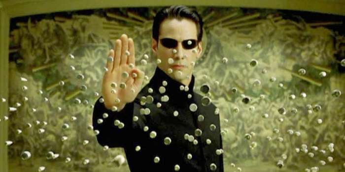
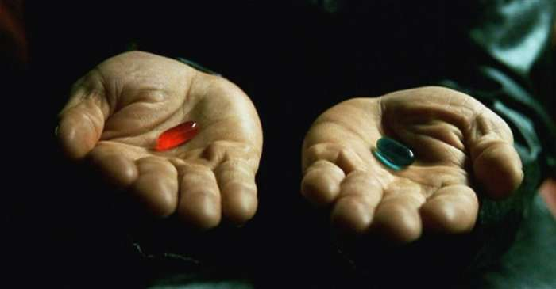

# Буддын шашинт, Голливудын од Киану Ривз амьдралыг яагаад үзэн яддаг вэ?

Тэрээр би, шударга ёс, итгэл үнэмшил, нандин бүхэн үгүй болж буйд, эр нөхрүүд нь эхнэрийнхээ ил задгай “завхай эм” мэт хувцаслалтыг хүлээн зөвшөөрч, нандигнах зүйлгүй болсонд, хундага тулган Бурханы төлөө уудагт, албан тушаалтай хүмүүс, хүмүүсийг дорд үздэгт, даруу занг дутагдал мэт үздэгт, залуус эх эцгийнхээ мөнгө төгрөгөөр зугаа цэнгэл хөөн, охид тэдэнд дурладагт, хүмүүс эр эм нь ялгарахаа больж, үүнийгээ “Эрх чөлөө” хэмээн тунхагладагт дургүй, үзэн яддаг гэжээ. Тэр маш даруухан амьдардаг бөгөөд Голливуудын одуудаас, ганцаараа тансаг орд харшгүй ажээ. Нэг төрсөн өдрөө, замын хажуугийн тавцан дээр суун, дэргэдүүр өнгөрөгсдийг кексээр дайлж, элдвийг хүүрнэн өнгөрүүлсэн гэнэ. Ийнхүү Matrix киноны дүрээр бүхний танил болсон, нэгэн алдартан сайхан жүжигчин, хорвоогийн сайн мууг ялгуулахаар сайн үгсийг олонд хүртээхээр амьдарч явна.
