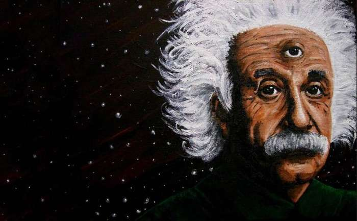

# “Бурхан байдаг” – Альберт Эйнштейн

Нэгэн дээд сургуулийн профессор, оюутнуудаасаа “Бурхан гэж байдаг уу? Бурхан энэ дэлхий ертөнц дээрх бүх зүйлсийг бүтээсэн үү?” гэж асуухад, нэг оюутан итгэлтэйгээр, –“ Тийм ээ, ноёнтон, байдаг, Тэр энэ бүхнийг бүтээсэн” гэж хариулахад, профессор, -“хэрэв Бурхан энэ бүхнийг бүтээсэн юм бол, яагаад бас муу зүйлсийг бий болгосон юм? Хүний хийж буй зүйл хүнийг тодорхойлдог, түүнтэй адил, үүнийг бүтээсэн болохоор, Бурхан өөрөө муу зүйл юм” гэхэд, өнөөх оюутан чимээгүй болов. Профессор, баяртайгаар, -“би Бурхан байхгүйг дахин нотолж чадлаа” гэж хэлэх үед өөр нэг оюутан босч, -“ноён профессор! Хүйтэн гэж байдаг уу?” гэж асуув. Профессор –“байдаг, чи даарч үзээгүй гэж үү?” гэж асуухад, бусад оюутнууд, нөгөө оюутныг шоолон инээлдэж байв. Нөгөө оюутан үргэлжлүүлэн, -“физикийн хуулиар бол, яг үнэндээ хүйтэн гэж байдаггүй. Хүйтэн гэдгийг дулаан байгаа үгүйгээр хэмждэг. Хүн ба эд зүйлсийг түүнд энерги байгаа эсэх мөн дамжуулдаг эсэхээр л судалж болно. Фарингейтын -460 градус, абсолют 0 гардус нь дулаан огт байхгүй байгааг заах бөгөөд бүх матери энэ төлөвт идэвхигүй, энэ температурт хариу үйлчлэл үзүүлэхгүй байдалд орсон байдаг. Тиймээс хүйтэн гэж байхгүй, бид дулаан байхгүй байна гэдгийг тодорхойлохын тулд энэ үгийг зохиосон. Ноён профессороо! Таныхаар харанхуй гэж бий юү?” гэж үргэлжлүүлэн асуув. Профессор, -“ тиймээ, байдаг” гэхэд, -“ ноёнтоон, та бас буруу ярьж байна. Харанхуй гэж бас байхгүй. Бид харанхуй гэж гэрэл байхгүй үеийг нэрлэдэг бөгөөд бид зөвхөн гэрлийг л судлах боломжтой. Ньютоны призмийг ашиглан, цагаан гэрлийг олон өнгөрүү шилжүүлж, тэрхүү өнгө бүрийн долгионууд тус бүрийн уртыг судалдаг. Бид харанхуйг судлах боломжгүй. Харанхуй руу ямар ч ердийн гэрлийн туяа тусч, түүнийг гэрэлтүүлж чаддаг. Та, ямар нэг орон зайг хир харанхуй байгааг яаж хэмжиж чадах юм бэ? Харанхуйг зөвхөн хичнээн гэрэл байгаагаар л хэмжиж болно. Харанхуй гэж байхгүй.” гэснээ, -“профессороо! муу зүйлс гэж байдаг уу?”гэж асуухад, профессор итгэлгүйгээр, -“тийм ээ, байдаг. Бид түүнийг өдөр бүр хардаг. Дайн, хүчирхийлэл, хууран мэхлэлт, бид бүгд мэднэ” гэлээ. Өнөө оюутан, -“үгүй, профессороо, муу зүйл гэж байхгүй, байсан ч тэр зүйл бол мөн хүйтэн, харанхуй гэдэгтэй адил ойлголт. Мөн “дулаан байхгүйг хүйтэн”, “гэрэл байхгүйг харанхуй” гэдгийн адил “муу зүйл бол Бурхан байхгүйг” тодорхойлсон хүмүүсийн зохиосон хүйтэн, харанхуй гэдэгтэй адил үг. Бурхан “муу зүйл”-ийг бүтээгээгүй. Муу зүйл нь итгэл үнэмшилгүй, хайр байхгүйгийн үр дагавар. Хүмүүс муу зүйл хийх нь тэдний зүрх сэтгэлд бурханлаг сайн зүйл байхгүйг харуулж байгаа юм. Муу зүйл нь, гэрэл байхгүйд бүрхэж авдаг харанхуй, дулаан үгүйд жиндүүлэн ирдэг хүйтэнтэй адил Бурхан үгүйд нөмрөн ирэх харгис, зэрлэг хүчирхийлэл, хамаг муухай зүйлс юм” гэхэд, профессор үг дуу ч үгүй суусан аж. Энэхүү оюутны нэрийг Альберт Эйнштейн гэдэг байжээ.
