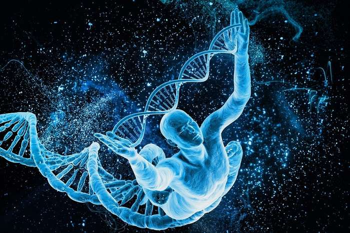
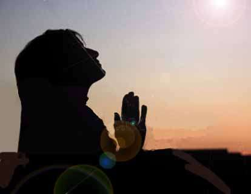

# Бурханд итгэх нь...

Хэзээ ч юм, нэгэн гүн ухаантан, “Бурхан эрт нас барсан, харин хүмүүс түүнийг нь мэддэггүй юм” гэж хэлсэн гэдэг. Харин, шашин шүтлэг, хүн төрөлхтөнтэй үргэлжид зэрэгцэн оршсоор ирсэн бөгөөд эртний соёл иргэншил судлаачид болон археологичид, хүмүүс эрт дээр үеэс Бурханд итгэдэг байсныг нотолсон олдвор баримтуудыг олсоор байна. Хүмүүс яагаад Бурхангүйгээр амьдарч болоогүй юм бол? Яагаад чаддаггүй юм бол? Ер нь Бурхан гэж юу вэ? гэсэн олон асуулт орчин үеийн хүмүүсийн сэтгэлд эргэлдсээр... Бурханыг, дэлхий ертөнцөөс хэтэрсэн дээд нэгэн, итгэл, хүндлэлийн шүтээн гэж хүн төрөлхтөн үздэг.

Зуу зуун жилийн өмнө хүмүүс аливаа тайлагдашгүй, тайлбарлашгүй, хүний хүчин мөхөсдсөн, давагдашгүй зүйлийг бишрэн хүлээж авч, хөндлөнгийн хүчирхэг нэгэн зүйл үйлчилж байна гэж бодсоноор тахилга, шүтлэг үүссэн гэж ч үзэх нь бий. Орчин үеийн шинжлэх ухаан, урд өмнө тайлбарлашгүй гайхамшигт тооцогддог байсан олон зүйлсэд тайлбар өгсөн нээлтүүд хийсээр байгаа билээ. Жишээ нь, өнөөдөр бид, газар хөдлөлт дэлхийн бүрхүүл хэсгийн хөдөлгөөн, мөргөлдөөний үр дүнд болдог, хар салхи агаарын урсгалаас үүсдэг гэхчилэн мэддэг болжээ. Харин эртний хүмүүс эдгээр байгалийн гамшгийг Бурханы гэсгээл, хилэгнэл хэмээн хүлээж авдаг байснаар шашин шүтлэг үүссэн гэж үздэг. Мөн олон шашин судлаач, шашны төлөөлөгчид Бурхан байдаг, байсан гэж олон баримтаар нотолдог боловч, шашингүй үзэлтнүүд тэр бүрчлэн няцаасаар иржээ. Гэсэн ч, Бурхан байдаг эсвэл байдаггүй гэх, бүрэн дүүрэн ямар ч баримт нотолгоо байхгүй байсаар байгаа нь сонин юм. Тиймээс, Бурханд итгэх, залбирах сэтгэхүйн энэхүү үйлдэл тухайн хүний сонголт болон үлддэг аж. Итгэл, залбирал бол үндсэндээ Бурханд хандсан, хүний гуйлт хүсэлт бөгөөд бодол сэтгэхүйн энэ үйлдэл ихээхэн хүчтэй болохыг мөн бодол санаа материаллаг буюу бодит болох чадвартай гэж шинжлэх ухааны үндэслэлтэй нотлосоор байгаа юм. Бидний бодол, хүсэлт, гуйлт, мөрөөдлийн агуулгаас амьдрал шалтгаална, мөн үг маань ид шидийн увидастай гэсэн үг аж. Бид хүнийг үгээрээ шархлуулж, эсвэл жигүүрлүүлж чаддаг. Тэгвэл бодол үг хоёр хамт, агуу хүчтэй байдаг гэнэ. Хүн залбирахдаа, бодол үгээр хамт залбирдаг, энэ үедээ өөр хэмжээст орсон мэт болж мөн цаг удааширах мэт байдалд оршдог, үүгээрээ Бурханд илүү ойртдог гэж шүтлэг бүхий хүмүүс олонтаа илэрхийлсэн байдаг гэнэ. Гэхдээ энэ нь үнэхээр Бурханы хариу нөлөөлөл үү, эсвэл хүмүүсийн тархины судлагдаагүй чадвар уу гэсэн асуулт хариултгүй үлддэг аж. Харин итгэлийн хувьд, ямар ч итгэл хүнийг жигүүрлүүлж, боломжууддаа итгэх хүчийг өгдөг бөгөөд итгэл алдраагүйн улмаас, эдгэшгүй өвчин, гаслан зовлонг давж гарсан мөн хар тамхи, архины хамаарлаас салсан олон хүмүүс байдаг. Итгэлийн энэ хүч бидний дотор байж байдаг уу, эсвэл Бурханд итгэх итгэл түүний онцгой нэгэн дааврыг өдөөж сэргээдэг үү? Энэ бас нэгэн хариултгүй асуулт юм. Өнөөдөр, бид, аливаад эргэлзэж, баримт нотолгоог эрж хайдаг орчин үеийн сэтгэлгээтэй хүмүүс атал Бурханд итгэхээс татгалздаггүй маань, энэхүү итгэл бидэнд амар амгаланг өгч мөн хүнд хэцүү үед тусламж ирэх нь зайлшгүй гэсэн найдварыг өгдөгтэй холбоотой байдаг аж. Нэг кинонд, нэгэн эрэгтэй мөн хүүхдүүд нь үхсэнийхээ дараа тус тусын итгэдэг зүйл буюу өөр өөрийн диваажинд очицгоож, эрэгтэй, амиа хорлож нас барсан эхнэрийнхээ хойноос туйлаас гашууддаг байснаар түүний ертөнцөд орсноор, итгэлийнхээ хүчээр эхнэрээ тамаас гаргаж, харин хүүхдүүд нь хүүхэд байхдаа итгэдэг байсан өөр өөрийн ертөнцийнхөө диваажинд очин амьдарч байгаагаар үзүүлдэг. Тиймээс, хүн бүр өөр өөрсдийн диваажинг бүтээх итгэлээр дүүрэн амьдарч, энэ итгэлээр бүх зүйл өгөгднө гэдгийг ойлгох хэрэгтэй бус уу. Ингээд хариултаасаа олон асуулт хөврөх энэхүү сэдвээ өндөрлөе. Яагаад ч юм, орчин үеийн хүмүүс бид, анагаах ухаан, шинжлэх ухаан, техникийн дэвшилд илүүтэй найдсан сэтгэлгээгээр амьдардаг ч, мөн Бурханд итгэх итгэл, Бурханы энэрлээс татгалзаж чаддаггүй амьдардаг маань нууцгүй нэгэн үнэн билээ...
