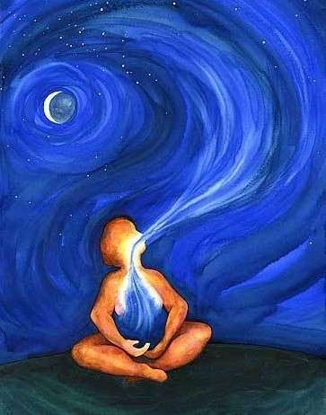
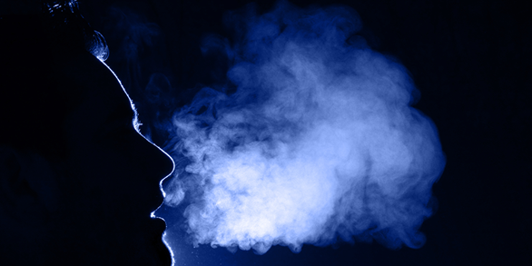

# Буруу амьсгалсны шийтгэл

Хүн анх амьсгалж мэндлээд, эцсийн удаа амьсгал авч нөгчдөг. Энэ хоёр туйлын хоорондын хугацаанд хүн яаж амьсгалж байснаас амьдралын чанар хамаарна.

Гүйцэд сайн амьсгалахгүй бол организмын амьдрах чадвар буурч, эдийн солилцооны үйл явц удааширдаг. Өнгөцхөн юм уу, дутуу заримдаг амьсгалах нь алжааж ядрах, цус багасах, сэтгэлээр унах зэрэгт хүргэдэг байна. Эдгээр шинж тэмдэг илэрвэл гүнзгий амьсгалахыг хичээгээрэй. Тэгэхдээ хэвлийн булчинг илүү анхаарах нь зүйтэй.\
Өнгөцхөн амьсгалнаас болж хүчилтөрөгч уушгинд хэрэгцээт хэмжээгээрээ очдоггүй. Буруу амьсгалах нь ой тогтоолт, бүтээлч чанар, анхаарал төвлөрүүлэх чадварт эсрэг нөлөөлдөг бөгөөд сэтгэл санаанд ч нөлөөлнө. Хүчилтөрөгчийн дутмагшилд орсон хүний сэтгэл санаа амархан хямарч, бачимдалд орох нь ч бий.

Нэг үгээр хэлбэл, буруу амьсгалах нь хүнийг амьдралын баяр баясгалангаас нь салгадаг.
