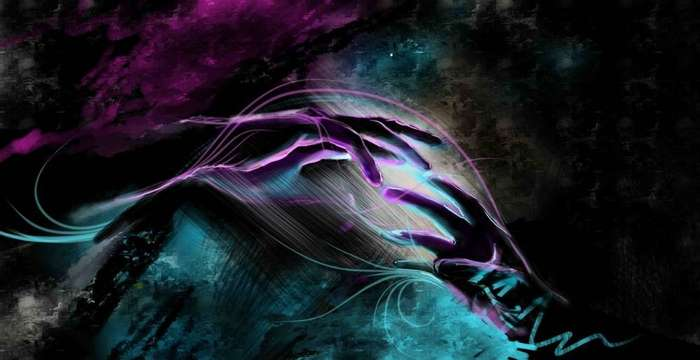

# Бусдыг, биедээ  хүргэхээс болгоомжил

Хүний бие, биеийн аль нэг хэсэгт хүрэх үйлдэл нь, хүнд хүчтэй нөлөөлдөг үйлчлэлийн нэг хэлбэр болдог байна. Энэ нь хүний сэтгэл санаа, сэтгэл хөдлөлийн байдлууд, дуртай ба дургүй байгаа зэргийг илэрхийлэх олон шинж, дохиог дамжуулах чадвартай байдаг аж. Тиймээс болгоомжтой байж, ойр дотнын хүн биш бол, аль болох биедээ бусдыг, биедээ хүргүүлэхгүй байх хэрэгтэй гэнэ.

Хүн биед хүрэхэд, итгэл төрөх, зарим өвдөлт намдах зэрэг таатай байдал илрэх тохиолдол байдаг. Гэтэл зарим тохиолдолд, эвгүйцэх, жихүүцэх мэдрэмж төрөх үе ч байдаг. Энэ нь, организм, хүрэх үйлдлийн нөлөөллүүдийг анхааруулж байна гэсэн үг аж. Чухал асуудлуудыг шийдэх уулзалт, хэлэлцээрийн үед аль болох зайгаа барьж, бусдыг өөртөө хүрэх боломж олгохгүй байхыг хичээх хэрэгтэй байдаг байна. Санамсаргүй гарт чинь хүрэхэд л шийдвэртээ эргэлзчих үе бий болдог. Энгийн дохио зангаа ч мөн нэг бол итгэл төрүүлж, үгүй бол хар сэр төрүүлдэг. Мөн зүүн гарыг илүү хүчтэй үйлчлэл үзүүлдэг гэж үздэг байна. Хамгийн их энергийн нөлөөлөлд өртдөг биеийн хэсгүүдийг, ар нуруу, тохой, хүзүүний ар тал гэж тооцдог.\
Зарим хүмүүс, сайн танил биш атлаа уулзах үед тэврэлдэхэд зүгээр, гэтэл, удаанаар хамт ажиллаж ирсэн танил биед хүрэхэд таагүй, жихүүдэс төрөх зэрэг нь организмын өгч буй дохио юм. Биед хүрэх үйлдлийн нөлөөллүүд: \
-Ямар ч тохиолдолд, хүн хүрэхэд таагүй мэдрэмж төрүүлдэг биеийн хэсгүүддээ, хүн хүрэх боломж өгч мөн биеэ дасгаж болохгүй. Дотоод ухамсраас өгч буй дохиог үгүйсгэж байна гэсэн үг. Хэн нэгэн таны мөрөн дээр алгаддаг, тэр нь танд, таагүй байдаг бол хэлж болиулах хэрэгтэй. Таны эрч хүч, ажилдаа зориулагдах бус харин хүний энергитэй тэмцэлдэхэд зарцуулагдна гэсэн үг. \
-Үсэндээ хүн хүргэхээс ямар ч тохиолдолд зайлсхий. Ялангуяа, эмэгтэй хүний үсийг далд хүчтэй гэж үздэг. Ид шидийн зан үйлийг ихэвчлэн, эмэгтэй хүний үсийг ашиглан хийдэг ба хараал хийхэд ашиладаг гэнэ. Үсийг антенн, энерги үүсгэгч гэж үзэх нь ч бий. Бусдын самаар, хэзээ ч үсээ бүү самна. \
-Нурууг дороос дээш илэхэд таатай нөлөөлөлтэй гэх бөгөөд зөвхөн ойр дотныхон, массажчинаар ингэж илүүлэх сайн. Зөвшөөрөлгүй нуруунд хүрэх, илэх нь, хүний, био орчинг эвддэг. Нуруунд хэн нэгэн хүрэх хэзээ ч таатай байдаггүй. Энэ үед, организм энергиэ алдах аюулыг сануулсан дохио өгч байдаг. Харин ойр дотны хайртай хүмүүс болон хүүхэд маань араас тэврэх, илэхэд хичнээн таатай байдаг билээ. Энэ үед аура маань тэтгэгддэг. Бидний бие организмын хувьд таатай ба таагүй гэсэн хоёр дохио өгдөг байх нь, түүнийг сонсож сурах хэрэгтэй. \
-Гэдэс, гэдэсний доод хэсэгт, хүн хүрэх асуудлыг онцгойлон авч үздэг. Маш эмзэг бөгөөд зүгээр, хүн харахад л, хүрсэнтэй адил өртөж байдаг. Гэдсээ ил гаргаж хувцаслан олон нийтийн газраар явах нь өөрийн энергийг цацаж, тарааж байгаатай дүйдэг аж.

Эцэст нь хэлэхэд, өөрийн ойр дотны хайртай хүмүүстэйгээ аль болох их тэврэлдэж, хүрэлцэж, таалалцаж, бие биеийнхээ аурагаа сэргээн, харин өөр бусдыг биедээ хэрхэвч хүргэхгүй байхыг зөвлөе. Бидний далд ухамсар биднийг байнга хамгаалж байдаг.
