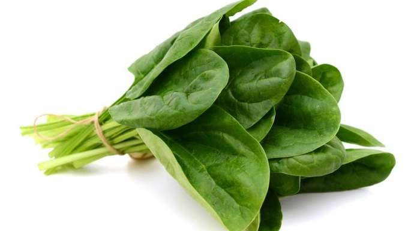
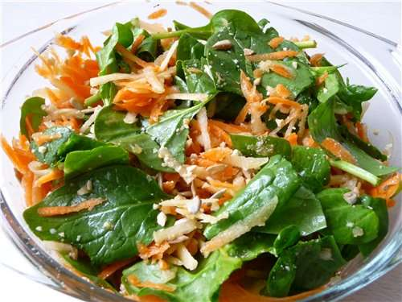

# Бууцай хэрэглэхийн ашиг тус

Бууцай нь, хүний бие организмд зайлшгүй хэрэгцээтэй ашигтай зүйлсийн жинхэнэ эх уурхай бөгөөд, В1, В2, С, Р, РР, К амин дэмүүд, микроэлементүүд, органик хүчлүүд, уураг каротинаар баялаг ба 100 грамм бууцайнд, 91.4 г ус, 2.9 г уураг, 0.4 г тос, 3.6 г нүүрс ус, 0.4 г ди ба моносахарид байдаг. /илчлэгийн хувьд, 100 гарммд 23 ккал/

Энэхүү бага илчлэгтэй, ашигт бодисын агууламж ихтэй чанараараа, илүүдэл жинтэй, бие галбиртаа анхаардаг хүмүүсийн хувьд хамгийн сайн хүнсний ногоо юм. Фолийн хүчил, токоферолын /Е амин дэм/ өндөр агууламж нь хөгшрөлтөөс сэргийлэх, найрлага дах кальци, төмөр, йод бие организмыг эрүүлжүүлэх, А амин дэмийн агууламж нь хүүхдийн хоол тэжээлд хэрэглэснээр хүүхдийн өсөлт хөгжилтийг дэмжих боломж өгч байдаг. Мөн жингийн дутагдалтай хүмүүс, удаан өвдсөн хүмүүс, сүрьеэ өвчний үед хэрэглэх нь үр дүнтэй байдаг ба байнгын хэрэглээ нь хорт хавдараас сэргийлдэг байна. энэ ногоог хэрэглэснээр:\
-шаардлагатай амин дэм ашигтай элементүүдийг авна. Ялангуяа хаврын цагт хэрэглэх нь амин дэмийн дутагдлыг нөхдөг\
-дархлаа өснө\
-хараанд сайн нөлөөлнө\
-судасны ханыг бэхжүүлнэ\
-нойр булчирхайн ажиллагаанд сайнаар нөлөөлдөг\
-организмын хөгшрөх процессыг удаашруулдаг\
-гэдэсний үйл ажиллагааг сайжруулдаг\
Бууцай хэрэглэх үед гардаг ганц дутагдалтай тал нь щавелийн хүчлийн агууламжид нь байх бөгөөд энэ хүчлийн организмд илүүдэх байдал нь организмд чулуу үүсгэх эрсдэл дагуулах магадлалтай ба мөн үе мөч, тулай, бөөр давсагны өвчлөлтэй хүмүүс хэрэглэхийг хориглодог байна
