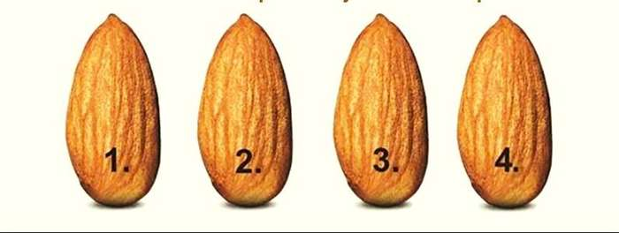
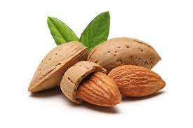

# Бүйлс буюу миндаль самарны ашиг тус

Оройд 4 ширхэг бүйлсний идээ буюу миндаль самрыг усанд дэвтээгээд өглөө нь идэж заншаарай. Энэ самар, олон эрдэс, аминдэм, Е амин дэм, кальци, цинк, магни, омега -3 –ын агууламжтай байдаг.

Хуурайгаар нь хэрэглэснээс дэвтээж хэрэглэх нь илүү ашигтай байдаг бөгөөд хуурай самарны хальс нь чийгнээс хамгаалсан олон төрлийн ферментүүдтэй байдаг нь дэвтэхдээ арилж илүү сайн үйлчилгээтэй болдог байна. Ингэж хэрэглэх нь, тархинд тэжээл болж, сэтгэл санаа сэргээн, хоол боловсруулах эрхтэний үйл ажиллагааг сайжруулж, олон тэжээллэг ашигтай бодисуудаар организмыг хангадаг. Энэ самарны найрлага дах, кали, уураг, Е амин дэм, ханаагүй тосны хүчлүүд зүрхний үйл ажиллагааг дэмжих, харин магни нь зүрхний шигдээсээс хамгаалах, эрдэс, амин дэмүүд нь артерийн үрэвслүүдээс сэргийлэх үйлчилгээтэй. Их эрч хүчтэй баймаар байвал, атга миндаль ид гэдэг нь, уг самар нь, зэс, марганц, рибофлавин агуулдагтай нь холбоотой юм. Фосфорын агууламж нь, ясыг бэхжүүлж, кали, натри даралтыг тогтворжуулдаг. Тогтмол хэрэглэх нь бүдүүн гэдэсний өвчлөл, хорт хавдараас бүрэн сэргийлдэг гэж үздэг байна.
